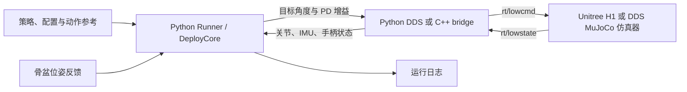

# H1 SuperMimic Deploy

面向 **标准 19 关节 Unitree H1** 的动作模仿部署工具链，支持 **SuperMimic / BlinkMimic** 策略的 CPU 推理、MuJoCo 仿真评估和 DDS 真机部署。

项目将策略加载、参考动作处理、机器人接口和运行状态机组织为独立部署工程，覆盖从模型导出、动作预处理、Sim2Sim 验证到 Sim2Real 接入的流程。运行器不依赖原训练工程、mjlab 或 MuJoCo Warp，CPU 推理路径无需 CUDA。

> 适用对象为使用 GO 消息协议的标准 H1，当前接口不适用于 H1-2。模型权重与动作数据需要单独准备；代码支持某项功能，并不表示具体策略已完成实机稳定性验证。

## 主要功能

- **双策略适配**：支持 SuperMimic 与 BlinkMimic 的观测、参考目标和模型加载约定，提供 ONNX Runtime 与 PyTorch CPU 推理后端。
- **MuJoCo 仿真**：支持可视化回放、无窗口运行、延迟与扰动评估、策略待机和过渡过程分析。
- **DDS 闭环联调**：仿真器通过 `rt/lowstate` / `rt/lowcmd` 与部署运行器交互，可模拟手柄输入、温度和支撑释放。
- **两种通信路径**：Python SDK 直接通信，或由独立 C++ bridge 承担状态接收、定频发送和通信看门狗。
- **动作选择与接管**：支持顺序播放和三动作手柄选择，包含固定 PD 准备、人工接管、目标渐变、策略待机与播放。
- **骨盆位姿反馈**：支持已对齐参考坐标系的 UDP 位姿；C++ bridge 运行器另支持 Unitree 里程计接入及每次准备时的 XY/yaw 对齐。
- **运行保护与记录**：提供状态时效、速度、动作幅值、倾角、温度、发送失败和控制器冲突检查，保存状态、动作、命令及事件日志。

## 控制链路

策略循环使用 `control_dt=0.02 s`，即 **50 Hz**；DDS 低层命令默认按 **500 Hz** 发送，策略更新后还可立即提交命令。策略输出经缩放与保护处理后形成关节目标角，底层使用 PD 增益执行。

下面是 DDS 仿真与真机共用的链路；不经 DDS 的单进程回放由 `play_sim.py` 直接连接部署核心与 MuJoCo。



C++ bridge 通过共享内存向 Python 提供状态，通过本地 Unix 数据报接收命令。runner 命令超时或连接断开时，bridge 可独立切换到锁定阻尼。策略推理和动作状态机仍在 Python 侧。

## 目录结构

```text
.
├── src/h1_deploy/
│   ├── deploy/                 # 部署核心、位姿反馈、动作选择、导出与分析
│   │   ├── core.py             # 配置/动作加载、观测历史、策略步进与保护
│   │   ├── policy.py           # ONNX / PyTorch 模型加载
│   │   ├── blinkmimic.py       # BlinkMimic 骨盆参考特征
│   │   ├── anchor.py           # 躯干 anchor 特征与参考位姿 UDP 接收
│   │   ├── odometry.py         # Unitree 里程计转换与参考对齐
│   │   ├── motion_selection.py # 三动作选择与按键路由
│   │   └── policy_takeover.py  # 固定 PD 到策略目标的渐变接管
│   ├── policy/                 # 推理网络定义
│   ├── robots/                 # H1 关节顺序与控制参数
│   └── data/                   # 动作格式校验与转换
├── scripts/
│   ├── run_sim2sim.sh          # 单进程仿真回放入口
│   ├── run_sim2real.sh         # Python DDS 部署入口
│   ├── run_sim2real_bridge.sh  # C++ bridge 部署入口
│   ├── deploy/                # 仿真器、评估、诊断及动作工具
│   │   └── bridge/            # C++ 电机/里程计桥接器及 Python 接口
│   └── data/                  # CSV 转换与动作修整工具
├── h1_data/                   # H1 XML、URDF 与网格资产
├── deploy_artifacts/          # 部署配置、场景、导出策略和动作
├── checkpoints/               # 本地准备的 PT 权重
├── data/                      # 本地准备的原始/训练格式动作
├── docs/                      # 仿真、真机部署和代码说明
└── LICENSES/                  # 第三方许可声明
```

`checkpoints/`、`data/` 中的运行资源，以及导出的二进制文件，不代表克隆仓库后已具备。

## 环境安装

使用 Linux 与 Python 3.10+。下面命令均在仓库根目录执行；也可以在已有 Conda 环境中安装。

```bash
python3 -m venv .venv
source .venv/bin/activate
python -m pip install --upgrade pip

# 运行已有 ONNX 模型所需的基础依赖
python -m pip install -e .
```

基础依赖包括 NumPy、SciPy、MuJoCo、ONNX Runtime 等，版本约束见 [pyproject.toml](pyproject.toml)。若需要加载 PT 或导出 ONNX，可安装 CPU 版 PyTorch 和扩展依赖：

```bash
python -m pip install torch --index-url https://download.pytorch.org/whl/cpu
python -m pip install -e '.[pt,export]'
```

使用源码目录和 editable 安装，并保留根目录的 `h1_data/`；当前 wheel 配置仅打包 Python 包，不包含这些机器人资产。

DDS 仿真、Python 真机通信及运动模式查询还需要安装 Unitree SDK2 Python 和对应的 Cyclone DDS 依赖。已有 SDK 源码时可使用：

```bash
python -m pip install -e /path/to/unitree_sdk2_python
```

C++ bridge 另外需要 Unitree SDK2 C++、C++17 编译器及 SDK 的 DDS 库。SDK 安装与接口说明见 [真机部署文档](docs/SIM2REAL.md)。

## 准备模型与动作

**仓库默认忽略 `*.pt`、`*.onnx`、`*.npz`、`data/` 和编译产物。** 本地已有这些文件不意味着 GitHub 仓库会包含它们，运行前需要自行准备兼容资源或完成导出。

一个部署模型目录通常包含：

```text
deploy_artifacts/<模型名>/
├── deploy_config.json   # 关节顺序、PD 增益、动作缩放、模型输入约定
└── policy.onnx          # 导出的策略，可选

deploy_artifacts/clips/
└── <动作名>.npz         # 部署格式参考轨迹
```

模型目录中存在 `policy.onnx` 时优先使用 ONNX；否则读取 `deploy_config.json` 的 `policy_checkpoint` 字段，按相对配置文件的路径加载 PT。

支持的模型输入约定如下，输出均为 19 维关节动作：

| 策略类型 | 历史观测维度 | 目标维度 | 位姿反馈要求 |
|---|---:|---:|---|
| SuperMimic，`anchor_obs=false` | 630 | 480 | 不额外要求外部根位置 |
| SuperMimic，`anchor_obs=true` | 630 | 489 | 需要参考坐标系下的骨盆位姿，用于躯干 anchor 特征 |
| BlinkMimic，`reference_position=true` | 720 | 530 | 需要骨盆位置与姿态，构造相对参考反馈 |

仓库中的 `deploy_artifacts/ckpt_latest/deploy_config.json` 对应 SuperMimic anchor 配置，`deploy_artifacts/last/deploy_config.json` 对应 BlinkMimic 配置。**BlinkMimic 即使设置 `anchor_obs=false`，仍需要骨盆位姿反馈。** 输入维度相同也不能替代关节、坐标系和控制配置的匹配检查。

以下示例统一使用 `last.pt` 和 `dance.npz`，它们是可替换的资源名称，不表示仓库已分发对应权重和轨迹。

### 从 checkpoint 导出

先将兼容的权重放到 `checkpoints/last.pt`，将 50 Hz 的 H1 训练格式动作放到 `data/h1/`：

```bash
python -m h1_deploy.deploy.export \
  --cmd all \
  --checkpoint checkpoints/last.pt \
  --npz-dir data/h1
```

该命令生成 `deploy_artifacts/last/` 下的配置与 ONNX、`deploy_artifacts/clips/` 下的部署动作，以及 `deploy_artifacts/models/` 下的场景。也可分别使用 `--cmd config`、`clips`、`onnx`、`models`；完整选项见 [export.py](src/h1_deploy/deploy/export.py)。

checkpoint 必须符合本项目支持的 H1 策略格式。它不能替代动作轨迹文件，也不能从权重中恢复参考动作。

### 从 CSV 导入动作

CSV 约定为 26 列：根位置 `xyz`、根四元数 `xyzw`、19 个模型顺序的关节角。输入采样率按实际数据填写，转换后默认输出 50 Hz 动作：

```bash
python scripts/data/csv_to_npz_batch.py \
  --input-dir /path/to/h1_csv \
  --output-dir data/h1 \
  --input-fps 30

python -m h1_deploy.deploy.export --cmd clips --npz-dir data/h1
```

运行器的 `--clip` 指向转换后的**部署格式 NPZ**；仅有相同扩展名不代表文件格式兼容。

## 仿真运行

### 单进程 MuJoCo 回放

完成模型与动作准备后，可直接运行，不需要 DDS：

```bash
bash scripts/run_sim2sim.sh \
  --artifacts deploy_artifacts/last \
  --clip deploy_artifacts/clips/dance.npz
```

无窗口运行并保存日志：

```bash
bash scripts/run_sim2sim.sh \
  --artifacts deploy_artifacts/last \
  --clip deploy_artifacts/clips/dance.npz \
  --headless --seconds 10 \
  --log outputs/sim2sim/dance.npz
```

`--latency-ms` 可注入控制延迟，`--scene` 可指定场景。默认回放以动作首帧初始化，保护触发时停止。该入口直接运行策略，完整的手柄准备与接管状态机需要使用下面的 DDS 联调。

### 仿真评估

```bash
python scripts/deploy/sim2sim.py \
  --cmd g2,g3,report \
  --ckpt last \
  --clips dance \
  --workers 1
```

`--ckpt` 对应 `deploy_artifacts/` 下的模型目录名，`--clips` 使用部署动作的文件名主干。评估包含控制延迟、增益、质量、摩擦、准备过渡及待机等场景，报告输出到 `deploy_artifacts/reports/`。训练环境轨迹对照需要另行提供参考记录。详见 [SIM2SIM.md](docs/SIM2SIM.md)。

### DDS 仿真联调

此模式使用与真机相同的运行器和消息话题，在独立 DDS 域中测试完整状态机。需要先安装 SDK2 Python。

终端 A：启动仿真器，并输出骨盆位姿。

```bash
mkdir -p outputs/dds_demo
printf '' > outputs/dds_demo/band
python scripts/deploy/sim_h1_mujoco.py \
  --iface lo --domain 1 \
  --clip deploy_artifacts/clips/dance.npz \
  --band-file outputs/dds_demo/band \
  --pose-udp 127.0.0.1:15101 \
  --viewer
```

终端 B：运行自动序列。两个终端都需要激活环境并位于仓库根目录。

```bash
bash scripts/run_sim2real.sh \
  --iface lo --domain 1 --sim \
  --stage air \
  --artifacts deploy_artifacts/last \
  --clip deploy_artifacts/clips/dance.npz \
  --pose-listen 127.0.0.1:15101 \
  --sim-band-file outputs/dds_demo/band \
  --auto-sequence
```

自动序列仍受接管、稳定性和运行保护约束，不保证每个模型与动作组合都能完成播放。手动联调可使用仿真器的 `--buttons-file` 注入按键，去掉运行器的 `--auto-sequence`。仿真支撑的释放与恢复由文件协议协调，相关参数见 [sim_support.py](src/h1_deploy/deploy/sim_support.py) 和仿真文档。

## 真机部署

真机使用 DDS domain `0`，网卡按实际连接填写。固定 PD 准备和退出策略的过渡阶段需要外部支撑；启动前应完成通信、关节映射、位姿坐标和当前策略的仿真检查。

当前文档记录了通信、位姿链路、软件逻辑和部分固定 PD 检查，也记录了 `last` 策略无支撑待机未通过的情况。请结合 [SIM2REAL.md](docs/SIM2REAL.md) 中的具体条件判断验证范围，不能将通信检查通过等同于动作已通过实机验证。

### 编译 C++ bridge

```bash
bash scripts/deploy/bridge/build.sh /path/to/unitree_sdk2
```

生成 `h1_bridge` 和 `libh1bridge_client.so`。二者需与本仓库的共享内存协议配套使用。

先通过只读入口检查状态频率、CRC、温度和其他命令发布者：

```bash
python scripts/deploy/bridge/ro_bridge_check.py \
  --iface eth0 --domain 0 --secs 10
```

`eth0` 是示例网卡名。Python SDK 路径另提供 `scripts/deploy/check_robot.py`，可使用 `--once --check-mode` 查看状态与内置运动模式。

### 启动控制器

以下示例假定 `127.0.0.1:15101` 已有与当前参考动作对齐的骨盆位姿流，且现场支撑与操作条件已就绪：

```bash
bash scripts/run_sim2real_bridge.sh \
  --iface eth0 --domain 0 \
  --stage air \
  --artifacts deploy_artifacts/last \
  --clip deploy_artifacts/clips/dance.npz \
  --pose-listen 127.0.0.1:15101
```

使用 Python DDS 路径时，将入口换为 `scripts/run_sim2real.sh`。启动器会执行状态接收、其他控制器和运动模式检查，并要求输入 `yes` 后才开始发送低层命令；不会主动调用 `ReleaseMode` 关闭官方运动服务。

`--no-policy` 可用于限制为固定 PD 准备与阻尼测试；它仍会发送电机命令。`air/feet/slack/ground` 是保护参数组合，具体数值以所选运行器的 `STAGES`、显式参数覆盖和启动日志为准。

### 骨盆位姿来源

| 来源 | 接入方式 |
|---|---|
| 已对齐的外部定位 | 两个运行器均可通过 `--pose-listen HOST:PORT` 接收 `frame_id=reference` 的 JSON 位姿包；发送端负责坐标和时钟对齐 |
| Unitree 里程计 | C++ bridge 运行器使用 `--pose-source unitree-odom`，由独立的只读 `h1_odom_bridge` 提供同机 UDP 数据 |

里程计桥接器单独编译：

```bash
bash scripts/deploy/bridge/build_pose.sh /path/to/unitree_sdk2
```

`unitree-odom` 模式需要明确指定 `--odom-z-offset` 与 `--odom-orientation-body`。它按每次准备时的参考首帧建立固定 XY/yaw 对齐，保留实测高度和倾斜差异；高度偏移与姿态所属刚体必须依据实际定位接口标定。完整命令与数据检查见 [真机部署文档](docs/SIM2REAL.md)，只读诊断入口为 [check_pelvis_pose.py](scripts/deploy/check_pelvis_pose.py)。

## 状态机与手柄操作

正常准备与播放流程：

```text
PASSIVE（阻尼等待）
  → INTERP（固定 PD 插值）
  → HOLD（固定 PD 保持）
  → STANDBY_PRE（策略首帧待机）
  → POLICY（动作播放）
  → STANDBY_POST（策略末帧待机）

退出策略/切换动作时可经过 END_HOLD；保护触发或阻尼按键进入 DAMP。
```

`STANDBY_PRE` 和 `STANDBY_POST` 均持续推理，只是参考保持在首帧或末帧。默认 `--policy-blend-s 5` 在接管时逐渐混合固定 PD 目标与策略目标；完成后才开始累计播放所需的稳定性窗口，是否 READY 仍由检查结果决定。

| 操作 | 普通模式 | `--motion-select` 三动作模式 |
|---|---|---|
| 选择并准备动作 | `L2+up`，按状态准备当前/下一个动作 | `L1+A` / `L1+X` / `L1+Y` |
| HOLD 中请求策略接管 | `R1+A` | `R1+B`，需单独组成该组合 |
| 稳定性检查通过后播放 | `R1+X` | `Start` |
| 切入阻尼 | `L2+B` | `L2+B` |

三动作模式示例：

```bash
bash scripts/run_sim2real_bridge.sh \
  --iface eth0 --domain 0 --stage air \
  --artifacts deploy_artifacts/last \
  --motion-select \
  --clip deploy_artifacts/clips/default.npz \
         deploy_artifacts/clips/walk.npz \
         deploy_artifacts/clips/dance.npz \
  --pose-listen 127.0.0.1:15101
```

该模式加载一份策略、三个不同参考动作。自定义文件名按命令行顺序绑定 `L1+A/X/Y`；文件名恰好为 `default/walk/dance` 时保留按名称绑定。选择后先停在 HOLD，必须另按 `R1+B` 接管，再等待 READY 并按 Start。提前按下接管键或 Start 不会排队；播放中选择下一个动作会等待当前动作结束，再进入有支撑的固定 PD 准备。

普通模式从策略待机返回固定 PD 使用 `L2+up` 二次确认。进入 `DAMP` 后不能通过选曲键恢复运行。完整转换规则见 [SIM2REAL.md](docs/SIM2REAL.md)。

## 日志与辅助工具

部署日志默认保存在 `deploy_logs/`，包括控制台文本和压缩 NPZ。主要记录关节状态、策略动作、候选与实际命令目标、PD 增益、运行状态、位姿、裁剪数量及事件；bridge 路径另记录通信和看门狗统计。`--log-obs` 可保存策略历史观测，`--log-dir` 可更改输出目录。

| 工具 | 用途 |
|---|---|
| [make_combo_clip.py](scripts/deploy/make_combo_clip.py) | 构建含准备、动作和结束段的组合参考 |
| [cap_joint_velocity.py](scripts/deploy/cap_joint_velocity.py) | 按关节速度约束处理参考动作 |
| [realstate_gate.py](scripts/deploy/realstate_gate.py) | 从日志中的实测状态初始化仿真评估 |
| [check_pelvis_pose.py](scripts/deploy/check_pelvis_pose.py) | 骨盆定位、高度与漂移诊断 |
| [make_thermal_stop_clips.py](scripts/deploy/make_thermal_stop_clips.py) | 生成热停止参考供离线分析 |
| [repair_dance_flatfeet.py](scripts/data/repair_dance_flatfeet.py) | 舞蹈动作的平足与姿态修整 |
| [bg_sync_server.py](scripts/deploy/bg_sync_server.py) | 接收运行进度以同步背景视频 |

这些工具有各自的输入约定，使用前查看对应源码说明或 `--help`。

## 文档与代码阅读

- [Sim2Sim 使用与评估](docs/SIM2SIM.md)
- [Sim2Sim 中文使用指南](docs/SIM2SIM使用指南.md)
- [Sim2Real、三动作模式与里程计接入](docs/SIM2REAL.md)
- [整体代码解析](docs/整体代码解析.md)
- [实机部署代码解析](docs/实机部署代码解析.md)
- [新策略接入方案](docs/新策略接入方案.md)

阅读控制逻辑可从 `h1_runner.py` 或 `h1_runner_bridge.py` 的 `main → startup → run` 开始，再查看 `DeployCore.step()`、策略加载器及对应参考特征实现。

## 来源与许可证

本工程基于 SuperMimic 复现及部署扩展代码整理，并加入标准 H1 接口和 BlinkMimic 部署适配。代码沿用 [MIT License](LICENSE)，保留原作者版权声明。

Unitree SDK 示例中的 CRC 实现、机器人资产、模型权重和动作数据具有各自的来源与许可约定，详见 [第三方声明](LICENSES/THIRD_PARTY_NOTICES.md)。
