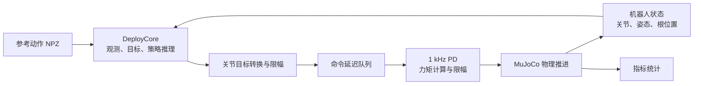

# sim2sim.py 动作策略评估详解与运行指南

本文对应仓库 `H1_SuperMimic_Deploy`，以 2026-11-12 工作区中的 [scripts/deploy/sim2sim.py](../scripts/deploy/sim2sim.py) 为依据。

本文是源码解析和命令说明，没有实际运行这些评估，不包含策略通过或失败的实测结论。文中的阈值、实验范围和 PASS 定义都是当前代码的定义。

## 阅读导航

| 想了解什么 | 阅读位置 |
|---|---|
| 这个脚本评估什么、与 DDS 仿真有什么区别 | 第 1、2 节 |
| 策略怎样在仿真里运行 | 第 3 节 |
| 动作误差、跌倒、力矩和速度指标 | 第 4 节 |
| G2 扰动实验与 PASS 条件 | 第 5 节 |
| 固定 PD 接管和退出的评估 | 第 6 节 |
| 首尾帧策略待机与动作交接 | 第 7 节 |
| 与训练环境的一致性对照 | 第 8 节 |
| 推理耗时、模型比较等其他实验 | 第 9 节 |
| 可以复制的完整运行命令 | 第 10 节 |
| DDS 三终端操作、三动作选择、调参和已知阻塞 | [SIM2SIM.md 的 DDS 仿真章节](SIM2SIM.md#dds-仿真) |
| 每个命令行参数是什么意思 | 第 11 节 |
| 源码、JSON、XML 参数在哪里修改 | 第 12 节 |
| 输出文件和结果阅读顺序 | 第 13 节 |
| 避免误读结果、函数定位 | 第 14、15 节 |

## 1. 评估的对象与边界

`sim2sim.py` 是一套自动化闭环仿真实验脚本。它加载策略、参考动作和机器人模型，在 MuJoCo 中执行控制，然后统计跟踪误差、跌倒、保护触发、力矩、速度及过渡冲击。

一次评估的对象是：

```text
策略模型 + 参考动作 NPZ + 部署控制配置 + 仿真条件
```

同一个策略跟踪不同动作，或者同一个动作使用不同延迟、增益和负载，结果都可能不同。脚本没有一个统一的“动作评分”，而是按实验分别输出数值和通过判据，也不会在评估中训练或更新策略权重。

### 1.1 与另外两个仿真入口的区别

| 入口 | 主要用途 | 是否经过 DDS | 是否有完整部署状态机 |
|---|---|---|---|
| `scripts/deploy/play_sim.py` | 快速播放动作、观察跟踪 | 否 | 没有完整启动流程 |
| `scripts/deploy/sim2sim.py` | 批量执行评估、扰动实验和统计 | 否 | 在实验函数中实现选定流程，不直接运行整个 runner |
| `sim_h1_mujoco.py` + `h1_runner.py` | 用部署控制器与虚拟机器人联调 | 是 | 运行实际 runner 的状态机 |

运行 `sim2sim.py` 不需要先打开 DDS 仿真器，也不需要 Unitree DDS 通信进程。它不是读取 DDS 日志后打分，而是自己运行仿真实验。部分辅助类被其他脚本导入，导入本身不会触发 `main()` 评估入口。

如果要验证部署控制器的 DDS 收发、固定 PD、动作选择和 Start 播放，请按 [DDS 完整操作与调参说明](SIM2SIM.md#dds-仿真) 执行。该说明分别记录了已通过的基础联调和当前完整播放仍存在的阻塞；本文的批量评估参数不能直接用于 DDS 入口。

### 1.2 主要实验类型

| `--cmd` 值 | 主要问题 |
|---|---|
| `g2` | 从动作首帧启动后，策略在不同执行条件下能否完成动作？ |
| `g3` | 固定 PD 与策略之间接管、退出时是否失稳或产生明显力矩跳变？ |
| `standby` | 策略能否在首帧站稳、执行动作，并在末帧继续站稳？ |
| `parity` | 部署仿真是否复现训练环境中的闭环运动？ |
| `timing` | 完整部署核心和纯网络调用耗时多少？ |
| `compare` | 两个仿真场景的模型参数是否一致？ |
| `margins` | 已有训练轨迹离动作幅值、关节速度保护阈值多远？ |
| `lw` / `lw_robust` | 仿真中锁定 torso yaw 对效果有何影响？ |
| `report` | 根据本次及已有结果生成 Markdown 汇总 |

## 2. 输入文件和参数路径

加载函数位于 [sim2sim.py 的 load_cfg/load_clip/load_policy](../scripts/deploy/sim2sim.py#L76)。

以参数为例：

```text
--artifacts deploy_artifacts
--ckpt ckpt_latest
--clips walk1_subject1
```

对应目录结构是：

```text
deploy_artifacts/
├── ckpt_latest/
│   ├── deploy_config.json
│   └── policy.onnx                 # 若不存在，可按配置回退到 PT
├── clips/
│   └── walk1_subject1.npz
├── models/
│   ├── h1_train_scene.xml
│   └── h1_torque_scene.xml
└── reports/                        # 运行时创建/更新
```

| 输入 | 用途 |
|---|---|
| `<ckpt>/policy.onnx` | 执行策略推理 |
| `<ckpt>/deploy_config.json` | 默认关节姿态、动作缩放、PD 参数、关节限制、anchor 配置等 |
| `clips/<动作名>.npz` | 参考动作、预计算目标、根位姿及相关速度 |
| `models/h1_torque_scene.xml` | G2、G3、standby 的显式 PD 力矩控制场景 |
| `models/h1_train_scene.xml` | parity 的位置执行器场景 |
| `reports/sim2sim/ref_*.npz` | parity/margins 所需的原训练环境运行记录 |

注意：

- `--artifacts` 指向整个产物根目录，不能照搬 `play_sim.py` 的 `--artifacts deploy_artifacts/ckpt_latest`。
- `--ckpt` 填模型子目录名，不是 PT 或 ONNX 文件路径。
- `--clips` 填部署动作文件名去掉 `.npz` 后的名称，不是完整路径。
- `data/h1/` 是原始训练格式动作；评估加载的是 `deploy_artifacts/clips/` 中的部署格式。
- 模型后端由 [policy.py](../src/h1_deploy/deploy/policy.py#L40) 决定：若 `policy.onnx` 存在则优先使用；否则根据 JSON 的 `policy_checkpoint` 加载 PT。只替换 PT 不会使已有 ONNX 自动失效。
- 标准 XML 路径不存在时，当前 [models.py](../src/h1_deploy/deploy/models.py#L36) 可回退到本地 H1 资产构建场景。严格对照训练环境时，应确认实际加载的场景，而不是仅根据文件名判断模型一致。

## 3. G2 的闭环仿真怎样运行

核心函数是 [g2_run()](../scripts/deploy/sim2sim.py#L583)，低层执行由 [PDSim](../scripts/deploy/sim2sim.py#L512) 实现。



### 3.1 初始化

1. 按指定质量、摩擦等条件创建仿真模型。
2. 读取动作首帧的根位置、根姿态和关节位置。
3. 将首帧关节角裁剪到配置的软关节范围。
4. 调整根部高度，使脚接触地面。
5. 初始速度归零；这与 parity 使用参考速度初始化不同。
6. 向 PD 仿真器提交零延迟的首帧保持目标，避免延迟队列尚无有效目标。
7. 创建 `DeployCore`，重置历史观测和上一动作。

`g2_settle500` 会在启动策略前额外保持首帧 500 ms；基础 `g2` 没有这一等待。

### 3.2 50 Hz 策略与 1 kHz PD

每个策略周期为 20 ms：

```text
读取 q、dq、角速度、四元数及根位置
→ 构造历史观测和未来参考目标
→ 执行网络
→ 将 action 转为 q_target，并做配置中的限幅
→ 命令进入延迟队列
→ 推进 20 个 1 ms 物理子步
→ 统计推进后的状态与参考误差
```

每个物理子步重新计算：

```text
tau_demand = kp × (q_target − q) − kd × dq
tau_command = clip(tau_demand, −effort_limit, +effort_limit)
```

同一个策略目标保持 20 ms 时，机器人状态仍在变化，因此 PD 力矩每毫秒都会变化。

需要区分三层处理：

1. `DeployCore` 根据当前状态限制关节目标，属于策略周期上的目标处理。
2. `PDSim` 每毫秒计算并限制 PD 力矩。
3. MuJoCo 执行器还按模型中的范围执行饱和。

因此，网络原始动作、限幅后的关节目标、需求力矩和模型实际执行的力矩不是同一个量。

### 3.3 何时结束一轮 G2

主循环在动作完成或满足一般跌倒判据时退出：

```text
pelvis 高度 < 0.5 m
或者
相对竖直方向的绝对倾斜角 > 60°
```

`r.abort` 会被记录，但不会立即让 G2 切换为阻尼。这样可以观察“保护条件触发之后继续执行会发生什么”。真实运行器会在 abort 后转入 DAMP，二者的后续轨迹不同。

## 4. 指标怎样计算、怎样阅读

统计主要分布在 [StepStats](../scripts/deploy/sim2sim.py#L246)、[PeakTracker](../scripts/deploy/sim2sim.py#L467) 和各实验的结果字典中。

### 4.1 G2 主要指标

| 字段 | 含义 | 阅读要点 |
|---|---|---|
| `completed` | 没跌倒，并推进到动作末尾 | 不代表没有 abort，也不等于 PASS |
| `fall` / `fall_step` | 是否跌倒及发生的策略步 | 结合首次 abort 和动作阶段看原因 |
| `track_rmse` | 实际关节角对参考动作的均方根误差 | 单位 rad；只统计已经运行的部分 |
| `track_rmse_ex_wrp` | 排除 torso yaw 后的关节 RMSE | 这里 WRP 对应 H1 的 torso yaw 索引，用于锁腰对照 |
| `disp_err_m` | 实际水平位移与同期参考水平位移的差 | 单位 m；不是完整 XY 路径误差积分 |
| `max_tilt_deg` | 相对竖直方向的最大倾斜 | 动作本身可能要求倾斜 |
| `max_tilt_err_deg` | 相对参考重力方向的最大倾斜误差 | 更接近“是否偏离动作要求”的含义 |
| `min_height` | 运行期间最低 pelvis 高度 | 配合跌倒判据阅读 |
| `n_abort_steps` / `first_abort` | 保护触发步数及第一次原因 | 应优先查看首次原因和时刻 |
| `max_tau_ratio` | 最大需求力矩 / 设定力矩限值 | 使用限幅前需求力矩，可能大于 1 |
| `frac_tau_gt_0p9` | 存在关节需求力矩超过 90% 限值的 1 ms 样本比例 | 衡量力矩余量 |
| `model_sat_ms` | 第一层限幅后的命令仍超过模型执行器范围的样本数 | 按关节记录；在 1 ms 步长下对应毫秒数 |
| `first_step_tau_max_Nm` | 第一个策略目标生效窗口中的最大力矩命令 | 用于观察初次接管负担 |
| `joint_limit_hit_steps` | 任一关节距模型硬限位不足 0.01 rad 或已超出时的策略步数 | 名称叫 hit，但也包含靠近限位 |
| `hard_clip_steps` | 硬目标裁剪发生的策略步数 | 主要用于 `g2_hardclip` |
| `stats.max_abs_a` | 原始网络动作的最大绝对值 | 不是关节角或力矩 |
| `stats.max_vfrac` | 50 Hz 采样最大关节速度 / 配置速度限值 | 反映部署核心按策略周期看到的速度 |
| `vfrac_1khz_max` | 1 kHz 采样最大速度比例 | 能观察到策略步之间的峰值 |
| `dq_peak_1khz` | 每个关节的速度峰值及所在参考帧 | 速度单位 rad/s |
| `stats.frac_steps_any_clamp` | 任一关节目标被核心限幅的策略步比例 | 过高说明控制执行经常偏离网络原始意图 |
| `stats.n_clamped_mean` | 每个策略步平均被限幅的关节数 | 可定位执行约束是否长期生效 |

### 4.2 关节 RMSE

对实际运行到的每个评估时刻，计算：

```text
joint_error[t, j] = actual_joint_position[t, j] − reference_joint_position[t, j]
RMSE = sqrt(mean(joint_error²))
```

G2 在推进 20 ms 后，使用推进后的参考帧计算误差，再对时间和关节维度共同求均方根。

提前跌倒的实验只包含失败前已经运行的样本。不能把“提前失败但 RMSE 小”直接理解为优于完整执行的实验。应先检查完成情况，再比较误差。

### 4.3 abort 与 fall

`abort` 来自部署核心保护条件，例如异常 IMU、相对参考倾斜过大、关节速度过大、网络动作非有限值或幅值超限。

`fall` 来自评估脚本的高度和绝对倾斜判据。两者可以在不同时间发生，也可能只发生其中一种。

G2 的 `abort_fp` 定义为：

```text
出现过 abort，并且继续执行后没有触发 fall
```

这个名称不证明保护是错误的。即使没有跌倒，关节速度或其他保护条件仍可能被违反。

`--vel-check-1khz` 会让 G2 额外把物理子步中的超速计入 abort 记录；默认部署核心只在 50 Hz 策略步检查所读取的状态。这个开关也不会让 G2 自动改为 abort 后 DAMP。

### 4.4 组合动作分段统计

若部署 NPZ 带有 `segment_names`、`segment_start`、`segment_end`，`StepStats` 可以按分段统计动作幅值、速度、倾斜误差及部分路径中的 RMSE，帮助判断组合动作的哪一段出现问题。没有分段元数据时，主要输出整体指标。

## 5. G2 扰动扫描和通过判据

### 5.1 基础扫描

| 条件 | 默认取值 | 实际作用 |
|---|---|---|
| 命令延迟 | 0、5、10、20 ms | 目标在仿真时间队列中延迟生效 |
| Kp 倍数 | 0.85、1.0、1.15 | 修改执行端 Kp；Kd 不随之缩放 |
| 躯干额外质量 | 0、1.8 kg | 增加 `torso_link` 质量，并按质量比例调整惯量 |
| 摩擦系数 | 0.6、1.0 | 修改所有 geom 的滑动摩擦系数 |

仅基础变体 `--g2 g2`，每个策略、每个动作执行：

```text
4 个延迟 × 3 个 Kp × 2 个质量 × 2 个摩擦 = 48 次
```

延迟是固定命令延迟，不是完整的网络丢包、状态延迟和随机调度模型。Kp 扰动主要改变执行端实际增益，核心仍使用原配置处理目标，用于测试控制参数存在偏差的影响。

### 5.2 变体

| `--g2` 可选值 | 目的 |
|---|---|
| `g2` | 核心默认目标限幅；从首帧静止启动 |
| `g2_settle500` | 首帧保持 0.5 秒后启动策略 |
| `g2_hardclip` | 假设执行端将关节目标裁剪到硬关节范围 |
| `g2_hr88` | 将髋 roll 力矩限值设为 88 Nm |
| `g2_f1.0` | 核心目标力矩限幅倍数为 1.0 |
| `g2_f0.5` | 核心目标力矩限幅倍数为 0.5 |
| `g2_noclamp` | 关闭核心目标力矩限幅，保留电机和模型饱和 |

未显式传 `--g2` 时默认执行全部变体。各变体扫描范围不同，定义在 [G2_VARIANTS](../scripts/deploy/sim2sim.py#L680)。

### 5.3 当前 PASS 的覆盖范围

[g2_criteria()](../scripts/deploy/sim2sim.py#L696) 只选择 Kp 倍数为 1.0、额外质量为 0 kg、属于当前评估动作集合的记录，再要求：

1. 这些记录没有跌倒。
2. 没有 `abort_fp`。
3. 每次实验至少 99% 的 1 ms 样本中，所有关节需求力矩均不超过限值的 90%。

所以：

- G2 PASS 不代表额外负载或 Kp 偏差下的全部组合通过。
- 关节跟踪 RMSE 被统计，但没有直接进入当前 G2 PASS 条件。
- 在零跌倒前提下，`abort_fp == 0` 也意味着这些记录没有被记录的 abort。
- `SAFE` 是沿用的分组名。当前 `main()` 将命令行所选动作都放入该集合，不代表动作已经得到实机验证。

## 6. G3：固定 PD 与策略的过渡评估

[g3_run()](../scripts/deploy/sim2sim.py#L736) 的基本流程：

```text
默认站姿
→ 4 秒余弦插值到动作首帧（stand 增益）
→ 1 秒 HOLD
→ 策略接管，首个策略目标与 policy 增益一起生效
→ 执行动作
→ 结束目标及增益过渡
→ 固定 PD 保持
```

它比较吊架支撑、脚着地支撑、悬空、无支撑，以及命令延迟、目标限幅倍数、结束时直接切换或渐变等条件。支撑在这里是施加到仿真刚体上的弹簧阻尼力。

结束方式包括：

- `blend`：默认 1 秒渐变目标和增益，再保持 2 秒；目标还按当时增益和力矩约束处理。
- `switch_pose`：直接切换到末帧姿态及 stand 增益。
- `switch_last`：保留最后一个策略目标，直接改用 stand 增益。

`g3_jobs()` 还包含 HOLD 末段预先渐变增益、60 秒参考循环等对照任务。这些方案中有的并非当前 runner 默认流程。

### 6.1 力矩跳变

计算相邻 1 ms 力矩命令之差：

```text
jump[t, j] = abs(tau[t, j] − tau[t − 1, j])
```

在切换附近的窗口取最大值并记录关节，主要字段包括：

| 字段 | 含义 |
|---|---|
| `jump_policy_start` | 固定 PD 切到策略附近的最大跳变 |
| `jump_end_switch` | 动作结束切换附近的最大跳变 |
| `jump_end_blend_whole` | 整段结束渐变中的最大跳变 |
| `jump_after_blend` | 渐变完成后的最大跳变 |
| `first_step_tau_max_Nm` | 首个策略目标生效窗口内的最大力矩命令 |
| `fall_phase` | 在插值、HOLD、策略或结束等哪个阶段跌倒 |
| `n_abort_steps` | 策略阶段触发保护的步数 |

脚本把相邻 1 ms 变化量按 `Nm/ms` 描述。它是仿真力矩命令变化，不是传感器测量的机械冲击。

### 6.2 G3 PASS 的限制

报告的 `g3_ok()` 主要要求该组实验保持直立且没有 abort，没有为跳变设置统一的绝对通过阈值。完整执行与否仍应查看 `completed`、`policy_steps` 等字段。

当前 runner 默认结束后进入 `STANDBY_POST`，而 G3 包含退出到固定 PD 的流程。因此，评估当前默认“前待机→动作→后待机”应使用 `standby`。

多动作参数也不意味着 G3 每种任务都对每个动作运行：一般对照任务使用 `IDLE`，即本次 `--clips` 的第一个动作；分阶段任务再遍历动作集合。具体见 [g3_jobs()](../scripts/deploy/sim2sim.py#L937)。

## 7. standby：首尾帧待机与动态动作交接

[standby_run()](../scripts/deploy/sim2sim.py#L1319) 对应以下流程：

```text
支撑下插值到首帧并 HOLD
→ 释放支撑
→ STANDBY_PRE：策略跟踪静态首帧
→ 满足模拟 R1+X 稳定窗口
→ POLICY：跟踪完整动态动作
→ STANDBY_POST：策略跟踪静态末帧
```

在前后待机阶段，参考帧不推进，但观测、网络输出和机器人状态不断更新。静态首帧与动态动作、动态动作与静态末帧之间保留历史观测和上一动作。

默认前待机 60 秒、后待机 30 秒。到前待机指定时刻，脚本检查是否允许启动动作：

- 已待机至少 3 秒。
- 最近 3 秒内倾斜误差始终小于 8°。
- 最近 3 秒内最大关节速度始终小于 1 rad/s。

若不满足，则额外等待，默认最多 30 秒。仍不满足时动作不启动，记录 `r1x_never`。这模拟的是稳定性检查的关键部分，不包含真实 DDS、温度、按键通信等全部运行器条件。

### 7.1 统计内容

每个阶段分别记录：

- 倾斜误差、动作幅值、关节速度。
- 水平位置漂移和航向漂移。
- 跌倒阶段、首次 abort、保护触发次数。
- R1+X 首次可接受时刻、等待时间、是否始终无法启动。
- 启动前两秒的水平移动和航向变化，用于标记 `start_moving`。
- 固定 PD→前待机、前待机→动作、动作→后待机三个交接点的力矩跳变。

### 7.2 当前通过判据

单次实验 `pass` 要求：

```text
完成整个流程
且没有 abort
且前后待机最大倾斜误差 < 8°
且前待机→动作、动作→后待机的跳变
均 ≤ 本次固定 PD→前待机跳变的 50%
```

该平滑判据是相对比较，并不独立保证切换力矩变化小于某个绝对阈值。位置与航向漂移虽然被记录，但没有直接纳入 PASS；`start_moving` 也需要单独阅读。

默认扫描量为：

```text
2 个 profile × 3 个延迟 × 2 个摩擦 × 3 个 Kp × 2 个质量
= 每个动作、每个策略 72 次
```

代码位置：[standby_gate()](../scripts/deploy/sim2sim.py#L1498)。

## 8. parity：与训练环境的闭环轨迹对照

parity 需要两个不同用途的参考：

| 数据 | 含义 |
|---|---|
| `clips/<动作>.npz` | 希望机器人完成的参考动作 |
| `reports/sim2sim/ref_*.npz` | 同一个策略在原训练环境中实际运行出来的轨迹 |

训练环境记录需要由原训练工程的 `scripts/deploy/record_h1_reference.py` 生成，独立部署仓库不能凭空生成该记录。默认要求：

```text
deploy_artifacts/reports/sim2sim/ref_ckpt_latest_no-tf32.npz
```

可选读取 `ref_ckpt_latest_tf32.npz`，用于比较同一训练环境中 TF32 与 FP32 数值差异引起的轨迹分叉。

### 8.1 对照方式

parity 使用位置控制场景，按参考根位姿、关节位置和速度初始化，每个策略周期推进 4 个 5 ms 物理子步。

| 比较内容 | 主要定位问题 |
|---|---|
| 第一步 `obs` 差异 | 状态提取、历史观测和排列是否一致 |
| 第一步 `goal` 差异 | 参考帧、目标特征、anchor 是否一致 |
| 第一步 `action` 差异 | 网络计算是否一致 |
| 关节与根部 XY 轨迹 | 闭环运动从何时开始分叉 |
| 两边相对动作参考的 RMSE | 部署后的跟踪质量是否下降 |
| 终止结果 | 是否同样触发训练定义的失败 |

首次分叉条件：两边某帧关节 RMS 差异超过 0.05 rad，或根部 XY 差异超过 0.1 m。

训练终止判据是参考 pelvis 高度误差超过 0.25 m，或重力方向 z 分量误差超过 0.8。后者是无量纲分量差，不是 0.8 rad，也不等于一般跌倒的 60° 阈值。

### 8.2 parity PASS

当前 `h1_gate()` 要求：

```text
失败/不失败结果一致
且部署仿真关节跟踪 RMSE ≤ 训练环境 RMSE × 1.2
```

不要求失败时刻相同；两边都失败也可能满足失败结果一致。首步差异和分叉时刻虽然记录，但没有直接作为这个 PASS 的阈值条件。

parity 通过主要说明所测条件下的复现一致性，不单独证明动作可以成功执行。源码：[h1_run() / h1_gate()](../scripts/deploy/sim2sim.py#L324)。

## 9. 其他评估功能

### 9.1 timing

[g5_gate()](../scripts/deploy/sim2sim.py#L1613) 分别测量完整 `DeployCore.step()` 和纯模型调用。默认各预热 100 次，再统计 5000 次，输出 p50、p99、最大耗时，以及 CPU、后端信息；预算标记为 20 ms。

完整核心包括观测与参考构造、网络、动作处理；启用 anchor 时还包含相应 FK。纯网络计时使用零输入。该实验不推进物理仿真，也不测 DDS 端到端通信时间。历史字段 `onnx_p50_ms` 在 PT 后端下仍可能出现，应结合 `backend` 解释。

### 9.2 compare

[compare_models()](../scripts/deploy/sim2sim.py#L1670) 比较位置执行器与力矩执行器场景的质量、惯量、关节范围、阻尼、摩擦、armature、执行器力矩范围、贴地高度和 IMU 转换等，用于解释仿真模型差异。

### 9.3 margins

[ref_margins()](../scripts/deploy/sim2sim.py#L1041) 从训练参考记录计算动作幅值和 50 Hz 关节位置有限差分速度，检查相对阶段阈值的余量。它不是新的物理运行，也不能由 50 Hz 差分准确恢复 1 kHz 瞬时速度峰值。

当前 `ref_margins()` 使用无前缀文件 `ref_<ckpt>_no-tf32.npz`，不接收 `--ref-prefix`；该参数只影响 parity 的参考文件选择。缺少 margins 参考时函数返回空结果。

### 9.4 lw / lw_robust

自动配对比较 torso yaw 自由与仿真焊接锁定的效果。网络仍输出 19 维动作，但锁定关节的动作不施加，读出的 q/dq 为 0。比较时还提供排除 torso yaw 的 18 关节 RMSE。

这里改变的是仿真模型，不代表实机存在同样的锁腰模式。

## 10. 完整运行命令

以下命令均在仓库根目录执行，使用示例策略 `ckpt_latest` 和动作 `walk1_subject1`。每条评估命令可独立执行；实际更换动作时，修改 `--clips` 中的名称。

### 10.1 环境准备

本机使用独立 Conda 环境 `supermimic`。每次打开终端先激活环境，再进入仓库：

```bash
conda activate supermimic
cd /home/ljp/human_learn/supermimic/H1_SuperMimic_Deploy
python -c "import sys, h1_deploy; print(sys.executable); print(h1_deploy.__file__)"
python scripts/deploy/sim2sim.py --help
```

解释器应位于 `/home/ljp/miniconda3/envs/supermimic/bin/python`，项目包应指向本仓库的 `src/h1_deploy/`。已有环境不需要重复创建；若在其他机器从零配置，使用：

```bash
cd /home/ljp/human_learn/supermimic/H1_SuperMimic_Deploy
conda create -n supermimic python=3.11 pip -y
conda env config vars set -n supermimic PYTHONNOUSERSITE=1
conda activate supermimic
python -m pip install 'torch==2.8.0' --index-url https://download.pytorch.org/whl/cpu
python -m pip install -e '.[pt,export]'
```

先安装 CPU 版 PyTorch，再安装本仓库的 PT/ONNX 导出依赖。`PYTHONNOUSERSITE=1` 是此 Conda 环境的专用变量，用于避免用户级 site-packages 混入。只运行已有 ONNX 时可以仅安装 `python -m pip install -e .`。依赖定义见 [pyproject.toml](../pyproject.toml#L5)。本评估链路不需要 DDS SDK，也不要求启动机器人通信进程。

`sim2sim.py` 会自行将 `src` 加入模块搜索路径，所以 `--help` 能显示并不能证明项目包已安装。上述 editable 安装完成后，同一环境中的 `python -m h1_deploy.deploy.export` 才能直接找到项目，无需手工设置 `PYTHONPATH`。安装命令应在激活 `supermimic` 后执行，以免把项目装到 `base`。

如果某个动作只有 `data/h1/` 下的原始文件，需要先导出部署目标表。下面命令会生成或覆盖该动作的部署 NPZ：

```bash
python -m h1_deploy.deploy.export \
  --cmd clips \
  --npz-dir data/h1 \
  --clips walk1_subject1 \
  --output deploy_artifacts
```

后续示例假设动作、模型和部署 JSON 已经准备好。

### 10.2 基础 G2：一个模型、一个动作、48 个条件

```bash
python scripts/deploy/sim2sim.py \
  --cmd g2,report \
  --artifacts deploy_artifacts \
  --ckpt ckpt_latest \
  --clips walk1_subject1 \
  --g2 g2 \
  --workers 1 \
  --tag walk_g2
```

worker标示并行实验进程数；tag：输出文件的名称标记（区分不同批次）

输出：

```text
deploy_artifacts/reports/sim2sim_walk_g2_ckpt_latest.json
deploy_artifacts/reports/SIM2SIM_walk_g2_ckpt_latest.md
```

`--cmd g2` 选择实验类型，`--g2 g2` 选择该类型内部的基础变体，二者用途不同。

### 10.3 多动作、多个 G2 变体

```bash
python scripts/deploy/sim2sim.py \
  --cmd g2,report \
  --artifacts deploy_artifacts \
  --ckpt ckpt_latest \
  --clips walk1_subject1 dance1_subject1 \
  --g2 g2 g2_settle500 g2_f1.0 \
  --workers 1 \
  --tag walk_dance_g2_variants
```

当前范围下，每个动作分别执行 48、8、8 次，共 64 次；两个动作共 128 次。

若要运行全部 G2 变体，可显式列出，便于保留实验记录：

```bash
python scripts/deploy/sim2sim.py \
  --cmd g2,report \
  --artifacts deploy_artifacts \
  --ckpt ckpt_latest \
  --clips walk1_subject1 \
  --g2 g2 g2_settle500 g2_hardclip g2_hr88 g2_f1.0 g2_f0.5 g2_noclamp \
  --workers 1 \
  --tag walk_g2_all_variants
```

| 变体           | 改动                                           | 检查什么                                       | 轮次 |
| -------------- | ---------------------------------------------- | ---------------------------------------------- | ---: |
| `g2`           | 使用默认控制配置，扫描延迟、Kp、质量、摩擦系数 | 策略对模型及控制条件变化的敏感程度             |   48 |
| `g2_settle500` | 启动策略前，先用 PD 保持动作第一帧姿态 0.5 秒  | 初始接触状态、启动方式是否影响结果             |    8 |
| `g2_hardclip`  | 将下发的关节目标角度裁剪到硬关节范围内         | 位置目标限幅是否破坏策略表现                   |    4 |
| `g2_hr88`      | 将左右髋关节侧摆轴的力矩限值设为 88 Nm         | 髋部侧向支撑力矩减小后是否仍能完成动作         |   16 |
| `g2_f1.0`      | 将控制核心的力矩限幅系数设为 1.0               | 较严格的目标限制对策略有什么影响               |    8 |
| `g2_f0.5`      | 将控制核心的力矩限幅系数设为 0.5               | 更保守的目标限制下，策略是否还能维持跟踪和平衡 |    8 |
| `g2_noclamp`   | 关闭控制核心的力矩目标限幅，保留模拟电机限幅   | 控制核心的目标裁剪是否影响策略表现             |    8 |

`--workers` 控制同时运行的实验进程数。增加它不会改变仿真控制频率，但会增加 CPU 和内存占用。

### 10.4 G3：固定 PD 接管、策略运行及结束过渡

```bash
python scripts/deploy/sim2sim.py \
  --cmd g3,report \
  --artifacts deploy_artifacts \
  --ckpt last \
  --clips dance \
  --workers 3 \
  --tag dance
```

此命令执行 `g3_jobs()` 定义的任务集合。没有 `--g3`、`--blend-s` 或 `--interp-s` 这类评估命令行开关；修改 G3 任务或持续时间的位置见第 12 节。

### 10.5 standby：先检查一个明确条件

```bash
python scripts/deploy/sim2sim.py \
  --cmd standby \
  --artifacts deploy_artifacts \
  --ckpt last \
  --clips dance \
  --standby-pre-s 10 \
  --standby-post-s 10 \
  --standby-lat 0 \
  --standby-kps 1.0 \
  --standby-mass 0 \
  --standby-fric 1.0 \
  --standby-profiles ground \
  --standby-r1x-window-s 3 \
  --standby-r1x-min-s 3 \
  --standby-r1x-cap-s 30 \
  --workers 1 \
  --tag dance
```

这是一组物理条件、一个 profile、一个动作，对应一次完整流程实验。前待机最早在 10 秒时尝试启动动作，条件不满足时可再等待最多 30 秒；后待机为 10 秒。

输出：

```text
deploy_artifacts/reports/sim2sim_walk_standby_nominal_ckpt_latest.json
deploy_artifacts/reports/standby_walk_standby_nominal_ckpt_latest.md
```

standby 专用 Markdown 无须额外指定 `report`。

### 10.6 standby：完整默认范围的显式命令

```bash
python scripts/deploy/sim2sim.py \
  --cmd standby \
  --artifacts deploy_artifacts \
  --ckpt last \
  --clips dance \
  --standby-pre-s 60 \
  --standby-post-s 30 \
  --standby-lat 0 10 20 \
  --standby-kps 0.85 1.0 1.15 \
  --standby-mass 0 1.8 \
  --standby-fric 0.6 1.0 \
  --standby-profiles slack ground \
  --standby-r1x-window-s 3 \
  --standby-r1x-min-s 3 \
  --standby-r1x-cap-s 30 \
  --workers 3 \
  --tag dance
```

每个动作、每个策略 72 次。每次还包含完整动作长度，不只有前后待机时间。

### 10.7 推理耗时和模型差异

```bash
python scripts/deploy/sim2sim.py \
  --cmd timing,compare,report \
  --artifacts deploy_artifacts \
  --ckpt ckpt_latest \
  --clips walk1_subject1 \
  --workers 1 \
  --tag walk_timing_models
```

`timing` 使用所选动作中的第一个动作构造输入。其 JSON 键名为 `g5`；`compare` 写入同一 JSON 的 `model_compare` 字段。当前主入口没有另外生成独立的 `sim2sim_model_compare.json`，即使旧报告模板文字提到了这个名字，也应以实际写文件代码为准。

### 10.8 parity：已有训练参考记录时运行

先确保以下文件存在且包含所选动作：

```text
deploy_artifacts/reports/sim2sim/ref_ckpt_latest_no-tf32.npz
```

然后运行：

```bash
python scripts/deploy/sim2sim.py \
  --cmd parity,report \
  --artifacts deploy_artifacts \
  --ckpt ckpt_latest \
  --clips walk1_subject1 \
  --workers 1 \
  --tag walk_parity
```

如果参考文件叫 `ref_baseline_ckpt_latest_no-tf32.npz`，完整命令为：

```bash
python scripts/deploy/sim2sim.py \
  --cmd parity,report \
  --artifacts deploy_artifacts \
  --ckpt ckpt_latest \
  --clips walk1_subject1 \
  --ref-prefix baseline_ \
  --workers 1 \
  --tag walk_parity_baseline
```

缺少训练参考时，parity 会报错。`--tag` 用于输出命名，不会自动成为参考文件前缀。

### 10.9 从训练记录统计保护余量

要求无前缀参考文件 `ref_ckpt_latest_no-tf32.npz`：

```bash
python scripts/deploy/sim2sim.py \
  --cmd margins,report \
  --artifacts deploy_artifacts \
  --ckpt ckpt_latest \
  --clips walk1_subject1 \
  --workers 1 \
  --tag walk_margins
```

### 10.10 腰部自由/锁定对照

```bash
python scripts/deploy/sim2sim.py \
  --cmd lw,lw_robust,report \
  --artifacts deploy_artifacts \
  --ckpt ckpt_latest \
  --clips walk1_subject1 \
  --workers 1 \
  --tag walk_waist_compare
```

`lw`、`lw_robust` 内部会生成自由和锁定两种模型的配对实验，不需要为了配对再传 `--lock-waist`。

若仅想让普通 G2 使用锁定模型，则运行：

```bash
python scripts/deploy/sim2sim.py \
  --cmd g2,report \
  --artifacts deploy_artifacts \
  --ckpt ckpt_latest \
  --clips walk1_subject1 \
  --g2 g2 \
  --lock-waist \
  --workers 1 \
  --tag walk_g2_locked
```

### 10.11 IMU 压力模型与 1 kHz 超速记录

```bash
python scripts/deploy/sim2sim.py \
  --cmd g2,report \
  --artifacts deploy_artifacts \
  --ckpt ckpt_latest \
  --clips walk1_subject1 \
  --g2 g2 \
  --imu-model \
  --vel-check-1khz \
  --workers 1 \
  --tag walk_g2_imu_1khz
```

这个 IMU 模型会对角速度进行饱和裁剪并积分姿态，默认每轴限值为 500°/s，是通用压力测试假设，不是 H1 传感器实测参数。它影响策略读取的 IMU；跌倒和物理状态统计仍依据仿真真实状态。

### 10.12 只重新生成已有结果的报告

假设已经运行过第 10.2 节：

```bash
python scripts/deploy/sim2sim.py \
  --cmd report \
  --artifacts deploy_artifacts \
  --ckpt ckpt_latest \
  --clips walk1_subject1 \
  --tag walk_g2
```

这会读取 `sim2sim_walk_g2_ckpt_latest.json` 并生成报告，不重跑物理实验。应使用原实验相同的动作集合和标记；改变参数不会自动重算旧记录。

### 10.13 一次运行主要实验

不依赖训练参考记录的组合示例：

```bash
python scripts/deploy/sim2sim.py \
  --cmd g2,g3,standby,timing,compare,report \
  --artifacts deploy_artifacts \
  --ckpt ckpt_latest \
  --clips walk1_subject1 \
  --g2 g2 \
  --standby-pre-s 10 \
  --standby-post-s 10 \
  --standby-lat 0 \
  --standby-kps 1.0 \
  --standby-mass 0 \
  --standby-fric 1.0 \
  --standby-profiles ground \
  --workers 1 \
  --tag walk_deploy_suite
```

其中仍然包含 48 次基础 G2 和 `g3_jobs()` 的任务集合；standby 只有一次。

已有无前缀训练参考记录时，也可以使用 `all`：

```bash
python scripts/deploy/sim2sim.py \
  --cmd all \
  --artifacts deploy_artifacts \
  --ckpt ckpt_latest \
  --clips walk1_subject1 \
  --g2 g2 \
  --standby-pre-s 10 \
  --standby-post-s 10 \
  --standby-lat 0 \
  --standby-kps 1.0 \
  --standby-mass 0 \
  --standby-fric 1.0 \
  --standby-profiles ground \
  --workers 1 \
  --tag walk_all
```

当前 `all` 展开为 `parity,g2,g3,timing,compare,margins,report,standby`，不包含 `lw` 或 `lw_robust`。缺少 parity 参考记录时会在前面的阶段失败，不能指望它自动跳过。

### 10.14 更换动作或策略

在上述完整命令中替换：

```text
--clips 动作A 动作B
--ckpt 模型子目录A 模型子目录B
```

这些名称必须分别对应 `deploy_artifacts/clips/` 下的文件和 `deploy_artifacts/` 下的模型目录。多个策略会分别产生结果文件。

模型必须兼容当前 `DeployCore` 的输入输出定义。仅用 `--ckpt` 指向不同维度、不同观测语义的网络，脚本不会自动完成适配。

## 11. 全部命令行参数说明

定义位置：[sim2sim.py 的 main()](../scripts/deploy/sim2sim.py#L1965)。多个 `--cmd` 值用逗号分隔且不要加空格；`--clips`、`--ckpt` 等列表参数用空格分隔。

### 11.1 通用参数

| 参数 | 默认值 | 含义与作用范围 |
|---|---|---|
| `--cmd` | `g2` | 实验类型，可用逗号组合；`h1` 是 `parity` 别名，`g5` 是 `timing` 别名 |
| `--artifacts` | 仓库根目录下 `deploy_artifacts` | 策略、动作、模型和报告的根目录 |
| `--ckpt` | `ckpt_latest` | 一个或多个模型子目录名 |
| `--clips` | `walk1_subject1 dance1_subject1` | 一个或多个部署动作名；不带扩展名 |
| `--workers` | `1` | G2/G3/standby/lw 等任务池的进程数，必须为正整数；timing 不因此变成多线程测速 |
| `--g2` | 全部 `G2_VARIANTS` 键 | 选择 G2 变体，只有运行 G2 时生效 |
| `--tag` | `h1` | 输出文件标记；不参与训练参考文件名选择 |
| `--ref-prefix` | 空字符串 | parity 参考文件前缀；文件名为 `ref_<前缀><ckpt>_no-tf32.npz` |
| `--lock-waist` | 关闭 | 普通实验使用仿真焊接 torso yaw 的模型；不是实机配置开关 |
| `--imu-model` | 关闭 | 开启通用 IMU 饱和与积分压力模型 |
| `--vel-check-1khz` | 关闭 | G2 额外把 1 kHz 子步超速计入 abort 记录 |

`timing` 和 G3 的若干任务使用所选动作的第一个作为 `IDLE`。`main()` 还会将本次所有动作放进 `SAFE` 集合；不要把这个内部名字解释为实机认证。

### 11.2 standby 专用参数

| 参数 | 不指定时的有效默认值 | 含义 |
|---|---|---|
| `--standby-pre-s` | `60.0` 秒 | 前待机预定持续时间，到时尝试启动动作 |
| `--standby-post-s` | `30.0` 秒 | 动作完成后的后待机持续时间 |
| `--standby-lat` | `0 10 20` ms | standby 命令延迟扫描列表 |
| `--standby-kps` | `0.85 1.0 1.15` | standby 执行端 Kp 倍数；同时作用于 stand 和 policy Kp |
| `--standby-mass` | `0.0 1.8` kg | 躯干额外质量扫描列表 |
| `--standby-fric` | `0.6 1.0` | 滑动摩擦系数列表 |
| `--standby-profiles` | `slack ground` | 保护配置集合，允许这两个名称 |
| `--standby-r1x-window-s` | `3.0` 秒 | 检查倾斜和速度是否连续稳定的窗口长度 |
| `--standby-r1x-min-s` | `3.0` 秒 | 动作启动前最短策略待机时间 |
| `--standby-r1x-cap-s` | `30.0` 秒 | 到预定启动时刻后，继续等待条件满足的最长时间 |

列表参数在 argparse 层默认是空值，随后由 `standby_gate()` 填入上表默认范围。`--standby-lat` 等参数只控制 standby，不会缩小 G2 的扫描范围。

### 11.3 当前支持的环境变量

| 环境变量 | 默认/含义 | 定义位置 |
|---|---|---|
| `H1_TORQUE_XML` | 覆盖 G2/G3/standby 等使用的力矩模型路径 | `sim2sim.py` 第 33、1996 行 |
| `SM_FALL_TILT_DEG` | 一般跌倒的绝对倾斜阈值，默认 60° | `sim2sim.py` 第 41 行 |
| `SM_IMU_MODEL` | 未设置、空值、`0` 为关闭；其他值开启 IMU 模型 | `imu_model.py` 第 13、17 行 |
| `SM_VEL_CHECK_1KHZ` | 值为 `1` 时开启 G2 子步超速记录 | `sim2sim.py` 第 61、607 行 |

使用自定义力矩场景的完整示例；`/absolute/path/custom_h1.xml` 需替换为存在的、兼容 H1 的场景文件：

```bash
H1_TORQUE_XML=/absolute/path/custom_h1.xml \
python scripts/deploy/sim2sim.py \
  --cmd g2,report \
  --artifacts deploy_artifacts \
  --ckpt ckpt_latest \
  --clips walk1_subject1 \
  --g2 g2 \
  --workers 1 \
  --tag walk_custom_model
```

已有 shell 环境变量也可能影响实验。比较默认条件与压力条件时，要确认上述变量没有遗留设置。修改跌倒阈值会改变评价定义，不等于提高策略能力。

## 12. 参数应该在哪里修改

优先使用已有命令行参数。没有命令行入口的实验范围、判据或过渡配置，需要修改下表对应源码。以下行号对应本文编写时版本，函数名与变量名更适合长期定位。

### 12.1 动作和模型选择

| 要改什么 | 修改方式/位置 |
|---|---|
| 评估动作 | 命令行 `--clips`；文件放在 `<artifacts>/clips/` |
| 策略权重 | 命令行 `--ckpt`；目录中放 `policy.onnx` 和 `deploy_config.json`，或通过配置指定 PT |
| 产物根目录 | 命令行 `--artifacts` |
| 默认动作和 checkpoint 名 | [sim2sim.py 顶部常量](../scripts/deploy/sim2sim.py#L30)；单次运行通常直接用 CLI 覆盖 |
| 默认参数值 | `main()` 的 `add_argument()`；仅影响未在命令行指定的值 |

### 12.2 G2 扫描范围和变体

| 要改什么 | 变量/函数 | 源码位置 |
|---|---|---|
| 命令延迟列表 | `G2_LATENCY_MS` | [sim2sim.py:50](../scripts/deploy/sim2sim.py#L50) |
| 执行端 Kp 倍数列表 | `G2_KP_SCALE` | 同上，第 51 行 |
| 额外质量列表 | `G2_EXTRA_MASS` | 同上，第 52 行 |
| 摩擦系数列表 | `G2_FRICTION` | 同上，第 53 行 |
| 不同变体的独立扫描组合 | `FULL`、`NOM`、`G2_VARIANTS` | [sim2sim.py:680](../scripts/deploy/sim2sim.py#L680) |
| 首帧稳定等待时间 | `g2_settle500` 的 `settle_ms` | `G2_VARIANTS` |
| 目标硬限位实验 | `g2_hardclip` 的 `hard_clip` | `G2_VARIANTS` |
| 髋 roll 力矩限制实验 | `g2_hr88` 的 `hr_effort` | `G2_VARIANTS` |
| 目标力矩限幅倍率 | 对应变体的 `factor` | `G2_VARIANTS` |
| 关闭核心目标力矩限幅 | 对应变体的 `torque=False` | `G2_VARIANTS` |
| G2 自动通过条件 | `g2_criteria()` | [sim2sim.py:696](../scripts/deploy/sim2sim.py#L696) |

例如，只想让基础 G2 测一个标称条件，可以把顶部配置改为：

```python
G2_LATENCY_MS = (0,)
G2_KP_SCALE = (1.0,)
G2_EXTRA_MASS = (0.0,)
G2_FRICTION = (1.0,)
```

然后执行第 10.2 节命令，这时每个策略、动作只产生一组基础 G2 任务。单元素元组的逗号需要保留。

修改顶部常量会影响引用它们的其他实验，例如 standby 默认摩擦使用 `G2_FRICTION`；部分变体又有自己的列表覆盖。需要只改某个实验时，应调整对应 `G2_VARIANTS` 的 grid，并在结果中核对实际 `lat/kps/mass/fric`。

当前没有 `--g2-lat`、`--g2-kps`、`--latency-ms` 这类 G2 CLI 参数。

### 12.3 G3 过渡参数

| 要改什么 | 修改位置 | 当前默认/含义 |
|---|---|---|
| 运行哪些过渡任务 | [g3_jobs()](../scripts/deploy/sim2sim.py#L937) | 每个 job 的 `tag`、`clip`、`lat`、`support`、`factor`、`end` 等 |
| 开始插值时间 | [g3_run() 的初始化循环](../scripts/deploy/sim2sim.py#L800) | 200 个 20 ms 步，共 4 秒；插值公式里的 4.0 也要同步 |
| HOLD 时间 | 同上 | 50 个 20 ms 步，共 1 秒；增益 ramp 的索引计算也依赖该步数 |
| HOLD 末段增益渐变 | job 的 `hold_ramp_s` | `start_ramp` 对照任务设为 1 秒 |
| 结束渐变时间 | `g3_run()` 的 `blend_s` 或 job 字段 | 默认 1 秒 |
| 结束渐变命令间隔 | `blend_dt_ms` | 默认 2 ms |
| 结束目标曲线 | `blend_shape` | 默认 linear，另有 cosine 对照 |
| 结束命令延迟 | `blend_lat` | 未指定时沿用策略目标延迟 |
| 结束是否恢复支撑 | `end_support` | 由支撑类型和 job 覆盖决定 |
| 渐变后的保持时间 | `g3_run()` 第 882 行附近 | 100 个 20 ms 步，共 2 秒 |
| 直接切换后的保持时间 | `g3_run()` 第 892 行附近 | 3000 ms |
| 60 秒循环测试时长 | job 的 `loop_s` | 只影响该循环任务 |
| 支撑刚度和阻尼 | 顶部 `BAND_K/BAND_D`、`AIR_K/AIR_D` | 分别用于 pelvis 支撑和悬吊模型 |

例如，需要给某个 G3 任务设置更长结束渐变，应在那个 job 中添加 `"blend_s": 2.0`，或修改函数默认值；不是向命令行添加一个不存在的 `--end-blend-s`。后者是 runner 的参数名称，不能直接用于本评估脚本。

### 12.4 standby 的参数和判据

| 要改什么 | 优先方式 | 源码位置 |
|---|---|---|
| 前后待机时间 | `--standby-pre-s` / `--standby-post-s` | `main()` 与 `standby_run()` |
| 延迟、增益、质量、摩擦 | 对应 `--standby-*` 列表 | [standby_gate()](../scripts/deploy/sim2sim.py#L1498) |
| 稳定窗口、最短待机、最多等待 | 三个 `--standby-r1x-*` 参数 | `main()` 与 `standby_run()` |
| 启动倾斜阈值 | `STANDBY_R1X_TILT_DEG` | [sim2sim.py:1309](../scripts/deploy/sim2sim.py#L1309)，默认 8° |
| 启动速度阈值 | `STANDBY_R1X_DQ` | 同上，默认 1 rad/s |
| 相对跳变比例 | `STANDBY_SMOOTH` | 第 1311 行，默认 0.5 |
| slack/ground 的保护数值 | `PROFILES` | [sim2sim.py:1070](../scripts/deploy/sim2sim.py#L1070) |
| PASS 是否包含漂移等指标 | `standby_run()` 返回 `pass` 的逻辑 | 第 1485—1495 行附近 |
| 启动前 4 秒插值和 1 秒 HOLD | `standby_run()` 的初始化循环 | 第 1354 行附近，与 G3 是两份实现 |

当前 profile 定义：

| profile | 最大速度/速度限值 | 最大原始动作幅值 | 核心目标力矩限幅倍数 |
|---|---|---|---|
| `slack` | 0.5 | 15.0 | 1.0 |
| `ground` | 0.8 | 50.0 | 1.5 |

选择 `--standby-profiles ground` 是选择保护配置，不表示自动更换仿真接触面或吊架模型。若要求与实机 runner 一致，应同时核对 runner 对应阈值；修改本文件不会自动修改 runner。

### 12.5 部署 JSON 中的控制参数

当前默认文件是 [deploy_config.json](../deploy_artifacts/ckpt_latest/deploy_config.json)。更换 `--ckpt` 后，应修改那个模型子目录中的配置。

| 字段 | 当前文件位置 | 作用 |
|---|---|---|
| `default_joint_pos` | 第 24 行 | action 转换基准和准备姿态 |
| `action_scale` | 第 45 行 | 网络动作到关节位置偏移的缩放 |
| `kp` | 第 66 行 | 策略控制的基准刚度 |
| `kd` | 第 87 行 | 策略控制的基准阻尼 |
| `effort_limit` | 第 108 行 | 核心约束及 PD 力矩限值 |
| `velocity_limit` | 第 129 行 | 速度比例和超速检查基准 |
| `joint_lower` / `joint_upper` | 第 150 / 171 行 | 目标限位及初始化裁剪相关范围 |
| `soft_limit_factor` | 第 192 行 | 软关节范围相对硬范围的比例 |
| `control_dt` | 第 193 行 | 当前要求 0.02 秒 |
| `anchor_obs` | 第 196 行 | 是否使用额外 9 维 anchor 目标输入 |
| `policy_checkpoint` | 第 197 行 | ONNX 缺失时回退到的 PT，相对于此 JSON 所在目录 |

需要注意：

1. 这些值应与模型训练和动作导出定义匹配。修改默认关节姿态时，还要核对部署 NPZ 的目标特征，因为导出时使用了默认姿态偏移。
2. G2 的 `kps` 是在配置 Kp 上再乘执行端倍数；不等于修改策略的训练配置。
3. G3 的 stand 增益来自本脚本顶部常量和 `stand_gains()`，不是全部来自 JSON 的 policy 增益。
4. parity 的位置执行器增益存储在模型 XML 中，代码会计算其与 JSON 的差异；只改 JSON 不会改 XML。
5. `control_dt` 目前被 [DeployConfig.load()](../src/h1_deploy/deploy/core.py#L65) 限制为 0.02，评估中还存在 20 个 1 ms 步、4 个 5 ms 步等固定逻辑。不能只改这一项就换控制频率。
6. `anchor_obs` 需要与模型实际输入维度一致，不是任意开启或关闭的功能开关。
7. 重新导出配置时，[export.py 的 make_config()](../src/h1_deploy/deploy/export.py#L18) 会从机器人常量生成值；长期维护应同步核对 [robots/h1.py](../src/h1_deploy/robots/h1.py)。

### 12.6 保护、跌倒和一致性阈值

| 参数 | 修改位置 | 当前含义 |
|---|---|---|
| 部署核心相对倾斜误差上限 | [core.py 的 SafetyCfg](../src/h1_deploy/deploy/core.py#L145) | 默认 0.35 rad |
| 核心速度比例、动作幅值、目标限幅 | 同上；也可被实验 options/profile 覆盖 | 默认 0.8、50.0、力矩目标限幅倍数 1.5 |
| 一般跌倒最低高度 | `sim2sim.py` 的 `FALL_HEIGHT` | 0.5 m |
| 一般跌倒绝对倾斜 | `FALL_TILT` / `SM_FALL_TILT_DEG` | 默认 60° |
| 训练终止高度偏差 | `TRAIN_HEIGHT_DEV` | 0.25 m |
| 训练终止重力 z 分量偏差 | `TRAIN_TILT_DEV` | 0.8，无量纲 |
| parity 关节轨迹分叉阈值 | `DIVERGE_Q_RMS` | 0.05 rad |
| parity XY 分叉阈值 | `DIVERGE_XY` | 0.1 m |
| parity RMSE 倍率判据 | `h1_gate()` 的 `1.2` | 部署 RMSE 不超过训练结果的 1.2 倍 |
| G2 力矩余量判据 | `g2_run()` 的 0.9 与 `g2_criteria()` 的 0.99 | 至少 99% 样本所有关节需求不超过 90% 限值 |
| G3 通过逻辑 | `g3_ok()` | 保持直立并且没有 abort |

改变判据会改变 PASS/FAIL 的含义，应记录在实验说明中。它不会改变网络本身的能力。

文件中还保留 `clipset_gates()`、`gate_clip()`、`MARGIN_MIN=1.2` 等辅助逻辑，但当前 `main()` 没有调用该套 clipset 汇总流程。不能把那里的额外余量判据当成普通 `--cmd g2` 自动执行的条件。

### 12.7 XML 和 IMU 模型

| 内容 | 修改位置 |
|---|---|
| 力矩场景质量、惯量、碰撞体、执行器范围 | [h1_torque_scene.xml](../deploy_artifacts/models/h1_torque_scene.xml) |
| parity 场景参数及位置执行器增益 | [h1_train_scene.xml](../deploy_artifacts/models/h1_train_scene.xml) |
| 场景生成逻辑 | [models.py 的 scene_xml()](../src/h1_deploy/deploy/models.py#L11) |
| 通用 IMU 每轴饱和限值 | [imu_model.py 的 GYRO_LIMIT](../src/h1_deploy/deploy/imu_model.py#L13) |
| 压力模型的积分和输出 | 同文件 `ImuModel.integrate()` / `observe()` |

G2/G3/standby 加载力矩场景后会把物理 timestep 设为 0.001 秒，parity 则检查 timestep 必须为 0.005 秒。`PDSim` 的队列时间、统计字段也按毫秒计算，不能只改 XML timestep 而认为时序定义自动适配。

## 13. 输出文件与结果阅读顺序

### 13.1 文件名

```text
<artifacts>/reports/sim2sim_<tag>_<ckpt>.json
<artifacts>/reports/SIM2SIM_<tag>_<ckpt>.md       # --cmd 包含 report
<artifacts>/reports/standby_<tag>_<ckpt>.md      # --cmd 包含 standby
```

JSON 中典型字段：

| 键 | 内容 |
|---|---|
| `h1` | parity 对照结果 |
| `g2`、`g2_f1.0` 等 | 对应 G2 变体的 rows、criteria 和说明 |
| `g3` | G3 各过渡任务结果 |
| `standby` | 待机实验条件、rows 与判据说明 |
| `g5` | timing 结果 |
| `model_compare` | 模型差异 |
| `ref_margins` | 训练参考的保护余量统计 |
| `lw` / `lw_robust` | 腰部自由/锁定对照 |

保存函数会移除以下划线开头的内部数组字段，例如 parity 的内部 `_qpos`、`_act`。这些 JSON 是统计报告，不保证包含每一毫秒完整轨迹，也不会自动产生视频。

### 13.2 阅读顺序

1. 核对模型、动作和每条记录的 `lat/kps/mass/fric/profile`。
2. 查看是否完整执行、是否跌倒、在哪个阶段发生。
3. 查看第一次 abort 的原因和时刻。
4. 查看关节 RMSE、水平位移或待机漂移。
5. 查看需求力矩余量、实际模型饱和及 1 kHz 速度峰值。
6. 查看接管和退出的力矩跳变，并与稳定运行段比较。
7. 最后根据该实验的实际判据解释 PASS/FAIL。

例如，若 `completed=true`，但 `n_abort_steps>0`，含义是评估继续运行后完成了动作；完整部署运行器可能已经在第一次 abort 时退出策略。

G2 Markdown 中某些单元格的 `ok` 只表示没有跌倒，不是整套 gate 的 PASS。standby 显示通过，也仍需查看漂移等未进入判据的指标。

### 13.3 结果复用与旧数据

主入口先读取同名 JSON，再更新本次执行的部分。因此：

- 使用相同 `tag + ckpt` 可以逐步补充不同实验类型。
- 改动作、配置或模型后重用旧 tag，未重跑的实验可能仍是旧结果。
- 顶层动作列表更新，不意味着旧实验 rows 已经重新计算。
- 一个 checkpoint 的所选实验执行到保存步骤才写入 JSON，中途报错不等于已有完整结果被保存。

区分不同参数或模型版本时，应使用不同 tag，并保留实际运行命令和修改过的配置。

## 14. 评估能说明什么，不能直接说明什么

| 看到的结果 | 可以说明 | 不能直接说明 |
|---|---|---|
| G2 完成动作 | 所测仿真条件下没有按该判据跌倒并跑到末帧 | 没有保护触发、全部扰动通过、实机同样成功 |
| G2 PASS | 被判据选择的标称 Kp/无负载组合满足要求 | 其他 Kp、额外负载组合都通过，或 RMSE 足够小 |
| G3 没有跌倒 | 所测准备、接管、退出流程保持直立 | 切换冲击已经小于某个绝对机械阈值 |
| standby PASS | 完成前后待机和动作，满足当前倾斜、保护和相对跳变判据 | 没有位置漂移，或所有切换冲击绝对值都很小 |
| parity PASS | 部署仿真与训练记录满足当前一致性判据 | 动作本身一定成功，或两个轨迹逐帧完全一致 |
| timing p99 小于 20 ms | 当前主机这次计算测量中大多数调用满足周期预算 | DDS 端到端或真实硬件始终满足实时要求 |

如果接入的是不同输入维度或不同动作语义的策略，应先适配 `DeployCore`、模型加载和输出映射，再使用这些实验。脚本不会仅凭不同 ONNX 文件名就自动理解新策略。

## 15. 源码定位索引

| 函数/类 | 作用 | 入口 |
|---|---|---|
| `load_cfg/load_clip/load_policy` | 读取产物 | [sim2sim.py:76](../scripts/deploy/sim2sim.py#L76) |
| `Robot` | 按关节名提取状态、设置姿态和执行器命令 | [sim2sim.py:119](../scripts/deploy/sim2sim.py#L119) |
| `StepStats` | 50 Hz 策略统计 | [sim2sim.py:246](../scripts/deploy/sim2sim.py#L246) |
| `h1_run/h1_gate` | parity 运行和对照 | [sim2sim.py:324](../scripts/deploy/sim2sim.py#L324) |
| `unitree_model` | 额外质量和摩擦修改 | [sim2sim.py:455](../scripts/deploy/sim2sim.py#L455) |
| `PeakTracker` | 1 kHz 速度峰值和超阈值样本 | [sim2sim.py:467](../scripts/deploy/sim2sim.py#L467) |
| `PDSim` | 延迟队列、PD 和力矩限制 | [sim2sim.py:512](../scripts/deploy/sim2sim.py#L512) |
| `g2_run/g2_all` | 单次 G2 和批量组合 | [sim2sim.py:583](../scripts/deploy/sim2sim.py#L583) |
| `g2_criteria` | G2 PASS | [sim2sim.py:696](../scripts/deploy/sim2sim.py#L696) |
| `g3_run/g3_jobs/g3_gate` | 过渡实验 | [sim2sim.py:736](../scripts/deploy/sim2sim.py#L736) |
| `standby_run/standby_gate` | 待机、动作交接实验 | [sim2sim.py:1319](../scripts/deploy/sim2sim.py#L1319) |
| `g5_gate` | 本机计算计时 | [sim2sim.py:1613](../scripts/deploy/sim2sim.py#L1613) |
| `compare_models` | 场景参数对照 | [sim2sim.py:1670](../scripts/deploy/sim2sim.py#L1670) |
| `main` | 参数解析、选择实验、保存结果 | [sim2sim.py:1965](../scripts/deploy/sim2sim.py#L1965) |

相关文档：[仓库整体流程解析](WORKFLOW_GUIDE_CN.md)、[Sim2Sim 简明用法](SIM2SIM.md)、[实机部署说明](SIM2REAL.md)、[anchor 位姿接口](ANCHOR_POSE.md)。

