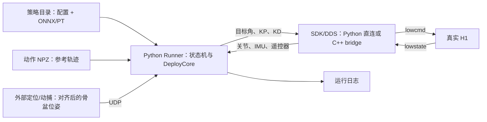
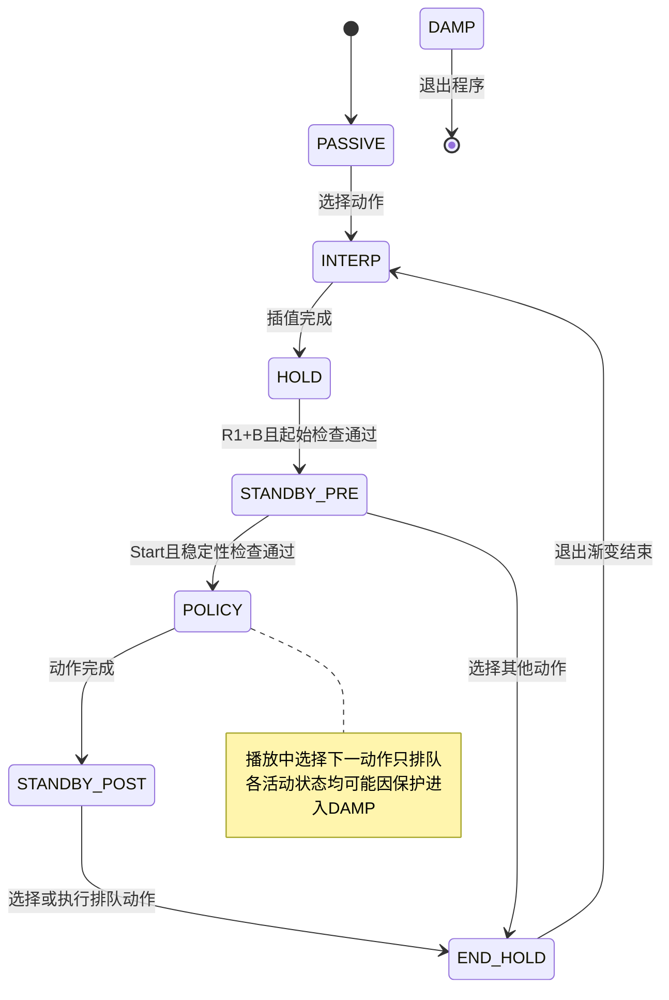

# H1 实机部署代码解析与问题记录

## 先看整体流程

本仓库已经接入 Unitree SDK2，面向标准 **19 关节 H1、20 槽位 GO 消息布局**。部署程序读取真实机器人状态和外部骨盆位姿，构造策略观测，在 CPU 上推理，再把关节目标与 KP/KD 通过 DDS 发给机器人。动作 NPZ 提供参考，网络根据实测反馈计算控制目标。

一次正常部署的完整过程是：

1. **准备输入**：策略目录、三个动作文件、机器人网卡、外部位姿发送端。
2. **加载与检查**：读取 JSON、NPZ、ONNX/PT，检查关节顺序、频率与网络维度。
3. **建立通信**：订阅 `rt/lowstate`，检查 CRC、状态新鲜度、温度、其他控制器和官方运动模式。
4. **启动发送**：通过程序的现场确认后，从 PASSIVE 阻尼状态开始发送低层命令。
5. **选择并准备动作**：选择 default/walk/dance，经固定 PD 插值进入首帧 HOLD；等待 R1+B，起始检查通过后进入策略前待机。
6. **策略待机与播放**：前待机持续推理但不推进参考帧；READY 后按 Start，开始推进动作。
7. **结束或切换**：动作结束后，策略维持末帧静态参考；选择另一动作时经固定 PD 过渡重新准备，再按 R1+B、等 READY、按 Start。
8. **停止与记录**：保护触发或 L2+B 进入 DAMP；正常退出阶段继续发送约 1 秒阻尼，随后保存日志并停止发送。

**C++ bridge 是另一条通信路径：策略推理和状态机仍在 Python，C++ 独立进程承担 DDS 收发、CRC、定频发布与失联看门狗。**



本文依据 **2026-11-13 当前工作区源码**整理，包含此前增加的三动作选择与 BlinkMimic 适配。仓库根目录为：

```text
/home/ljp/human_learn/supermimic/H1_SuperMimic_Deploy
```

下面的文件路径均相对于此目录，链接可以打开对应文件。旧文档、旧日志中的参数可能不同；本文将当前默认值与历史讨论分开说明。此次仅编写文档，不修改部署代码或参数，不执行仿真、编译或实机指令。

阅读索引：[文件地图](#files) · [启动顺序](#startup) · [状态与位姿](#feedback) · [策略推理](#inference) · [PD 与命令](#commands) · [动作切换](#switching) · [参数](#parameters) · [保护](#protection) · [C++ bridge](#bridge) · [位姿配置](#alignment) · [命令模板](#usage) · [日志](#logs) · [实机部署问题](#real-deploy-issues)

<a id="files"></a>

## 1. 文件地图：从哪里开始读

| 文件位置 | 关键入口 | 负责什么 |
|---|---|---|
| [scripts/run_sim2real.sh](../scripts/run_sim2real.sh) | shell 入口 | 设置项目路径，启动 Python 直连运行器 |
| [scripts/deploy/h1_runner.py](../scripts/deploy/h1_runner.py) | `main()`、`Runner` | Python SDK 通信、状态机、控制循环、保护与日志 |
| [scripts/deploy/h1_common.py](../scripts/deploy/h1_common.py) | `extract_state()`、`pelvis_imu()`、`motor_modes()` | H1 电机映射、IMU 转换、遥控器解析、DDS 初始化 |
| [src/h1_deploy/deploy/core.py](../src/h1_deploy/deploy/core.py) | `DeployConfig`、`Clip`、`DeployCore` | 配置与动作读取、观测历史、目标构造、动作缩放和保护判定 |
| [src/h1_deploy/deploy/policy.py](../src/h1_deploy/deploy/policy.py) | `load_policy()`、`TorchPolicy` | ONNX/PT 加载及策略格式识别 |
| [src/h1_deploy/deploy/blinkmimic.py](../src/h1_deploy/deploy/blinkmimic.py) | `BlinkReference` | 新策略的相对骨盆位姿和 530 维未来参考 |
| [src/h1_deploy/deploy/anchor.py](../src/h1_deploy/deploy/anchor.py) | `PoseReceiver`、`features()` | 外部位姿接收；旧策略的 torso anchor 特征 |
| [src/h1_deploy/deploy/motion_selection.py](../src/h1_deploy/deploy/motion_selection.py) | `MotionSelectionMixin` | 三动作选择、排队、READY 和 Start 事件路由 |
| [scripts/run_sim2real_bridge.sh](../scripts/run_sim2real_bridge.sh) | shell 入口 | 启动 bridge 运行器 |
| [scripts/deploy/bridge/h1_runner_bridge.py](../scripts/deploy/bridge/h1_runner_bridge.py) | `Runner` | bridge 路径的 Python 控制器，另有温升预测与热停止 |
| [scripts/deploy/bridge/h1_bridge_io.py](../scripts/deploy/bridge/h1_bridge_io.py) | `Bridge`、`BridgeWatcher` | 启动 C++ 进程，读取共享内存，提交控制命令 |
| [scripts/deploy/bridge/h1_bridge.cpp](../scripts/deploy/bridge/h1_bridge.cpp) | `main()`、`on_lowstate()` | C++ DDS 收发、固定频率发布、独立看门狗 |
| [scripts/deploy/bridge/h1_bridge_shm.h](../scripts/deploy/bridge/h1_bridge_shm.h) | `H1BSnap/H1BCmd/H1BStatus` | Python 与 C++ 的共享结构、版本和消息格式 |
| [scripts/deploy/bridge/h1_bridge_client.cpp](../scripts/deploy/bridge/h1_bridge_client.cpp) | `h1b_read_snap()` 等 | 供 Python ctypes 调用的共享内存读取函数 |
| [scripts/deploy/bridge/build.sh](../scripts/deploy/bridge/build.sh) | g++ 构建命令 | 生成 bridge 程序和 client 动态库 |
| [scripts/deploy/check_robot.py](../scripts/deploy/check_robot.py) | `main()` | Python 路径只读检查状态及控制器模式 |
| [scripts/deploy/bridge/ro_bridge_check.py](../scripts/deploy/bridge/ro_bridge_check.py) | `listen_only=True` | C++ 路径只读检查状态频率、CRC 和通信间隔 |

模型、网络内部及新旧策略适配的进一步说明，可参见 [新策略接入方案.md](新策略接入方案.md)。本文重点解释它们如何进入实机控制流程。

<a id="startup"></a>

## 2. 从启动命令到第一条电机命令

### 2.1 shell 入口与 main()

**对应文件：** [scripts/run_sim2real.sh](../scripts/run_sim2real.sh)、[scripts/deploy/h1_runner.py](../scripts/deploy/h1_runner.py)，重点看 `main()`。

shell 脚本把当前目录切到仓库根目录，把 `src` 加入 `PYTHONPATH`，然后使用 `H1_PYTHON` 指定的解释器或当前 `python` 启动运行器。因此激活哪个 Conda 环境会影响默认解释器。

`main()` 先解析参数并检查组合是否合法。当前代码将 DDS domain 0 视为实机域，拒绝在该域使用 `--sim` 和相应仿真注入选项；`--motion-select` 要求三个动作文件名分别为 default、walk、dance，且不能同时使用自动播放或旧式结束模式。

随后创建打印队列、Runner 和信号处理，依次调用：

```text
Runner.__init__() → startup() → run() → finally 中的阻尼退出与 save()
```

### 2.2 构造 Runner 时准备了什么

**对应文件：** [h1_runner.py](../scripts/deploy/h1_runner.py)，`Runner.__init__()`。

按当前代码顺序，主要包括：

1. 读取 `--artifacts/deploy_config.json`。
2. 检查策略是否需要根位姿；需要但没有 `--pose-listen` 就直接报错。配置监听时创建 UDP 接收器。
3. 读取 `--clip` 中全部部署动作，建立文件名到动作编号的映射。
4. 对每个动作准备软限位裁剪后的首帧 `f0s`、末帧 `fends`。
5. 用 `static_clip()` 构造首帧、末帧的静态参考，供策略待机使用。
6. 加载策略，并检查网络输入维度与部署 JSON 是否一致。
7. 根据 `--stage` 和命令行覆盖项构造保护配置；准备固定 PD 增益。
8. 建立状态锁、命令锁、按键队列、日志缓冲区，并把初始状态设为 PASSIVE。

这里已创建位姿接收器，但**持续读取外部位姿发生在后面的策略状态分支**。不要把“socket 已绑定”理解为“位姿已经完成有效性检查”。

### 2.3 startup() 的真实顺序

**对应文件：** [h1_runner.py](../scripts/deploy/h1_runner.py)，`startup()`、`check_mode()`、`LowcmdWatcher`。

| 顺序 | 行为 | 不满足时的结果 |
|---|---|---|
| 1 | 初始化 SDK DDS，创建 CRC 工具和状态订阅 | 初始化失败退出 |
| 2 | 等待有效 `rt/lowstate`，默认最长 5 秒 | 没有状态则退出 |
| 3 | 统计约 1 秒状态接收率，提取当前关节、IMU、温度 | 无效状态可能导致异常退出 |
| 4 | 等待独立 watcher 就绪，检查其他 `rt/lowcmd` 发布者 | 发现其他控制器则退出 |
| 5 | 查询 MotionSwitcher 的 `CheckMode()` | 已知模式仍激活则退出 |
| 6 | 检查温度，并用零输入预热策略三次 | 过温或推理失败则退出 |
| 7 | 打印配置和现场确认提示，等待输入 `yes` | 未确认则不启动电机命令发送 |
| 8 | 再次检查其他发布者、运动模式、温度和状态新鲜度 | 复查不通过则退出 |
| 9 | 创建 lowcmd 发布器，清理旧按键事件，启动命令线程 | 从 PASSIVE 阻尼开始发送 |

代码**不会主动调用 ReleaseMode**。若 CheckMode 服务没有回答，默认打印警告并依赖 lowcmd 发布者检查；加上 `--require-check-mode` 后，服务无响应也会拒绝启动。它并不是无条件自动接管官方控制器。

三次网络预热只覆盖网络调用，不等于所有状态读取、参考构造及首次运动学计算都已预热。

### 2.4 Python 运行时的线程与进程

**对应文件：** [h1_runner.py](../scripts/deploy/h1_runner.py)，`on_state()`、`run()`、`cmd_loop()`、`Printer`、`LowcmdWatcher`。

| 执行部分 | 主要任务 |
|---|---|
| DDS 状态回调 | 检查 CRC，更新最新状态和 tick，解析去抖后的按键事件 |
| 50 Hz 主循环 | 运行状态机、读取反馈、推理、更新目标、记录日志 |
| 默认 500 Hz 命令线程 | 重发最新命令、检测状态过期和主循环心跳、响应阻尼请求 |
| watcher 子进程 | 统计 lowcmd 接收量，辅助识别其他命令发布者 |
| 打印线程 | 从队列输出终端和控制台日志，减少主控制流程被打印阻塞 |

500 Hz 发包并不表示策略推理 500 次/秒。策略每 20 ms 更新一次目标，发送线程在两次推理之间继续发送最近目标；策略更新成功时还会立即发送一次，所以实际发包间隔并非严格只有一个 2 ms 时钟。

<a id="feedback"></a>

## 3. 机器人反馈如何成为策略状态

### 3.1 19 个策略关节与 20 个硬件槽位

**对应文件：** [h1_common.py](../scripts/deploy/h1_common.py)，`JOINT_TO_MOTOR`、`state_from_arrays()`、`to_motor()`。

策略使用模型关节顺序，SDK 消息使用硬件电机槽位，两者必须映射。当前映射是：

```text
策略索引： 0  1  2  3   4  5  6  7  8   9 10 11 12 13 14 15 16 17 18
硬件槽位： 7  3  4  5  10  8  0  1  2  11  6 16 17 18 19 12 13 14 15
```

策略索引 0–4 为左腿，5–9 为右腿，10 为 torso yaw，11–14 为左臂，15–18 为右臂。硬件槽位 9 未使用。

状态接收时用该表从 20 槽位取出 19 关节；命令发送时做反向填充。`motor_modes()` 对未使用槽位写 0，配置中的强电机使用 0x0A、弱电机使用 0x01。这是仓库的 H1 适配实现，不是任意 Unitree 机型的通用映射。

### 3.2 lowstate 提供哪些信息

**对应文件：** [h1_common.py](../scripts/deploy/h1_common.py)，`H1State`、`extract_state()`。

- 关节：`q`、`dq`、`tau_est`、温度、`lost` 计数。
- IMU：四元数、角速度、加速度等。
- 通信：tick、接收时刻和 CRC 检查结果。
- 遥控器：`wireless_remote` 中的按键位。

当前 GO 温度字段被重复成两列以兼容日志，不代表每个关节有两个独立实测温度传感器。`motorstate` 日志列保存的是 `lost` 计数，不能按其他协议的故障位掩码解释。

### 3.3 为什么需要 torso IMU → pelvis 转换

**对应文件：** [h1_common.py](../scripts/deploy/h1_common.py)，`pelvis_imu()`。

当前适配把输入 IMU 视为 torso 观测，而策略使用骨盆坐标系。躯干可绕 torso yaw 转动，因此不能直接把 torso 的姿态和角速度当作骨盆状态。

代码用腰部关节角构造旋转矩阵 Rz，计算：

```text
R_world_pelvis = R_world_torso × Rz.T
gyro_pelvis = Rz × gyro_torso − [0, 0, torso_joint_velocity]
```

这同时处理了坐标轴变化和腰部相对角速度。加速度字段仍是原始 torso 加速度，没有被声明为完整的骨盆线加速度估计。

### 3.4 外部位姿是另一条反馈通道

**对应文件：** [anchor.py](../src/h1_deploy/deploy/anchor.py)，`PoseReceiver.read()`；[h1_runner.py](../scripts/deploy/h1_runner.py)，`run()` 的 POLICY_STATES 分支。

当前旧策略的 anchor 和新 BlinkMimic 都需要外部骨盆位置。通过 `--pose-listen` 接收的数据包含真实骨盆位置及姿态；lowstate 的关节角和 IMU 并没有自动替代这条世界坐标位姿通道。

需要区分当前代码中两种姿态的用途：

| 用途 | 当前数据来源 |
|---|---|
| HOLD 接管检查、待机稳定窗口、日志中的 `quat/tilt_err` | lowstate IMU 转换后的骨盆姿态 |
| 策略观测及 DeployCore 的姿态保护（启用外部反馈时） | UDP 提供的骨盆姿态 |
| 策略角速度 | lowstate IMU 转换后的骨盆角速度 |
| 策略世界坐标位置 | UDP 提供的骨盆位置 |

所以，外部定位和 IMU 的轴约定、时间对应关系必须一致。待机日志的倾角与 core 报出的姿态保护值不一定来自同一个姿态输入，这一点在排查问题时尤其重要。

<a id="inference"></a>

## 4. 策略如何被加载并完成一次推理

### 4.1 --artifacts 决定配置和权重来源

**对应文件：** [policy.py](../src/h1_deploy/deploy/policy.py)，`load_policy()`；[core.py](../src/h1_deploy/deploy/core.py)，`DeployConfig.load()`。

Runner 请求加载 `策略目录/policy.onnx`，实际优先级是：

1. 如果 policy.onnx 存在，使用 ONNX Runtime CPU 推理。
2. 如果不存在，读取同目录 JSON 的 `policy_checkpoint`，按相对路径加载 PT。
3. 两者都不可用则报错。

当前检查时，`deploy_artifacts/ckpt_latest` 没有 policy.onnx，JSON 指向 `checkpoints/ckpt_latest.pt`；`deploy_artifacts/last` 已有 policy.onnx，JSON 也记录了 `checkpoints/last.pt` 路径。因此仅替换 last.pt，并不意味着现有 ONNX 会随之更新。

配置检查包括：19 个关节顺序正确、各参数数组形状正确且数值有限、控制周期为 0.02 s，以及历史维度和策略格式一致。不能只把维度字段改大就认为新网络已适配。

### 4.2 新旧策略分别使用什么输入

**对应文件：** [core.py](../src/h1_deploy/deploy/core.py)，`obs_frame()`、`observation()`、`goal()`；[blinkmimic.py](../src/h1_deploy/deploy/blinkmimic.py)，`BlinkReference`。

每帧基础观测共 63 维：

```text
关节角相对默认姿态 19
+ 关节速度 19
+ 骨盆角速度 3
+ 投影重力 3
+ 上一步原始网络动作 19
= 63
```

| 项目 | ckpt_latest：SuperMimic | last：BlinkMimic |
|---|---|---|
| 每帧观测 | 63 | 72，即基础 63 + 相对骨盆位姿 9 |
| 历史长度 | 10 帧 | 10 帧 |
| 展平观测 | 630，按观测项分组排列历史 | 720，按时间帧排列 |
| 目标输入 | 480 + torso anchor 9 = 489 | 10 个未来参考 × 53 = 530 |
| 相对位姿位置 | 目标输入末尾 | 每一帧观测末尾 |
| 输出 | 19 维关节动作 | 19 维关节动作 |
| 外部根位姿 | 需要 | 需要 |

旧策略未来目标使用 frame+1 到 frame+10，超出末帧就重复末帧。旧 anchor 使用 CPU MuJoCo 正运动学计算实际 torso 和参考 torso 的相对位姿；它只计算运动学，不推进仿真物理。

新策略通过根位置、根姿态和关节参考重建目标：每个未来参考包含位置差 3、旋转表示 6、线速度 3、角速度 3、关节角 19、缩放后的关节速度 19。相对骨盆位姿使用当前参考帧；这个分支不调用旧 torso anchor 的正运动学计算。

首次建立历史时，把当前观测重复 10 次；后续每步移除最旧一帧并加入新观测。两种历史排列方式不同，不能简单 reshape 成另一个维度。

### 4.3 DeployCore.step() 的实际执行顺序

**对应文件：** [core.py](../src/h1_deploy/deploy/core.py)，`DeployCore.step()`。

```text
检查输入状态，记录 abort 原因
→ 构造当前观测并更新历史
→ 构造未来目标和必要的相对位姿
→ 调用策略
→ 检查动作形状、非有限值和幅度
→ 动作缩放并生成受限目标角
→ 保存 last_action
→ 根据 advance 决定是否推进参考帧
→ 返回 StepResult
```

`_check()` 得到 abort 后，step 本身仍可能继续推理并返回结果；最终由调用者决定如何处理。实机 Runner 检查到 `r.abort` 后进入 DAMP，不把该次策略目标作为正常控制提交。离线评估可能记录 abort 后继续仿真，二者不能混同。

`advance=False` 只冻结参考帧，**没有停止网络推理、观测历史更新或命令发送**。这就是前后策略待机与固定 PD HOLD 的区别。


<a id="commands"></a>

## 5. 网络输出如何变成电机命令

### 5.1 网络动作不是直接发送的力矩

**对应文件：** [core.py](../src/h1_deploy/deploy/core.py)，`DeployCore.targets()`。

首先按关节计算：

```text
q_raw = action × action_scale + default_joint_pos
```

当前两个策略目录的 action_scale 均为每关节 0.25。这里的 default_joint_pos 是动作输出的基准姿态，不是当前动作的首帧姿态，也不是上一帧目标。

随后可对目标角做力矩需求约束。基于本次采样的 q、dq，按零目标速度的 PD 关系：

```text
tau_PD = Kp × (q_target − q) − Kd × dq
tau_allow = torque_clamp_factor × effort_limit

q_low  = q + (−tau_allow + Kd × dq) / Kp
q_high = q + ( tau_allow + Kd × dq) / Kp
q_target = clip(q_raw, q_low, q_high)
```

这个步骤通过限制目标角来约束预测 PD 力矩，不是测量或直接发送电机实际力矩。机器人状态在两次策略更新之间仍会变化，所以不能把它当成硬件每个时刻都严格满足该限幅的证明。

`SafetyCfg.clamp_soft_limits` 默认 False；固定 PD 使用的首尾姿态仍会被单独裁剪到软限位。二者是不同代码路径。

### 5.2 两套 KP/KD 分别来自哪里

**对应文件：** [h1_runner.py](../scripts/deploy/h1_runner.py) 和 [h1_runner_bridge.py](../scripts/deploy/bridge/h1_runner_bridge.py) 顶部的 `STAND_KP` 及 `Runner.__init__()` 的 `self.stand_kd = c.kd.copy()`；[ckpt_latest 配置](../deploy_artifacts/ckpt_latest/deploy_config.json)、[last 配置](../deploy_artifacts/last/deploy_config.json)。下表为当前配置且无命令行 KD 覆盖时的数值。

| 关节组 | 固定 PD Kp | 固定 PD Kd | 当前策略 JSON Kp | 当前策略 JSON Kd |
|---|---:|---:|---:|---:|
| 每侧髋 yaw/roll/pitch | 150 | 2 | 150 | 2 |
| 每侧膝 | 200 | 4 | 200 | 4 |
| 每侧踝 | 40 | 2 | 40 | 2 |
| torso yaw | 300 | 3 | 300 | 3 |
| 每侧肩 pitch/roll/yaw | 100 | 2 | 100 | 2 |
| 每侧肘 | 50 | 2 | 50 | 2 |

- INTERP/HOLD 使用运行器内的固定 PD 增益。
- STANDBY_PRE/POLICY/STANDBY_POST 使用当前策略 JSON 的 kp/kd。
- END_HOLD 将策略增益逐渐混合到固定 PD 增益。
- PASSIVE/DAMP 使用 Kp=0、Kd=3。

固定 PD 的 kd 默认读取当前策略 JSON 的 kd 副本，修改 JSON 并重新启动会同时影响两阶段的默认阻尼。`--stand-arm-kd` 和 `--stand-waist-kd` 默认不覆盖；显式传值时仅覆盖固定 PD 的手臂、腰部阻尼，不改写 JSON 或策略阶段的 kd。固定 PD 的 Kp 仍来自独立的 `STAND_KP`。

### 5.3 Python SDK 路径发送了什么

**对应文件：** [h1_runner.py](../scripts/deploy/h1_runner.py)，`build_cmd()`、`set_cmd()`、`send()`。

`build_cmd()` 建立 GO LowCmd，配置消息头和各电机 mode，初始把 dq、tau 等设为零。`send()` 按硬件映射填入 q、kp、kd，计算 CRC，然后调用 `ChannelPublisher.Write()`。

因此当前控制命令的核心字段是：

```text
q = 策略/插值产生的目标角
dq = 0
kp/kd = 当前状态选择的增益
tau = 0（不附加前馈力矩）
```

“tau 字段为零”不等于电机没有输出；PD 误差和阻尼项仍会产生控制作用。

`set_cmd(..., expect_state)` 在锁内确认状态没有发生变化，避免推理途中已经触发 DAMP，随后旧的策略结果又把阻尼命令覆盖。它也更新主循环心跳 `t_main_cmd`。

<a id="switching"></a>

## 6. 状态机与三个动作的选择

### 6.1 每个状态具体做什么

**对应文件：** [h1_runner.py](../scripts/deploy/h1_runner.py)，`STATES`、`run()`；bridge 的同名 Runner 保留对应流程。

| 状态 | 控制内容 | 是否推理 | 参考是否推进 |
|---|---|---|---|
| PASSIVE | Kp=0、Kd=3 的阻尼，等待选择 | 否 | 否 |
| INTERP | 从当前/上一目标姿态余弦插值到动作首帧 | 否 | 否 |
| HOLD | 固定 PD 保持首帧，等待手动接管请求及起始检查通过 | 否 | 否 |
| STANDBY_PRE | 策略跟踪首帧静态参考，积累稳定窗口 | 是 | 否 |
| POLICY | 策略跟踪动态动作 | 是 | 是 |
| STANDBY_POST | 策略跟踪末帧静态参考 | 是 | 否 |
| END_HOLD | 从策略目标与增益过渡到固定 PD，可继续下一动作准备 | 否 | 否 |
| DAMP | 锁定阻尼状态，当前进程不再恢复播放 | 否 | 否 |

`interpolate_pose()` 的插值系数是 `s = (1 − cos(pi × t / duration)) / 2`，使首尾目标速度较平滑。它不包含机器人整体平衡控制。

后续加入了 `--policy-blend-s`（默认 5 秒）：进入 STANDBY_PRE 时，先由 `src/h1_deploy/deploy/policy_takeover.py::PolicyTakeover` 将上一条 HOLD 目标线性混合到每周期策略目标，混合后重新执行原力矩/位置裁剪。网络照常推理，KP/KD、历史定义及状态顺序不变；完全策略目标成功提交后才开始稳定窗口，bridge 的温升窗口也从此开始。两个 Runner 的 `run()` 应用混合、`standby_allowed()` 阻止过早播放。日志增加 `policy_q_target`、`policy_blend_alpha` 和 `blend_n_clamped`。当前无吊架 last 闭环测试未通过，不应仅凭此改动重试实机，详见 [SIM2REAL.md](SIM2REAL.md)。

END_HOLD 的目标也使用余弦插值，增益则按时间比例线性混合。运行器还裁剪目标角，使弹簧项 Kp×角度误差受限；这个限制没有把阻尼项一起纳入，不能等同于完整实际电机力矩限幅。

### 6.2 当前三动作模式

**对应文件：** [motion_selection.py](../src/h1_deploy/deploy/motion_selection.py)，`MOTION_BUTTONS`、`selection_combos()`、`motion_events()`、`begin_selected_motion()`。

启用 `--motion-select` 后：

| 按键 | 功能 |
|---|---|
| L1+A | 选择 default.npz |
| L1+X | 选择 walk.npz |
| L1+Y | 选择 dance.npz |
| R1+B | HOLD 中请求起始检查，通过后进入 STANDBY_PRE |
| Start | 准备条件满足后开始播放 |
| L2+B | 进入 DAMP |

绑定依据是**文件名去掉 .npz 后的名称**，不是 NPZ 内部 name 字段。三个文件必须各提供一次，命令中的排列顺序可以不同。选择键自动触发固定 PD 准备；HOLD 不再自动进入策略，需要 R1+B 请求接管。未启用本模式的旧按键不变。



细节如下：

- 在 PASSIVE 选择动作：以实测关节角为起点进入 INTERP。
- 在 STANDBY_PRE/POST 选择动作：先 END_HOLD，再插值到新动作首帧。
- 播放中选择另一个动作：记录待切换目标，当前动作结束后开始准备；不会立即打断当前帧。
- 准备过程中再次选择：忽略，避免打断正在执行的 PD 过渡。
- HOLD 中 R1+B 检查失败会继续固定 PD，需要松开后重新按；提前请求不排队。每个动作及返回 default 均需这一步。
- R1+B 只接受这两个键；与其他键重叠后须全部松开 R1、B 才能重试，L2+B 优先。检测在 `scripts/deploy/h1_common.py::ComboDebounce`；接管条件仍在两个 Runner 的 `policy_allowed()`。
- 准备好之后再次按 Start，程序仍重新检查门槛，READY 不是永久授权。
- 提前按 Start 不排队；动作结束后直接按 Start 也不自动重新准备。重播需要重新选择该动作。
- 同时选择多个动作会拒绝；选择与 Start 同时到达时不会把 Start 留待以后执行。
- bridge 已进入热停止流程时，动作选择和播放会被拒绝。

### 6.3 参考切换与网络权重切换不同

**对应文件：** [motion_selection.py](../src/h1_deploy/deploy/motion_selection.py)、[core.py](../src/h1_deploy/deploy/core.py) 的 `reset()/switch_clip()`，以及两个 Runner 的 `policy` 事件分支。

当前一次进程只加载一份策略。三个按键改变参考 NPZ，不会重新加载不同网络。

从 HOLD 新接管一个动作时，Runner 创建新的 DeployCore，并清空历史及 last_action；从策略前待机进入播放、从播放进入后待机时，只调用 `switch_clip()`，保留历史和 last_action。

所以：

- 两个策略目录都能由入口选择加载，不等于运行中能够在两个不同维度网络之间热切换。
- default/walk/dance 的转换包含固定 PD 阶段，不是全程策略平衡的无缝转换。
- 固定 PD 关节插值只处理关节姿态，没有自动对齐世界坐标位置和朝向。

### 6.4 未启用三动作模式时

**对应文件：** 两个 Runner 的 `COMBOS` 和 `run()` 原事件分支。

原操作仍是 L2+up 进行准备，R1+A 进入策略前待机，R1+X 播放，L2+B 阻尼。策略待机下退出到固定 PD 的原流程有双按确认；三动作模式通过选择事件进入相同的 PD 过渡分支，使用不同的按键交互。

<a id="parameters"></a>

## 7. 参数从哪里改，以及当前默认值

### 7.1 参数来源的优先关系

**对应文件：** [h1_runner.py](../scripts/deploy/h1_runner.py) 和 [h1_runner_bridge.py](../scripts/deploy/bridge/h1_runner_bridge.py) 的 `main()/Runner.__init__()`；[core.py](../src/h1_deploy/deploy/core.py) 的 `SafetyCfg/DeployConfig`。

| 想调整的内容 | 应查看或修改的位置 |
|---|---|
| 策略、动作、网卡、DDS 域、位姿端口 | 启动命令中的 --artifacts、--clip、--iface、--domain、--pose-listen |
| 插值时间、HOLD 和 Start 门槛、超时 | 两个入口 main() 的 argparse；单次运行优先显式传参数 |
| 策略 KP/KD、动作缩放、关节范围/速度/力矩参数 | 对应策略目录的 deploy_config.json |
| 固定 PD KP/KD | KP：两个 Runner 顶部 STAND_KP；KD：当前 deploy_config.json 的 kd 副本，手臂/腰部可显式命令行覆盖 |
| stage 的默认保护组合 | 两个 Runner 顶部 STAGES |
| 核心倾角保护和默认裁剪行为 | core.py 的 SafetyCfg |
| H1 电机编号、IMU 转换、遥控器位 | h1_common.py |
| 三动作按键与选择逻辑 | motion_selection.py |
| C++ 看门狗与独立发布线程 | bridge 入口 --bridge-* 参数和 h1_bridge.cpp |

`STAGES` 先选出参数组合，再由非 None 的命令行参数覆盖。当前程序没有把这些运行参数自动写回 JSON；下次启动需使用相同命令或保存在自己的启动配置中。

### 7.2 接管、待机和时间参数

**对应文件：** 两个 Runner 的 `main()`、`policy_allowed()`、`standby_allowed()`。

| 参数 | Python 当前默认 | bridge 当前默认 | 作用 |
|---|---:|---:|---|
| --cmd-hz | 500 Hz | 500 Hz | 命令发送频率 |
| --interp-s | 4 s | 4 s | 固定 PD 首帧插值时长 |
| --end-blend-s | 1 s | 1 s | 退出策略后的增益/目标混合时长 |
| --hold-min-s | 1 s | 1 s | HOLD 至少保持多久 |
| **--hold-tol** | **0.25 rad** | **0.1 rad** | 最大首帧关节角差必须小于该值 |
| --start-max-dq | 0.5 rad/s | 0.5 rad/s | HOLD 接管前关节速度上限 |
| --start-max-tilt-deg | 10° | 10° | HOLD 相对动作首帧的姿态误差门槛 |
| --standby-min-s | 3 s | 3 s | 前待机最短时长 |
| --standby-window-s | 3 s | 3 s | Start 检查的最近稳定窗口 |
| --standby-max-tilt-deg | 8° | 8° | 窗口内最大姿态误差门槛 |
| --standby-max-dq | 1 rad/s | 1 rad/s | 窗口内最大关节速度门槛 |
| --pose-max-age | 0.1 s | 0.1 s | 外部位姿最大年龄 |
| --stale-ms | 20 ms | 20 ms | lowstate/tick 过期门槛 |
| --max-overrun | 2 个周期 | 2 个周期 | 主循环调度迟到门槛 |
| --warn-temp / --max-temp | 70 / 80°C | 70 / 80°C | 拒绝接管/播放的温度门槛与 DAMP 门槛 |

**上述 hold-tol 差异来自当前文件，不是本文修改。** 之前讨论中的 0.1 rad 和其他旧文档中的 0.2 rad 不能代替当前实际启动参数；显式命令行参数又会覆盖各自默认值。切换 Python/bridge 入口时必须知道它们并非所有默认值都相同。

`policy_allowed()` 不满足时保持 HOLD，仍持续固定 PD。策略前待机的 Start 检查不满足时维持策略待机。它们与触发 DAMP 是不同结果。

`--no-policy` 会让策略接管始终被拒绝，适用于只进行固定 PD 准备的运行；不能带着它等待 Start 进入策略播放。

### 7.3 stage 参数组

**对应文件：** 两个 Runner 的 `STAGES`；核心检查在 [core.py](../src/h1_deploy/deploy/core.py)。

| stage | 速度阈值 / 关节速度限值 | 原始动作幅度阈值 | 目标力矩系数 | 固定 PD 绝对倾角门槛 |
|---|---:|---:|---:|---:|
| air | 0.3 | 10 | 0.5 | 0.35 rad |
| feet | 0.3 | 10 | 0.5 | 0.35 rad |
| slack | 0.5 | 15 | 1.0 | 0.5 rad |
| ground | 0.8 | 50 | 1.5 | 0.8 rad |

这里的固定 PD 倾角与 **DeployCore 相对参考倾角 0.35 rad** 是不同检查。`--stage ground` 不会自动改变机器人接触条件、吊绳、权重或动作，也不代表动作已通过地面运行验证。

<a id="protection"></a>

## 8. 保护、超时与停止行为

### 8.1 WAIT、REFUSED、DAMP 各是什么意思

**对应文件：** [h1_runner.py](../scripts/deploy/h1_runner.py)，`policy_allowed()`、`standby_allowed()`、`damp()`；[motion_selection.py](../src/h1_deploy/deploy/motion_selection.py)。

| 日志/状态 | 实际含义 |
|---|---|
| WAIT | HOLD 等待 R1+B，或策略待机条件暂未满足；仍在当前状态控制 |
| REFUSED | 本次按键请求未通过检查；不等于整个程序已经退出 |
| READY | 最近检查满足播放条件；Start 时还会复查 |
| DAMP | 已停止正常策略/固定姿态控制，改为 Kp=0、Kd=3 的阻尼 |
| SHUTDOWN | 正在退出；最后发送阻尼，再结束命令流 |

DAMP 是当前进程内的锁定状态。`set_state()` 在 DAMP 后拒绝正常状态跳转，因此不能继续按 Start 恢复。DAMP 也不是硬件断电或主动站稳功能；Kp=0 后机器人不会继续保持原关节目标。

### 8.2 不同的“超时”分别监视什么

**对应文件：** [h1_runner.py](../scripts/deploy/h1_runner.py)，`state_age()/cmd_loop()/run()`；[anchor.py](../src/h1_deploy/deploy/anchor.py)，`read()`。

| 检查 | 默认条件 | 作用 |
|---|---|---|
| lowstate 过期 | 接收或已开始变化的 tick 超过 20 ms 不更新 | 检查机器人状态通信是否新鲜 |
| 主循环调度迟到 | 超过 2×20=40 ms | 检查主循环是否落后于计划执行时刻 |
| 主循环命令心跳 | 超过 (2+0.5)×20=50 ms 没有更新目标 | 即使旧命令仍在发送，也识别主循环停滞 |
| 外部位姿年龄 | 默认超过 100 ms，或时间戳超前超过 20 ms | 检查定位数据新鲜度及跨机时钟 |
| 连续发送失败 | 默认 10 次 | 检查命令提交是否持续失败 |

`PoseReceiver.read()` 会在最多约 20 ms 的预算内读取队列、丢弃旧数据并等待新位姿；这个时间本身会消耗主循环预算。`--pose-max-age` 与 50 ms 主循环心跳是两套独立检查，增大其中一个不会自动修复另一个。

在 Python 直连模式，命令线程虽然与主循环分开，但仍在同一进程。若进程整体失效或线程无法被调度，它不能保证仍继续发包；C++ bridge 增加的是独立进程层面的失联处理。

### 8.3 core、Runner 和 SDK 的分工

**对应文件：** [core.py](../src/h1_deploy/deploy/core.py)、两个 Runner、[h1_common.py](../scripts/deploy/h1_common.py)。

- DeployCore：IMU/状态有效性、相对参考倾角、关节速度、原始动作幅度，以及目标角裁剪。
- Runner：当前状态的接管和播放门槛、温度、固定 PD 倾角、超时、按键和异常处理。
- SDK 接口：消息收发、CRC、硬件槽位和字段填充。
- 其他控制器检查：启动时不允许发现已有 lowcmd 发布者；运行时通过收发速率估计识别额外发布者，属于监测逻辑，不是硬件独占锁。
- `--max-motor-lost`：可选的 GO lost 计数门槛，默认不启用，不能代替完整的固件故障诊断。

### 8.4 退出程序的处理

**对应文件：** 两个 Runner 的 `main()` 中 signal handler、异常分支和 finally。

程序监听 Ctrl-C 等信号。已经开始发送命令时，正常异常处理/退出路径会进入 DAMP，继续发送约 1 秒阻尼，然后结束线程、保存日志。bridge 路径还向 C++ 进程发送 QUIT。

这描述的是程序能够执行清理代码时的行为，不包括强制杀进程、断电或硬件网络完全断开时的同等保证。实机不会因为设置了仿真吊绳文件而获得物理支撑。

<a id="bridge"></a>

## 9. C++ SDK 路径的代码解析

### 9.1 C++ 与 Python 如何协作

**对应文件：** [h1_runner_bridge.py](../scripts/deploy/bridge/h1_runner_bridge.py)、[h1_bridge_io.py](../scripts/deploy/bridge/h1_bridge_io.py)、[h1_bridge.cpp](../scripts/deploy/bridge/h1_bridge.cpp)。

```text
机器人 rt/lowstate
  → C++ on_lowstate()：CRC、快照、逐消息环形记录
  → 共享内存
  → ctypes client + Python read_state()/pump()
  → Python 状态机 + DeployCore 推理
  → Unix datagram socket：最新 q/kp/kd/mode
  → C++ 发布循环
  → 机器人 rt/lowcmd
```

`read_state()` 获取最新状态；`pump()` 读取期间发生的逐消息按键/tick 记录，避免只看低频快照而遗漏按键去抖所需的样本。

**实机 bridge 入口仍会使用 Python SDK 初始化和查询 MotionSwitcher。** 转用 C++ 收发 lowstate/lowcmd 不意味着当前入口可以完全卸载 unitree_sdk2py。

### 9.2 共享内存与命令结构

**对应文件：** [h1_bridge_shm.h](../scripts/deploy/bridge/h1_bridge_shm.h)、[h1_bridge_client.cpp](../scripts/deploy/bridge/h1_bridge_client.cpp)、[h1_bridge_io.py](../scripts/deploy/bridge/h1_bridge_io.py)。

| 结构 | 内容 |
|---|---|
| H1BSnap | 最新有效 lowstate、接收/tick 时间、关节/IMU/温度/遥控器 |
| H1BRingEntry | 每个接收样本的序号、时刻、tick、按键；环容量 256 |
| H1BStatus | 发包计数、失败计数、心跳、看门狗状态、发包间隔统计 |
| H1BCmd | 20 槽位的 mode、q、kp、kd，以及立即发送/测量角/退出标志 |

快照使用写入序列号和内存屏障检查读取一致性；环形记录被覆盖时会统计丢失条目。client 启动时校验结构尺寸和字段偏移，版本、布局不匹配会拒绝使用。

因此 h1_bridge、client 动态库、Python 接口和共享头文件必须配套，不能随便拿另一个仓库或其他机器人版本的二进制替换。

### 9.3 发布与独立看门狗

**对应文件：** [h1_bridge.cpp](../scripts/deploy/bridge/h1_bridge.cpp)，`main()` 的 publish lambda 和 watchdog 分支。

普通控制模式会提前创建 DDS writer，但在收到第一条 Runner 控制命令之前不发布 lowcmd。只读模式 `--listen-only` 连 lowcmd writer 都不初始化。

控制开始后，C++ 定频发送最新目标；带 NOW 标志的命令还可立即发布。每条消息重新计算 CRC。当前 dq 和前馈 tau 同样为零。

| 参数 | 默认值 | 含义 |
|---|---:|---|
| --bridge-wd-ms | 100 ms | C++ 超时未收到 Python 提交的命令则锁定阻尼 |
| --bridge-hb-ms | 50 ms | Python 检查 C++ 发布循环心跳 |
| --bridge-orphan-s | 10 s | 发现父进程退出或相应终止信号后，维持阻尼再退出 |
| --bridge-cpu | -1 | C++ 发布线程默认不绑定指定 CPU |
| --bridge-prio | 0 | C++ 发布线程默认不申请实时调度优先级 |

C++ 的 100 ms 看门狗监视的是 **Python→bridge 命令流**，不是每次策略推理本身。只要 Python 命令线程还在转发，C++ 可能仍持续收到命令；主循环推理是否停滞由 Runner 的 50 ms 心跳检查负责。两个机制互补。

看门狗触发后，后续普通命令不能解除其阻尼锁定。只有“Runner silent”而父进程仍在时，代码不会单凭 orphan-s 退出；10 秒退出计时对应父进程消失/终止信号场景。

### 9.4 bridge 额外的温升预测和热停止

**对应文件：** [h1_runner_bridge.py](../scripts/deploy/bridge/h1_runner_bridge.py)，`temp_forecast()`、`thermal_stop()`、`thermal_stop_clip()`。

bridge 与 Python 直连是两个 Runner 实现，除了 I/O，还存在以下差异：

- 前待机收集温度历史，默认窗口 20 秒、最少跨度 10 秒。
- Start 前按“当前温度 + 正向温升率 × 动作时长”估算动作结束温度。
- 默认预测限值为热停止阈值 65°C；正常播放期间达到该阈值会生成约 1 秒的停止参考。
- 停止参考完成后切到静态参考继续策略待机，不自动播放下一动作。
- 80°C 硬温度停止等原保护仍独立存在。

热停止使用的默认姿态是 current；另有 frame0/upright 选项。它通过改变参考动作让网络尝试停稳，并不是一个已验证在任意舞姿下都能停稳的独立控制器。`--temp-headroom` 会改变有效温度的比较基准，不能把它看成无影响的显示参数。

### 9.5 构建、已有依赖与迁移问题

**对应文件：** [build.sh](../scripts/deploy/bridge/build.sh)、[.gitignore](../.gitignore)、[h1_bridge_io.py](../scripts/deploy/bridge/h1_bridge_io.py)。

本机已找到 C++ SDK：

```text
/home/ljp/human_learn/whole_body/OTHER/RobotBridge/unitree_sdk2
```

此前只读检查确认了 x86_64 库、GO 消息头文件、DDS 头文件/动态库及 g++ 存在。当前 bridge 源码在仓库内；默认目录缺少 h1_bridge 和 libh1bridge_client.so 两个编译产物。它们被 .gitignore 明确忽略，提取记录也注明当时没有执行编译，因此不能仅凭这两个文件缺失认定核心源码漏迁移。

构建模板如下，本文没有执行：

```bash
cd /home/ljp/human_learn/supermimic/H1_SuperMimic_Deploy
bash scripts/deploy/bridge/build.sh \
  /home/ljp/human_learn/whole_body/OTHER/RobotBridge/unitree_sdk2
```

脚本使用当前 CPU 架构对应的 SDK 库，输出到 scripts/deploy/bridge。DDS 动态库目录写入运行时搜索路径；SDK 被移动、C++ 代码/共享结构改变、架构变化时应重新处理构建。

`SM_BRIDGE_HOME` 可以指定另一套配套产物所在目录。默认使用代码约定的 bridge 目录。启动子进程时会移除继承的 LD_LIBRARY_PATH 和 CYCLONEDDS_URI，以使用构建指定的 SDK 库路径；Python 自己的 SDK 模式查询仍有自身依赖环境。


<a id="alignment"></a>

## 10. 外部位姿与坐标对齐：哪些一次配置，哪些持续更新

### 10.1 接口格式和读取行为

**对应文件：** [anchor.py](../src/h1_deploy/deploy/anchor.py)，`PoseReceiver`；[blinkmimic.py](../src/h1_deploy/deploy/blinkmimic.py)，`relative_pose()`。

每个 UDP 数据报是 UTF-8 JSON，例如：

```json
{
  "time_unix_s": 1794300000.0,
  "frame_id": "reference",
  "root_pos": [0.0, 0.0, 1.0],
  "root_quat_wxyz": [1.0, 0.0, 0.0, 0.0]
}
```

这些数字仅展示格式，不能作为实时反馈。位置单位为米，姿态为 wxyz 顺序单位四元数，时间戳应对应测量时刻的 Unix 秒。

接收器检查 frame_id、数组形状、有限值、四元数长度和时间新鲜度；它保留时间戳更新的数据，并在读取时处理排队的旧包。**frame_id 写成 reference 只是协议字段，代码不会因此替你完成坐标标定。**

没有有效数据、数据过期或时钟偏差时，策略分支调用 damp()。跨计算机发送时，需要处理时钟同步；不能把发送时间替代测量时间来掩盖延迟。

### 10.2 代码没有自动提供的内容

**对应文件：** [anchor.py](../src/h1_deploy/deploy/anchor.py)、[h1_common.py](../scripts/deploy/h1_common.py)。

仓库没有把动捕、视觉定位或某套实机状态估计器实现为完整的位姿生产端，也没有从当前 lowstate 自动估计所需世界坐标根位置。需要外部系统输出：

1. 真实骨盆位置和姿态，而不是传感器外壳位置。
2. 与参考动作一致的坐标轴、单位、地面高度和朝向约定。
3. 正确的测量时间及足够新鲜的数据。
4. 与关节/IMU 数据相容的骨盆定义。

不能直接把动作 NPZ 的 root_pos 作为真实反馈，否则网络会失去实际位置偏差信息。

### 10.3 如何理解“一次配置好”

| 内容 | 可以提前完成吗 | 后续是否每次更新 |
|---|---|---|
| 位姿发送程序、消息转换和接收接口 | 可以，先用记录数据或仿真联调 | 代码一般复用 |
| IP、端口、单位、四元数顺序 | 可以 | 网络/设备配置变化时更新 |
| 传感器或动捕标记到骨盆的安装变换 | 可写好算法；真实标定需要实际安装关系 | 安装不变可保存，拆装后重标 |
| 测量世界坐标到参考动作坐标的关系 | 可提前实现处理逻辑 | 每次启动检查；原点重置、换场地或换起点时可能重建 |
| 运行中的 root_pos/root_quat | 需要真实传感器持续提供 | 每次运行都必须连续更新 |
| walk 后切换 default/dance 的参考位置 | 可以先在仿真设计并验证转换逻辑 | 每次切换要正确处理；当前未自动实现 |

这里的世界坐标对齐应保持正确重力方向和地面高度关系，不能通过随意旋转或调整高度来掩盖机器人真实倾斜/悬空状态。

最终实机确认不要求先播放舞蹈，可以先让机器人静止，检查测量位置、朝向、安装偏移与时间戳是否正确。外部定位系统本身的标定也不一定要求已经通过 SDK 控制机器人。

### 10.4 吊绳与位姿不是同一个功能

**对应文件：** 两个 Runner 的 `release_band()/sim_band_on()`；[sim_h1_mujoco.py](../scripts/deploy/sim_h1_mujoco.py) 的 `ElasticBand`。

仿真器可以提供真值位姿，也能根据标志文件施加颈部附近的弹性支撑力。实机上，SDK 的低层命令、外部位姿系统、物理吊装是三套不同接口。

当前仿真逻辑在固定 PD 阶段保留支撑，前待机首次有效推理且命令提交成功后释放，动作结束或进入固定 PD/DAMP 时恢复。对应函数在非仿真运行中直接返回，不操作真实吊绳。

<a id="usage"></a>

## 11. 实机与 bridge 命令如何组织

本节是配置模板，**本文没有执行这些命令，也没有把现有评估结果标记为可上机**。当前讨论的硬件验证问题保持暂不处理。

### 11.1 公共环境与 Python 只读检查

**对应文件：** [run_sim2real.sh](../scripts/run_sim2real.sh)、[check_robot.py](../scripts/deploy/check_robot.py)。

本机环境示例：

```bash
conda activate supermimic
cd /home/ljp/human_learn/supermimic/H1_SuperMimic_Deploy

export CYCLONEDDS_HOME=/home/ljp/human_learn/Camera2Real/RoboJuDo/.runtime/cyclonedds
export LD_LIBRARY_PATH="$CYCLONEDDS_HOME/lib${LD_LIBRARY_PATH:+:$LD_LIBRARY_PATH}"
```

以上是当前机器已有 Python DDS 库的路径，不是其他机器必须具有的目录，也不是 C++ 构建所用的 SDK 根目录。

只读检查模板：

```bash
python scripts/deploy/check_robot.py \
  --iface enp12s0 \
  --domain 0 \
  --artifacts deploy_artifacts/last \
  --once \
  --check-mode
```

enp12s0 只是示例，需要替换为实际连接机器人的网卡。该工具读取状态及查询模式，不发布控制命令。

### 11.2 Python 实机三动作入口

**对应文件：** [run_sim2real.sh](../scripts/run_sim2real.sh)、[h1_runner.py](../scripts/deploy/h1_runner.py)、[motion_selection.py](../src/h1_deploy/deploy/motion_selection.py)。

```bash
bash scripts/run_sim2real.sh \
  --iface enp12s0 \
  --domain 0 \
  --stage air \
  --artifacts deploy_artifacts/last \
  --motion-select \
  --clip deploy_artifacts/use/default.npz \
         deploy_artifacts/use/walk.npz \
         deploy_artifacts/use/dance.npz \
  --pose-listen 127.0.0.1:15101 \
  --log-dir deploy_logs/last
```

| 参数 | 这里的含义 |
|---|---|
| --iface | SDK 使用的机器人通信网卡 |
| --domain 0 | 本仓库实机域约定 |
| --stage air | 采用 air 保护参数；不会自动吊起机器人，也不保证舞蹈满足该档阈值 |
| --artifacts | 具体策略子目录；旧策略改用 deploy_artifacts/ckpt_latest |
| --motion-select | 启用三动作选择与 Start 播放 |
| --clip | 已导出的部署 NPZ，必须满足 Clip.load() 的格式检查 |
| --pose-listen | 控制器绑定的位姿接收地址 |
| --log-dir | 控制器日志输出目录 |

127.0.0.1 表示只接收本机进程发来的位姿；如果发送端在其他电脑，要绑定合适的本机地址或 0.0.0.0，并在发送端配置控制器 IP。它不是机器人 DDS 的网络接口地址。

当前 SDK 环境已修复并在此前做过本地导入/CRC 检查；这不表示真实机器人网络通信和整个控制流程已验证通过。

### 11.3 C++ bridge 的构建、只读检查与运行

**对应文件：** [build.sh](../scripts/deploy/bridge/build.sh)、[ro_bridge_check.py](../scripts/deploy/bridge/ro_bridge_check.py)、[run_sim2real_bridge.sh](../scripts/run_sim2real_bridge.sh)。

首先按第 9.5 节构建配套二进制。之后可使用只读检查：

```bash
python scripts/deploy/bridge/ro_bridge_check.py \
  --iface enp12s0 \
  --domain 0 \
  --secs 10
```

该工具将 bridge 设置为 listen-only，报告接收频率、CRC、接收间隔和其他 lowcmd 发布者。它会写入 /tmp/ro_bridge_check.log；若后续实际运行，应按用户要求在完成分析后清理临时测试文件。

完整控制入口结构如下：

```bash
bash scripts/run_sim2real_bridge.sh \
  --iface enp12s0 \
  --domain 0 \
  --stage air \
  --artifacts deploy_artifacts/last \
  --motion-select \
  --clip deploy_artifacts/use/default.npz \
         deploy_artifacts/use/walk.npz \
         deploy_artifacts/use/dance.npz \
  --pose-listen 127.0.0.1:15101 \
  --log-dir deploy_logs/last_bridge
```

Python 与 bridge 的通信、策略、动作参数对应，但 HOLD 默认容差和额外温度条件不完全相同，见第 7.2、9.4 节。不要把“换一个 shell 入口”理解为两个运行器的全部行为都一致。

未连接实机时，可以先让 bridge 连接原 DDS 仿真器：使用双方一致的非零域和 lo 网卡，控制器加 --sim，并沿用双方相同的位姿端口和吊绳文件。详细 A/B/C 操作见 [SIM2SIM.md](SIM2SIM.md)。这一步验证通信与流程，不替代真实位姿生产端。

<a id="logs"></a>

## 12. 日志记录了什么，出问题先看哪里

**对应文件：** 两个 Runner 的 `_alloc_logs()/run()/save()/summarize()`；bridge 另有 `bridge_meta()`。

| 日志内容 | 可以回答的问题 |
|---|---|
| state、clip、frame、events | 当前在哪个阶段，何时选择/开始/结束，为什么被拒绝 |
| q、dq、q_target、action | 实际关节状态与网络目标相差多少，是否有速度或动作突变 |
| root_pos、anchor_quat | 策略使用的外部骨盆位置与姿态 |
| quat、gyro、tilt_err | lowstate 转换后的骨盆 IMU，以及 Runner 计算的姿态误差 |
| state_age_ms、tick | 低层状态有没有过期或停滞 |
| deadline、compute_ms | 主循环调度与控制分支计算耗时；不是端到端电机响应延迟 |
| cmd_t、cmd_q、cmd_kp、cmd_kd | 实际提交命令的时间、目标角与增益 |
| meta.damp_reason | 首次进入 DAMP 的原因 |
| --log-obs 的 obs_hist | 构造观测时使用的历史样本 |
| bridge 的 temp 与发布计数/间隔 | 温度趋势、C++ 发包与看门狗表现 |

特别注意：

- 输入动作 NPZ 是参考；输出 run_*.npz 是实际反馈、命令和事件记录，不能互相替代。
- obs_hist 保存 core.hist 的时间帧排列；旧 SuperMimic 真正输入网络时还会按观测项重新排列，不能直接把日志 reshape 当作它的网络输入。
- 网络使用的外部姿态记录在 anchor_quat，不能只看 quat 就断定 core 的全部姿态输入。
- Python 的 n_sent 是发送尝试计数；bridge 的相关 Runner 计数与 C++ n_pub 含义不同。Write 成功也不是机器人已经准确执行目标的回执。
- cmd 日志有环形缓冲区；--rec-max-s 到期主要停止大体积 obs_hist 记录，其他主循环记录仍可能继续。
- Python 直连日志没有像 bridge 那样保存完整逐步 temp 数组；不能假设两个入口的日志字段完全一致。

常见现象与定位入口：

| 现象 | 先看哪里 |
|---|---|
| No module named h1_deploy | 环境、项目包安装、shell 入口的 PYTHONPATH |
| crc_amd64.so 缺失 | SDK 安装完整性；与动作/KP 无关 |
| name is not a file in the archive | core.py 的 Clip.load()，确认输入是部署格式 NPZ |
| no rt/lowstate | startup()：网卡、DDS 域、状态源和 CRC |
| REFUSED: R1+B (policy standby): --no-policy | policy_allowed()：启动参数明确禁止接管，保持 HOLD |
| max\|q-f0\| >= hold-tol | policy_allowed()：仍处于固定 PD HOLD |
| anchor pose stale / clock mismatch | PoseReceiver.read()：位姿发送、测量时间、时钟和接收排队 |
| main loop stalled | cmd_loop()：50 ms 主循环心跳，不是位姿年龄门槛 |
| DeployCore abort | core.py 的 _check()/step()，查看具体姿态/速度/动作原因 |
| bridge layout mismatch | client 与 Python 数据结构不配套 |
| bridge READY 比 Python 慢 | 检查温升预测最少 10 秒历史及不同的 hold-tol |

<a id="real-deploy-issues"></a>

## 13. 实机部署问题：后续讨论记录

**固定讨论标签：实机部署问题。** 后续可以直接说“继续实机部署问题 1”或“处理 REAL-04”。本节保存此前回答的结论与当前状态，不代表这些功能已经实施完成。

记录日期：2026-11-13。

| 编号 | 名称 | 当前状态 |
|---|---|---|
| REAL-01 / 实机部署问题 1 | 真实根位姿来源 | 接收接口已有；具体实机来源与发送端待确定/接入 |
| REAL-02 / 实机部署问题 2 | 坐标标定、启动对齐、动作切换对齐 | 接口约定已有；自动对齐逻辑未实现 |
| REAL-03 / 实机部署问题 3 | 硬件核验与完整控制验证 | **用户明确要求暂不处理** |
| REAL-04 / 实机部署问题 4 | C++ SDK 与 bridge 路径启用 | 源码和本机依赖已找到；尚未编译或联调 |

<a id="real-deploy-01"></a>

### REAL-01：真实根位姿来源

**已确认：** 当前 ckpt_latest 和 last 都需要真实根位姿。DDS 仿真由 MuJoCo 发布；实机需要动捕、定位或已有状态估计系统。代码只提供通用接收接口，没有提供完整实机估计器。

**关于是否必须连实机：** 可以先实现消息转换、UDP 发送和接口测试；最终需要真实设备数据来确认骨盆测量、安装关系与延迟，但不要求先让机器人播放动作。

**关于是否每次重新配置：** 程序与固定参数一般复用；每次运行都要启动位姿发送，并持续更新测量数据。不能只保存一次位置后一直使用。

**继续讨论时需要的信息：** 实际可用的定位设备/软件、输出坐标和四元数约定、数据频率、所在电脑及现有接口。

**相关代码：** [anchor.py](../src/h1_deploy/deploy/anchor.py) 的 PoseReceiver；两个 Runner 的策略反馈分支。下一步是明确数据来源并设计适配，不修改现有读取阶段顺序。

<a id="real-deploy-02"></a>

### REAL-02：坐标对齐

**已确认：** 外部测量必须与参考动作使用一致的世界坐标和骨盆定义。当前没有每次启动或切换动作时自动平移/转向对齐的完整逻辑。

**关于是否只配置一次：** 安装变换、单位和轴方向可在设备不变时长期复用；定位原点重置、换场地、起点改变或动作参考改变时，应检查并可能重建对齐。正常运动过程中仍要保留真实位置误差，不能不断重置坐标来把误差“抹掉”。

**具体场景：** walk 产生位移后切回 default，需要处理新参考在当前位置的定义；仅切换 NPZ 不会自动完成这一步。

**继续讨论时需要的信息：** 定位世界坐标是否固定、动作是否要求在当前地点开始、每次切换时是否保留当前朝向，以及各 NPZ 的参考起点。

**相关代码：** [anchor.py](../src/h1_deploy/deploy/anchor.py) 的 features、[blinkmimic.py](../src/h1_deploy/deploy/blinkmimic.py) 的 relative_pose/goal、[motion_selection.py](../src/h1_deploy/deploy/motion_selection.py)。对齐方案可以先在仿真实现和检查，最终仍需真实测量确认。

<a id="real-deploy-03"></a>

### REAL-03：硬件核验与完整控制验证

**状态：用户要求“问题 3 先不解决”。** 本次只保留问题记录，不进行硬件测试，不修改阈值或控制流程。

已知待验证项包括实际 H1 的电机映射/模式、IMU 转换、固定 PD 接管、实时性、外部位姿时序、动作切换及温度/保护行为。此前 G2/G3/standby 评估暴露的力矩余量和接管问题，不因 SDK 文件齐全而自动消失。

结果说明见 [last/dance 评估分析](../deploy_artifacts/reports/SIM2SIM_dance_new_last_ANALYSIS_CN.md)。后续由用户恢复讨论后再确定验证范围。

<a id="real-deploy-04"></a>

### REAL-04：C++ SDK 与 bridge

**已确认：** 本机已找到 SDK、g++ 及当前架构相关依赖文件。仓库已有 bridge 源码、client、共享结构、Python 入口和构建脚本。当前默认目录没有两项编译产物。

**迁移是否不完整：** 两项缺失文件是 .gitignore 排除的生成文件，提取记录注明当时未编译。现有证据不能把它们的缺失归为核心源码漏迁移；也不能用静态文件检查代替实际编译/兼容性验证。

**后续实施顺序：** 编译配套产物 → 检查共享布局和库加载 → 使用现有 DDS 仿真器联调 → 接实机时先只读检查。实机控制验证属于暂不处理的 REAL-03，不自动纳入当前工作。

**一次配置与复用：** 同一机器和 SDK 路径上可复用构建产物；源码/共享结构/SDK/CPU 架构变化时重新构建。不要直接复制不匹配的其他项目 bridge 二进制。

**额外记录：** Python 与 bridge 当前 hold-tol 分别为 0.25/0.1 rad；bridge 有额外温升预测。切换入口前须明确预期参数，但本次不自动统一或放宽它们。

**相关代码：** 第 9 节列出的 bridge 文件，以及第 11.3 节命令模板。

### 13.5 已知附加边界

下列事项单独记录，不改变上述四个问题编号：

- 官方运动服务：只查询/检查，不自动 ReleaseMode。
- 实机吊装：当前只有仿真文件开关，没有真实吊绳设备控制。
- 多网络热切换：当前三动作按键切换参考，同一进程不切换不同维度网络。
- 后续任何测试产生的临时脚本、日志或临时动作文件，完成分析后按用户要求清理；正式交付文档和需要保留的部署产物另行区分。

## 14. 本文范围与后续维护

本次新增这一份解析文档；未修改 Python/C++ 控制代码、策略配置或现有程序执行顺序，未编译 bridge、运行仿真或连接实机，也没有生成测试文件。

本文记录的是当前工作区实现。后续修改程序时，优先同步第 7 节默认值、第 9 节两条入口差异及第 13 节问题状态，避免把历史方案误认为当前行为。
