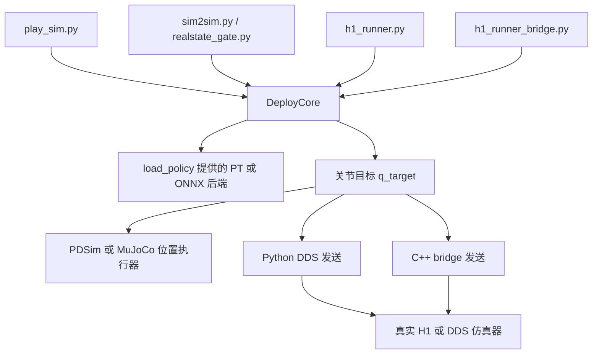
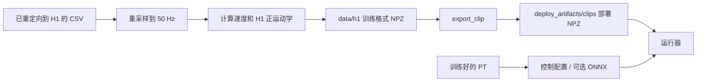
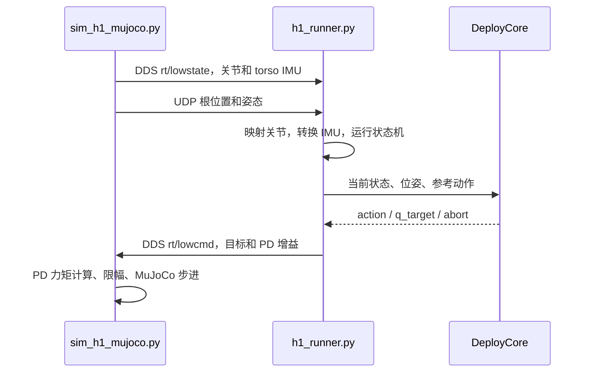
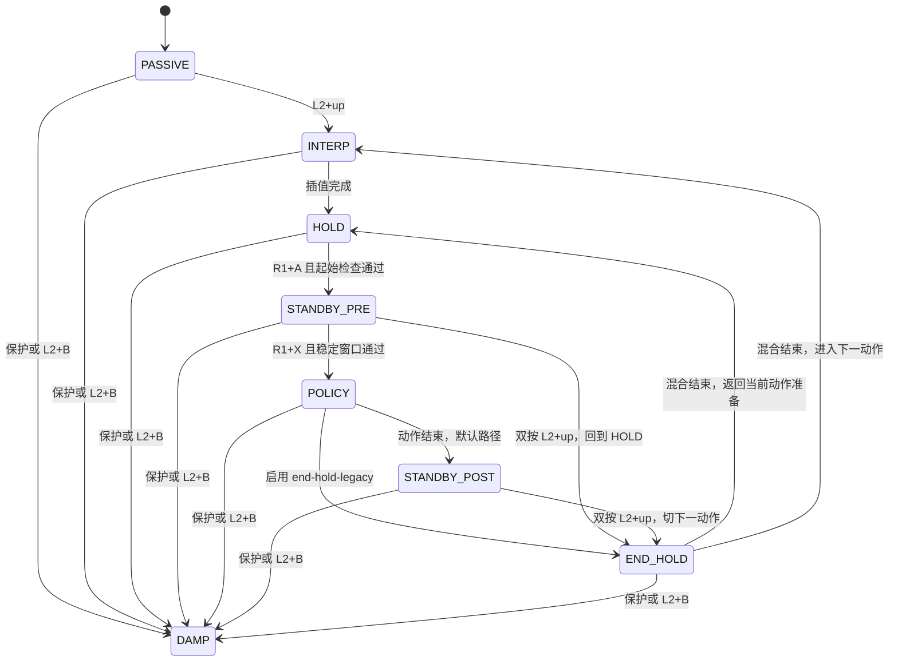

# H1 SuperMimic Deploy：流程、推理链路与代码阅读指南

本文根据 2026-11-11 工作区中的代码整理，面向标准 **19 关节 Unitree H1**。重点解释数据如何进入策略、策略如何控制仿真或实机，以及不同入口为什么会产生不同结果。

本文属于代码解析：核对了源码、配置和部分 NPZ 文件头，没有执行策略推理、物理仿真、DDS 通信、C++ 编译或真机控制。下文的默认值是代码默认值，不代表实测性能或硬件标定结果。代码中的算法意图与静态检查发现的实现限制分别说明。

## 阅读导航

| 想弄清的问题 | 对应章节 |
|---|---|
| 仓库整体在做什么，几个入口是什么关系 | 1、2 |
| 19 个关节、630/489 维输入、坐标系是什么意思 | 3、5 |
| CSV、原始 NPZ、部署 NPZ、PT、ONNX 如何关联 | 4 |
| 神经网络输出如何变成机器人运动 | 5、6 |
| 直接仿真、DDS 仿真、评估脚本各自怎么运行 | 7、8、9 |
| 实机的启动、待机、动作和停止流程 | 10 |
| C++ bridge 与 Python 运行器有什么区别 | 11 |
| 如何从实机日志继续仿真，辅助工具有什么用 | 12、13 |
| 参数在哪改、日志怎么看、命令怎么写 | 14、15、16 |
| 当前代码有什么容易踩到的问题 | 17 |
| 推荐按什么顺序读源码和定位问题 | 18 |

## 1. 仓库整体解决的问题

这是一个从训练工程中抽取出来的部署工程。它接收已经训练好的策略和 H1 参考动作，在 CPU 上执行推理，再把策略输出交给 MuJoCo 或真实机器人的低层接口。

运行时的主要关系是：

```text
参考动作文件 ──提供未来目标──────┐
                              ↓
机器人状态 ──构建历史观测──→ 策略网络 ──→ 19 维动作
    ↑                                           ↓
    └──── 物理运动 ← PD/电机接口 ← 关节目标与限幅 ─┘
```

它是一个闭环动作跟踪系统：每一步都会重新读取机器人实际状态，并结合未来参考动作决定下一组关节目标。参考动作中的关节角不会在策略模式下被逐帧原样下发。

需要区分三个对象：

- **参考动作**：描述希望机器人做什么，包括关节运动、根部位姿和速度等。
- **策略权重**：把当前状态与参考目标转换为控制动作的神经网络参数。
- **物理机器人/仿真模型**：接受关节目标和 PD 参数，产生实际运动及状态反馈。

因此，只有 PT 权重不够；运行器还需要部署动作 NPZ 和控制配置。只有动作 NPZ 也不够；闭环控制还需要策略。

当前仓库没有提供完整的策略训练入口。`world_model/dynamics.py` 在这里实际保留的是通用 MLP 定义，策略网络借用它构造编码器和解码器。不能因为目录叫 `world_model`，就认为每次部署推理都在运行世界模型预测、MPC 或在线学习。

## 2. 目录、入口与复用关系

### 2.1 目录分工

```text
H1_SuperMimic_Deploy/
├── checkpoints/ckpt_latest.pt          策略权重
├── data/h1/                           训练格式的参考动作 NPZ
├── deploy_artifacts/
│   ├── ckpt_latest/deploy_config.json  部署控制配置及 PT 路径
│   ├── ckpt_latest/policy.onnx         可选的 ONNX 策略
│   ├── clips/                         预计算后的部署目标表
│   ├── models/                        位置/力矩控制场景及 meshes
│   └── reports/                       运行评估后生成的结果
├── h1_data/                           原始 H1 模型资产
├── src/h1_deploy/
│   ├── robots/h1.py                   关节顺序、模型、控制常量
│   ├── data/                          动作转换和格式校验
│   ├── policy/nets.py                 策略网络结构
│   ├── world_model/dynamics.py        策略使用的通用 MLP
│   └── deploy/
│       ├── core.py                    观测、目标、动作缩放、保护
│       ├── policy.py                  PT/ONNX 后端加载
│       ├── anchor.py                  相对 torso 位姿、UDP 位姿输入
│       ├── models.py                  构造/加载 MuJoCo 场景
│       ├── imu_model.py               可选的 IMU 饱和压力模型
│       └── export.py                  导出配置、动作、ONNX、场景
├── scripts/
│   ├── run_sim2sim.sh                 调用 play_sim.py
│   ├── run_sim2real.sh                调用 h1_runner.py
│   ├── run_sim2real_bridge.sh         调用 bridge/h1_runner_bridge.py
│   ├── data/csv_to_npz_batch.py       批量转换 CSV
│   └── deploy/                       仿真、运行器、评估和辅助工具
└── docs/                              使用说明及本文
```

文件链接：[README](../README.md)、[提取记录](EXTRACTION.md)、[打包与依赖](../pyproject.toml)。

### 2.2 各运行入口的职责

| 入口 | 环境 | 是否推理 | 状态来源 | 输出去向 |
|---|---|---:|---|---|
| `play_sim.py` | 单进程 MuJoCo | 是 | 直接读取 MuJoCo | `PDSim` 的目标队列 |
| `sim2sim.py` | CPU 仿真评估 | 是 | 直接读取 MuJoCo，可施加观测模型 | 仿真执行器、报告 |
| `sim_h1_mujoco.py` | DDS 仿真器 | 否 | 自身的物理模型 | DDS 状态及可选 UDP 位姿 |
| `h1_runner.py` | DDS 仿真或实机 | 是 | DDS 低层状态及外部位姿 | DDS `rt/lowcmd` |
| `h1_runner_bridge.py` | DDS 仿真或实机 | 是 | C++ bridge 快照及外部位姿 | 本地 socket，再由 bridge 发 DDS |
| `realstate_gate.py` | 从日志状态启动仿真 | 是 | 日志初始化后读取 MuJoCo | 仿真执行器、JSON 结果 |
| `check_robot.py` | 只读检查 | 否 | DDS 状态 | 终端诊断 |

**`run_sim2sim.sh` 调用的是 `play_sim.py`，不是 `sim2sim.py`。**前者是交互式查看策略效果的入口，后者是实验评估入口。

### 2.3 哪些部分是共享的



这些入口复用的是 **观测构造、参考目标、网络调用、动作转换和部分保护规则**。初始化、低层执行、运行状态机、时钟、通信和保护触发后的处理并不完全相同。

## 3. 机器人维度、关节顺序与坐标系

主要代码：[robots/h1.py](../src/h1_deploy/robots/h1.py)、[robot_dimensions.py](../src/h1_deploy/robot_dimensions.py)、[h1_common.py](../scripts/deploy/h1_common.py)。

### 3.1 19 个受控关节不等于完整仿真状态只有 19 维

标准 H1 的受控关节是左腿 5、右腿 5、torso yaw 1、左臂 4、右臂 4。

MuJoCo 模型还有一个自由根关节：

- `qpos`：根位置 3 + 根四元数 4 + 关节角 19 = **26 维**。
- `qvel`：根线速度 3 + 根角速度 3 + 关节速度 19 = **25 维**。
- 策略动作：只控制 19 个实际关节，因此为 **19 维**。

根位置没有对应的电机可以直接控制；机器人通过关节力矩、接触和重力产生根部运动。

### 3.2 策略关节顺序与硬件槽位

策略顺序由 `H1_JOINT_NAMES` 定义，不能直接当成 DDS 电机数组下标。

| 策略下标 | 关节名 | GO 电机槽位 |
|---:|---|---:|
| 0 | left_hip_yaw_joint | 7 |
| 1 | left_hip_roll_joint | 3 |
| 2 | left_hip_pitch_joint | 4 |
| 3 | left_knee_joint | 5 |
| 4 | left_ankle_joint | 10 |
| 5 | right_hip_yaw_joint | 8 |
| 6 | right_hip_roll_joint | 0 |
| 7 | right_hip_pitch_joint | 1 |
| 8 | right_knee_joint | 2 |
| 9 | right_ankle_joint | 11 |
| 10 | torso_joint | 6 |
| 11 | left_shoulder_pitch_joint | 16 |
| 12 | left_shoulder_roll_joint | 17 |
| 13 | left_shoulder_yaw_joint | 18 |
| 14 | left_elbow_joint | 19 |
| 15 | right_shoulder_pitch_joint | 12 |
| 16 | right_shoulder_roll_joint | 13 |
| 17 | right_shoulder_yaw_joint | 14 |
| 18 | right_elbow_joint | 15 |

GO 消息数组有 20 个槽位，槽位 9 不启用。接收状态和发送命令都必须应用映射。`sim_h1_mujoco.py` 也按这个映射模拟机器人，所以 DDS 仿真能覆盖这部分适配逻辑。

### 3.3 坐标和单位约定

| 量 | 代码约定 |
|---|---|
| 位置 | 米 |
| 关节角、关节角速度 | rad、rad/s |
| 运行时根四元数 | `wxyz` |
| 普通无表头 CSV 的四元数 | `xyzw`，转换阶段再换序 |
| `root_lin_vel_w` | 世界坐标系根线速度 |
| `root_ang_vel_w` | 世界坐标系根角速度 |
| 策略的 `gyro` | pelvis 局部坐标系角速度 |
| `projected_gravity` | 世界重力方向 `[0,0,-1]` 转到 pelvis 坐标系 |
| 目标中的根线速度 | 去除根航向后的 heading 坐标系线速度 |
| anchor 输入的根位姿 | 已与当前参考动作对齐的世界坐标系位姿 |

`Robot.set_state()` 接收世界系根角速度后，会转成 MuJoCo free joint 使用的局部角速度。`Robot.state()` 返回的角速度已经是策略需要的 pelvis 局部量。

## 4. 离线数据准备与导出

### 4.1 数据流水线



这里的 CSV 转换接收的已经是 H1 根轨迹和 19 个关节角。它没有实现从原始人体视频或人体骨架到 H1 的完整重定向算法。

### 4.2 CSV 转训练格式 NPZ

入口：[csv_to_npz_batch.py](../scripts/data/csv_to_npz_batch.py)。实现：[motion_convert.py](../src/h1_deploy/data/motion_convert.py)。

转换步骤为：

1. 读取 CSV，统一成 `根位置 3 + 根四元数 4 + 关节角 19` 的 26 列格式。
2. 对带 BONES 表头的数据，将厘米转米、角度转弧度、根 Euler 角转四元数，并按 H1 关节名排序。
3. 位置和关节角做线性插值，四元数按最短路径做球面插值。
4. 默认重采样到 50 Hz，即每 20 ms 一帧。
5. 对位置和关节角求数值导数；根角速度用旋转差分计算。
6. 将每帧根状态和关节状态放入 H1 模型，执行正运动学，得到各 body 的位置、姿态和速度。
7. 校验后保存 NPZ，并输出转换清单。

这里的正运动学用于求各连杆状态，不是在验证动作的接触动力学或平衡能力。

主要原始 NPZ 字段：

| 字段 | 形状 | 含义 |
|---|---|---|
| `joint_pos` / `joint_vel` | `(T,19)` | 关节角和角速度 |
| `body_pos_w` | `(T,B,3)` | 各 body 世界系位置 |
| `body_quat_w` | `(T,B,4)` | 各 body 世界系姿态，wxyz |
| `body_lin_vel_w` / `body_ang_vel_w` | `(T,B,3)` | 各 body 世界系速度 |
| `body_names` | `(B,)` | body 数组的名字顺序 |
| `fps` | 单值 | 采样率 |
| `joint_names`、机器人身份字段 | 元数据 | 识别模型、关节顺序和资产 |

格式检查位于 [motion_format.py](../src/h1_deploy/data/motion_format.py)。它检查采样率、维度、有限值、四元数范数、body 名称和可用的机器人身份字段。校验通过表示数据格式满足约定，不等于动作能稳定执行。

### 4.3 为什么还要导出部署 NPZ

运行时每 20 ms 都要取未来多帧目标。如果每次都从所有 body 状态重新计算目标特征，会增加实时路径的工作量。

[export.py](../src/h1_deploy/deploy/export.py) 中的 `export_clip()` 预先把每帧压成 **48 维目标特征**：

| 切片，右端不含 | 内容 | 维度 |
|---|---|---:|
| `0:19` | 参考关节角减默认关节角 | 19 |
| `19:38` | 参考关节角速度 | 19 |
| `38:41` | 参考 pelvis 的投影重力 | 3 |
| `41:44` | 参考 pelvis 局部角速度 | 3 |
| `44:47` | 参考 heading 系线速度 | 3 |
| `47:48` | 参考根高度 | 1 |

部署 NPZ 额外保留 `joint_pos`、`proj_grav`、`root_pos`、`root_quat_wxyz` 等数据，分别供初始姿态、保护、anchor 和评估使用。组合动作的 `segment_*` 元数据也会被传递。

当前工作区有 47 个原始动作 NPZ 和 47 个部署 NPZ。只读取文件头即可确认，示例 `walk1_subject1` 有 13066 帧，目标表为 `(13066,48)`；其首尾采样时间差是 `(13066-1)/50 = 261.3 s`。因此，播放完整示例动作并不只是几秒钟。

`data_manifest.json` 记录了动作来源、权重校验和以及训练动作匹配情况；它不是仿真效果报告。

### 4.4 PT、ONNX 与配置的关系

[policy.py](../src/h1_deploy/deploy/policy.py) 的 `load_policy()` 采用以下规则：

```text
传入策略目录 → 查找目录中的 policy.onnx
    ├─ ONNX 存在 → OnnxPolicy
    └─ ONNX 不存在 → 读取 deploy_config.json 的 policy_checkpoint → TorchPolicy

直接传入 .pt → TorchPolicy
直接传入已存在的 .onnx → OnnxPolicy
```

PT 后端在 CPU 加载 checkpoint，用 checkpoint 中的网络配置重建 `Policy`，加载权重，切换到 `eval()` 并使用 `torch.inference_mode()`。

ONNX 后端使用 ONNX Runtime 的 `CPUExecutionProvider`，接口约定为 `obs`、`goal` 输入与 `action` 输出。两个后端都执行前向推理，不更新参数。

默认策略目录是 `deploy_artifacts/ckpt_latest`，JSON 中的 PT 路径是相对该 JSON 所在目录解析的：

```text
../../checkpoints/ckpt_latest.pt
```

如果同时存在 ONNX 和 PT，运行入口会优先使用 ONNX。只替换 PT 不会自动让旧 ONNX 失效。切换策略时需要同时检查实际选中的后端、部署配置与动作格式。

### 4.5 export 的几个子任务

| `--cmd` | 作用 |
|---|---|
| `config` | 从 H1 常量、模型和 checkpoint 信息生成部署配置，记录权重路径 |
| `clips` | 将训练格式 NPZ 导出为部署目标表 |
| `models` | 生成位置控制和力矩控制场景，复制 meshes |
| `onnx` | 将策略导出为 ONNX，并检查 ONNX 模型结构 |
| `all` | 依次执行上述任务 |

重新生成 `config` 会按代码中的常量写配置；手工调整过的 JSON 应单独保留实验版本。ONNX 结构检查也不等于已经完成 PT/ONNX 数值一致性或完整闭环验证。

## 5. 一次策略推理具体做了什么

核心实现：[core.py](../src/h1_deploy/deploy/core.py)，主要入口 `DeployCore.step()`。

### 5.1 推理输入与输出

```text
q[19], dq[19], gyro[3], pelvis_quat[4], root_pos[3]
    │
    ├─ observation() → obs[630]
    ├─ goal()        → future_goal[480]
    └─ anchor        → relative_torso_pose[9]

policy(obs[630], goal[489]) → action[19]
targets(action, q, dq)     → q_target[19]
```

四元数和根位置不直接作为完整向量拼进 630 维观测：四元数用于计算投影重力与 anchor，根位置用于 anchor。

### 5.2 单帧观测是 63 维

```text
obs_frame = [q - q_default, dq, gyro, projected_gravity, last_action]
               19          19    3          3              19
```

这里的 `last_action` 是上一次网络的动作，经异常处理后保存的动作向量，不是限幅后的 `q_target`，也不是实际电机力矩。

第一次推理没有 10 帧历史，代码把第一帧重复 10 次初始化历史；之后每一步移除最旧帧，加入最新帧。

### 5.3 630 维的展开顺序很关键

内部 `hist` 的形状为 `(10,63)`，每行是一帧；但输入网络时采用 **按特征项分组的历史展开**：

```text
[10 帧关节位置偏差,
 10 帧关节速度,
 10 帧 pelvis 角速度,
 10 帧投影重力,
 10 帧历史动作]
```

各组内部从旧到新排列。这与直接对 `(10,63)` 调用 `reshape(-1)` 的逐帧展开不同。即便最终长度同为 630，排列错误也会让网络读到错误语义。

日志中的 `obs_hist` 保存的是内部逐帧历史，使用它复核网络输入时应再次按 `observation()` 的分组逻辑展开。

### 5.4 未来目标为何是 480 或 489 维

假设调用 `step()` 前内部参考帧为 `k`，目标窗口是：

```text
clip.goal[k+1], clip.goal[k+2], ... , clip.goal[k+10]
```

每帧 48 维，共 `10 × 48 = 480` 维。超出动作末尾的索引被截到最后一帧，不做环绕播放。

当前配置 `anchor_obs=true`，再附加 9 维动态 torso 相对位姿，形成 489 维。网络约每步看到未来 20～200 ms 的参考信息。

### 5.5 anchor 9 维如何计算

实现：[anchor.py](../src/h1_deploy/deploy/anchor.py)。

代码用 H1 正运动学分别求出当前机器人 torso 和参考帧 `k+1` 的 torso 世界位姿：

```text
当前根位姿 + 当前关节角 → robot_p, robot_R
参考根位姿 + 参考关节角 → ref_p, ref_R

p_rel = robot_R.T @ (ref_p - robot_p)
R_rel = robot_R.T @ ref_R
anchor = concatenate(p_rel, R_rel[:, :2].reshape(6))
```

前 3 维是机器人 torso 坐标系中的参考 torso 位置误差；后 6 维是相对旋转矩阵前两列的逐行展开。单位相对旋转编码为 `[1,0,0,1,0,0]`。

这个特征提供了全局位姿误差的局部表达。只有 IMU 姿态和关节角，无法据此得到根部世界位置，因此当前策略的实机入口需要额外位姿反馈。

还有一个容易忽略的依赖：即使在实机上，当前 anchor 实现也会调用 CPU MuJoCo 做正运动学。这里没有推进仿真物理，但仍需要 H1 模型资产与 MuJoCo 库。

### 5.6 神经网络结构

实现：[nets.py](../src/h1_deploy/policy/nets.py)。计算结构为：

```text
goal → 固定尺度归一化 → MotionEncoder MLP → tanh → latent z
obs  → 固定尺度归一化 ────────────────────────────┐
                                               ↓
                          concatenate(z, obs) → Decoder MLP → action
```

`PolicyCfg` 的默认编码器与解码器隐藏层为 `(2048,1024,512,256)`，默认 latent 为 32 维；**实际加载的 PT 结构以 checkpoint 的 `config['policy']` 为准**，不能仅看类默认值。

默认观测尺度对关节速度除以 5、角速度除以 2；目标也有对应的固定尺度。归一化写在网络内部，不应在外部未经核对重复缩放。

编码器 latent 使用 `tanh`，最终 action 输出没有在这里统一压成 `[-1,1]`。动作幅度由后面的保护和目标转换逻辑处理。

### 5.7 动作怎样转成关节目标

首先计算：

```text
q_raw = q_default + action_scale * action
```

仓库默认每个关节的 `action_scale` 为 0.25。这里的基准是默认关节角，不是当前参考帧的关节角。

举例：某关节默认角度为 `-0.4 rad`，网络输出为 `2`，尺度为 `0.25`，则限幅前目标为 `0.1 rad`。该目标之后还可能被修改。

启用目标力矩限幅时，代码根据当前测得的 `q,dq` 限制目标：

```text
tau_bound = torque_clamp_factor * effort_limit
q_lower = q + (-tau_bound + kd*dq) / kp
q_upper = q + ( tau_bound + kd*dq) / kp
q_target = clip(q_raw, q_lower, q_upper)
```

这是根据当前采样状态限制估计 PD 力矩需求。它不是对下一段时间所有实际力矩的严格保证；低层 PD 继续运行时，状态还会变化，仿真执行器还会有独立饱和。

如果启用了软关节范围限制，再把目标夹到软范围。默认 `clamp_soft_limits=False`；启动/结束姿态的软限位处理是运行器另外执行的步骤。

### 5.8 保护、帧号与返回值

`step()` 大致顺序：

1. 检查 IMU 有限值、四元数范数、相对参考的倾斜误差、关节速度及状态有效性。
2. 更新观测历史，构造未来目标和 anchor。
3. 调用策略，检查动作形状、有限值和幅度。
4. 转成关节目标并限幅，保存上一动作。
5. 若 `advance=True`，内部参考帧加一。
6. 返回 `StepResult`：目标、动作、帧号、结束标志、保护原因、限幅关节数。

`abort` 是返回的原因标记。`DeployCore` 不直接发送阻尼命令，且 `_check()` 返回原因后并不一定跳过本次网络计算。调用者决定停止、进入 DAMP，还是仅记录问题继续评估。

返回的 `frame` 通常是加一后的参考帧，而读入的机器人状态来自这次控制步开始时。对齐日志与参考动作时要考虑这一帧差；`realstate_gate.py` 使用 `frame-1` 恢复初始参考索引。

### 5.9 静态待机仍然在推理

`static_clip()` 提取某个参考帧，把目标里的关节速度、角速度和线速度清零，并保留姿态、根位置、高度等信息，生成两帧相同的静态参考。

待机时调用 `step(..., advance=False)`，参考帧保持不变，但每次仍更新观测、执行网络并更新动作。因此 `STANDBY_PRE/POST` 是策略维持静态参考，和固定 PD 的 `HOLD` 不同。

`switch_clip()` 改变参考但保留观测历史和上一动作，使“静态待机 → 动作 → 静态待机”交接不必重新填充历史。进入一轮新的策略控制时才创建/重置核心。

## 6. 策略、PD、物理仿真与通信的时间关系

### 6.1 需要区分四类频率

| 层级 | 当前典型值 | 控制什么 |
|---|---:|---|
| 参考动作/策略控制 | 50 Hz | 每 20 ms 生成一次新动作目标 |
| G2/G3/直接回放默认物理子步 | 1000 Hz | 每 1 ms 更新 PD 力矩和物理状态 |
| 训练场景对照 `parity` | 200 Hz 物理步进 | 每个 20 ms 控制周期执行 4 个 5 ms 子步 |
| 运行器 DDS 命令定频发送 | 默认 500 Hz | 重发最近目标，提高命令刷新和保护响应频率 |

500 Hz 发包不意味着网络每秒推理 500 次。发送线程通常反复发送最近一次 50 Hz 推理给出的目标；策略更新后还会立即发送，因此实际消息统计也可能略高于定频值。

上表中的低层频率描述本仓库的仿真实现和命令发送配置，不是在声明真实电机固件的内部控制频率。

### 6.2 PD 怎样产生力矩

仿真力矩控制使用：

```text
tau_requested = kp * (q_target - q) + kd * (dq_target - dq) + tau_feedforward
```

策略运行器通常使用 `dq_target=0`、`tau_feedforward=0`，于是变成：

```text
tau_requested = kp * (q_target - q) - kd * dq
```

`PDSim` 每个子步用最新 `q,dq` 重新算力矩，然后按电机力矩限值裁剪，再写入 MuJoCo 执行器。目标不变时，力矩仍会随机器人实际运动变化。

可以理解为：网络负责较慢地决定“关节目标放在哪里”，PD 负责较快地根据误差产生驱动力。

### 6.3 两类仿真执行器

场景构造见 [models.py](../src/h1_deploy/deploy/models.py)。

- **位置执行器场景**：`h1_train_scene.xml`，MuJoCo 执行器接收关节目标，内部体现位置/速度增益。主要用于 `parity` 对照。
- **力矩执行器场景**：`h1_torque_scene.xml`，MuJoCo 接收显式计算的力矩。`PDSim` 或 DDS 仿真器负责计算 PD，便于加入延迟、增益变化和力矩统计。

内置场景由 `h1_data/h1_training.xml` 添加地面和执行器构成。仅凭文件名中的 `train`，不能认定它与训练工程的全部物理设置完全一致。

## 7. 直接可视化仿真的完整流程

入口：[run_sim2sim.sh](../scripts/run_sim2sim.sh) → [play_sim.py](../scripts/deploy/play_sim.py)。

### 7.1 初始化

1. 解析策略目录、动作、场景、运行时长、延迟和日志路径。
2. 加载 `DeployConfig` 和 `Clip`，要求动作具有根位姿。
3. 加载力矩控制 MuJoCo 场景。
4. 建立 `Robot`：根据关节名字找到 MuJoCo 的 qpos/qvel 地址和执行器索引。
5. 用参考第一帧根位置、姿态和关节角设置模型。
6. 通过 `place_on_ground()` 调整根高度，让足底最低碰撞位置贴到地面。
7. 创建 `PDSim`、策略后端和 `DeployCore`。
8. 没有 `--headless` 时启动 MuJoCo viewer。

这里没有把参考第一帧速度传给 `set_state()`，因此初始速度默认归零。它与 `parity` 的参考速度初始化不同。

### 7.2 每个控制周期

```python
# 逻辑示意，省略参数解析、日志和异常处理
state = robot.state()
result = core.step(*state, root_pos=robot.root()[0])
if result.abort:
    break
sim.command(result.q_target, latency_ms)
for _ in range(round(control_dt / model.opt.timestep)):
    sim.step_ms(record=False)
viewer.sync()  # 有窗口时
```

有窗口时会尽量按控制周期等待，让播放接近实时。headless 模式不做这个展示等待，通常按计算能力推进仿真，仿真时间不等于墙钟时间。

### 7.3 结束与输出

运行完整动作、达到 `--seconds` 限制、触发核心保护或关闭 viewer 都可能结束回放。保存的 NPZ 包含 `qpos`、`action`、`q_target`。

这里记录的 `qpos` 是这一控制步物理推进之前的状态，保存的是将要施加的动作；不是所有控制周期内的 1 kHz 状态采样。

### 7.4 适合验证什么

适合快速确认权重和动作能否加载、观察跟踪表现、检查动作期间的保护原因。它没有完整执行 `PASSIVE → INTERP → HOLD → STANDBY_PRE`，也没有覆盖 DDS 状态包、线程调度或真实传感器适配。

因此，“直接回放看起来正常”只说明该初始化与配置下的闭环仿真表现，不能直接推出完整实机启动链路也正常。

## 8. DDS 仿真：用虚拟机器人连接真实运行器

入口：[sim_h1_mujoco.py](../scripts/deploy/sim_h1_mujoco.py)，配合 [h1_runner.py](../scripts/deploy/h1_runner.py) 或 bridge 运行器。

### 8.1 两个进程各做什么



仿真器不加载策略权重。`--clip` 在仿真器里只用于初始化；真正选择未来动作并推进参考帧的是运行器。

### 8.2 仿真器的循环

仿真器启动后建立 `rt/lowstate` 发布者和 `rt/lowcmd` 订阅者。收到命令时：

1. 检查 CRC。
2. 按 `JOINT_TO_MOTOR` 提取 19 个关节的 `q,dq,kp,kd,tau`。
3. 检查有限值，处理没有使能的电机。
4. 缓存最近命令及接收时间。

物理循环中：

1. 根据支撑标志文件计算可选的吊架力。
2. 若已经收到命令，计算并裁剪 PD 力矩，然后执行 `mj_step()`。
3. 将关节状态重新填回 GO 的 20 槽位消息。
4. 读取场景中的 torso IMU 传感器，写入状态消息。
5. 注入文件指定的按键或温度，更新 tick 和 CRC，发布状态。
6. 可选发送 UDP 根位姿、记录日志、刷新窗口。

**第一条控制命令到达之前不推进物理步，但会发布状态**，让运行器能够完成启动时的订阅和检查。第一条命令通常是 PASSIVE 阻尼命令，而不是动作策略输出。

最近命令超过 0.1 秒未更新时，仿真器使用 `-3*dq` 的阻尼力矩。这是仿真器自己的命令超时处理，与运行器内部的 stale/heartbeat 检查分别存在。

### 8.3 支撑、按键与温度注入

| 接口 | 作用 |
|---|---|
| `--band-file` | 文件存在时启用弹性支撑；运行器可创建/删除它 |
| `--band-length` | 支撑绳的参考长度，默认 1 m |
| `--buttons-file` | 文件内容如 `L2+up`，被编码进遥控器状态 |
| `--temp-file` | 每行给出硬件电机槽位、基础温度、升温速率 |
| `--motor-temp` | 未被注入覆盖时的基础模拟温度 |
| `--viewer` | 是否打开可视化窗口 |
| `--log-tau` | 开启后提高日志记录频率，保存物理循环中的力矩信息 |

温度是可控测试输入，没有在此实现电机的真实热动力学。支撑也只是弹簧/阻尼近似，不是实际吊架的完整机械模型。

手动按键需要释放后重新按下才能再次触发；控制器带有去抖动和重新就绪逻辑。使用 `--auto-sequence` 时，运行器按状态自动产生事件，但仍检查启动条件。

### 8.4 torso IMU 为什么要转换

GO 接口提供 torso IMU，而策略观测需要 pelvis 角速度和姿态。torso 相对 pelvis 还存在 `torso_joint` 的 yaw 转动。

`h1_common.pelvis_imu()` 用 torso 关节角构造旋转 `Rz`：

```text
R_world_pelvis = R_world_torso @ Rz.T
gyro_pelvis = Rz @ gyro_torso - [0,0,dq_torso]
```

因此，不能只把 torso 四元数和角速度重命名为 pelvis 就输入策略。DDS 仿真发布 torso 传感器，让控制器走与实机相同的转换代码。

### 8.5 当前 anchor 策略还有一条 UDP 位姿链路

当前实现中，策略状态组合为：

- 关节角、关节速度：来自 GO 状态映射。
- pelvis 角速度：来自 torso IMU 转换。
- 传入核心的 pelvis 姿态与根位置：启用 anchor 时来自 UDP 位姿流。

这里不是把所有状态都替换成 UDP，而是组合了多个来源。部分运行器启动与待机检查仍读取 GO 转换后的姿态，所以两套反馈应在时间和坐标上对应。

UDP 数据报格式见 [ANCHOR_POSE.md](ANCHOR_POSE.md)：

```json
{
  "time_unix_s": 1794300000.0,
  "frame_id": "reference",
  "root_pos": [0.0, 0.0, 1.0],
  "root_quat_wxyz": [1.0, 0.0, 0.0, 0.0]
}
```

上面的时间与位姿只是格式示例。实际数据需要实时更新、四元数归一化，并对齐当前参考动作的原点和航向。

`PoseReceiver` 检查数据形状、有限值、时间戳顺序、`frame_id` 和四元数范数；默认拒绝超过 0.1 秒的旧位姿及超过 20 ms 的未来时间偏差。它不执行位置估计，也不自动做坐标对齐。运行器缺少位姿监听配置时拒绝初始化；运行中读不到有效位姿时转为 DAMP。

### 8.6 DDS 仿真与直接回放的主要差别

| 项目 | 直接回放 | DDS 仿真联调 |
|---|---|---|
| 进程 | 一个主要 Python 进程 | 仿真器与控制器分开 |
| 推理 | `play_sim.py` 内直接执行 | 运行器执行 |
| 状态 | 直接读取 pelvis 仿真状态 | GO 消息、映射、IMU 转换、UDP 位姿 |
| 初始化 | 参考第一帧并贴地 | 仿真器初始化后再走运行器状态机 |
| 启动过程 | 直接进入策略 | PASSIVE、插值、HOLD、策略待机 |
| 命令执行 | 仿真时间队列 | 实际进程调度与通信 |
| 时间 | headless 可以快于实时 | 使用墙钟调度，受主机负载影响 |
| 可验证范围 | 策略物理表现 | 控制器、接口、状态机与物理表现 |

## 9. sim2sim.py：自动化实验与指标统计

入口：[sim2sim.py](../scripts/deploy/sim2sim.py)。它自己加载模型、动作和策略并执行实验，不依赖正在运行的 DDS 仿真器，也不是单纯读取 DDS 日志打分。

### 9.1 公共仿真组件

| 组件 | 用途 |
|---|---|
| `Robot` | 按名字访问关节与执行器，设置根状态，读取策略顺序状态，计算贴地高度 |
| `PDSim` | 保存待生效目标，模拟命令延迟，每毫秒计算 PD 与力矩饱和 |
| `StepStats` | 记录每个策略步的动作幅度、速度比例、目标限幅等 |
| `PeakTracker` | 在 1 kHz 子步上统计速度峰值，发现 50 Hz 采样可能漏掉的峰值 |
| `Recorder` | 保存网络实际接收的 obs/goal，用于一致性对照 |
| `ImuModel` | 可选地模拟陀螺仪饱和及姿态积分误差 |

`play_sim.py` 导入 `Robot/PDSim`，DDS 仿真器导入 `Robot`。导入这些类不会自动执行评估入口，评估只在脚本的 `main()` 被调用时运行。

### 9.2 G2：动力学扰动和低层执行差异

流程为：

```text
选择策略、动作与 G2 变体
  → 为每组延迟/增益/质量/摩擦建立独立实验
  → 第一帧姿态初始化、贴地、速度归零
  → 显式 PD + 力矩限制 + 50 Hz 策略
  → 记录跟踪误差、跌倒、保护、力矩和速度指标
```

基础扫描范围：

| 变量 | 默认值 |
|---|---|
| 命令延迟 | 0、5、10、20 ms |
| Kp 比例 | 0.85、1.0、1.15 |
| torso 额外质量 | 0、1.8 kg |
| 摩擦系数 | 0.6、1.0 |

仅基础 `g2` 变体，每个动作每个策略就有 `4×3×2×2=48` 组实验。未指定 `--g2` 时会执行全部配置的 G2 变体，实验量还会增加。

变体包括开始前保持 0.5 秒、假设硬件裁剪目标到硬关节范围、改变髋 roll 力矩上限、改变目标力矩限制倍数等。它们用于比较不同假设，不能把所有变体都看作当前硬件的已知事实。

主要指标包括：关节跟踪 RMSE、跌倒时刻、最大倾斜角、相对参考倾斜误差、目标限幅次数、力矩需求/限值比例、实际饱和统计、速度峰值和位移误差。

代码中一般跌倒判据为 pelvis 高度低于 0.5 m 或绝对倾斜大于 60°；训练对照的终止判据另有定义。报告里的 `abort` 与 `fall` 因而不是同一个概念。

### 9.3 G3：启动和结束过渡

G3 重点检查类似以下的流程：

```text
默认站姿 → 4 秒插值到动作首帧 → 1 秒 HOLD
    → 切换到策略与策略增益 → 动作执行
    → 结束目标/增益过渡 → 站姿保持
```

它比较支撑、悬吊、延迟、目标力矩倍数、结束时直接切换或渐变等条件，记录过渡瞬间的力矩跳变、跌倒阶段和保护触发。

G3 包含原部署方案的过渡实验。当前运行器默认结束后进入 `STANDBY_POST`；不能把每个 G3 变体都当作当前运行器的逐行复现。当前“策略待机 → 动作 → 策略待机”流程应同时看 `standby` 实验。

`g3_jobs()` 中一部分任务使用首个动作 `IDLE`，另一部分按动作集合生成分阶段任务。多动作参数不意味着每一种 G3 变体都会对所有动作执行完全相同的组合。

### 9.4 standby：策略接管前后的稳定性

主要流程：

1. 支撑下插值到动作首帧并 HOLD。
2. 放开支撑，策略跟踪首帧的静态参考。
3. 检查模拟 R1+X 的稳定窗口；没有通过时继续等待至上限。
4. 保留历史，切换为动态动作参考。
5. 动作结束后保留历史，切换为末帧静态参考。
6. 统计前后待机漂移、倾斜、关节速度及切换力矩跳变。

这能区分“动态动作可以完成”和“在起始/结束姿态能持续站稳”。并非所有动作的第一帧和最后一帧都适合作为长期静态待机目标。

### 9.5 parity：与训练环境轨迹对照

`parity` 使用位置控制场景，按参考根位姿、关节位置以及参考速度初始化，每次策略推理后推进 4 个 5 ms 子步。

训练工程需要事先生成参考轨迹文件，典型路径是：

```text
deploy_artifacts/reports/sim2sim/ref_<prefix><ckpt>_no-tf32.npz
```

另可提供 `_tf32.npz`。评估比较首步观测/目标/动作、关节与根轨迹、RMSE、终止结果和分叉时刻。独立部署仓库不能凭空生成训练环境的实际运行轨迹。

这类对照的前提是场景、初始化、关节顺序、目标布局等与训练记录相匹配。`parity` 通过说明所测条件下满足代码判据，不等于所有动作与所有物理参数都一致。

### 9.6 timing、compare、margins、锁定 torso 实验

| 命令 | 作用 |
|---|---|
| `timing`，别名 `g5` | 分别计时完整 `DeployCore.step()` 与纯网络调用，输出 p50/p99/max |
| `compare` | 比较两个场景的质量、关节范围、执行器限值与 IMU 转换等 |
| `margins` | 从训练参考轨迹分析保护阈值余量，依赖参考记录 |
| `lw` / `lw_robust` | 对照 torso yaw 自由/仿真锁定条件下的表现 |
| `report` | 根据当前及已有结果生成 Markdown 汇总 |

`timing` 不做真实 DDS 端到端测量；包含 anchor 的完整核心耗时也会包含相应 FK 计算。历史字段名 `onnx_p50_ms` 在 PT 后端下仍可能出现，应结合 `backend` 字段理解。

`--lock-waist` 是修改仿真模型、焊接 torso yaw 的实验选项。它不是“实机少一个电机”的声明，也不是标准 H1 的部署开关。

### 9.7 评估结果与控制器保护的区别

G2/G3/standby 等实验为了统计失败过程，可能记录 `abort` 后继续施加策略目标；直接回放遇到 `abort` 会停止；实际运行器会转 DAMP。

因此可以出现“评估动作最终没有倒，但中间多次触发保护”的结果。这个结果不意味着同样配置在完整运行器上能够一直执行完动作。

结果文件会按 `tag + ckpt` 复用：脚本先读取已有 JSON，再更新本次执行的项目。用相同 tag 重跑不同动作集合或不同参数时，旧项目可能仍留在文件中；比较实验时应使用独立 tag，并检查报告中各项目实际记录的配置。

## 10. Python 实机运行器的生命周期

实现：[h1_runner.py](../scripts/deploy/h1_runner.py)，协议适配：[h1_common.py](../scripts/deploy/h1_common.py)。同一运行器既可连接 DDS 仿真，也可连接真实 H1。

### 10.1 构造与启动

`Runner.__init__()` 加载配置、动作、策略和可选位姿接收器，创建静态首尾参考，选择保护参数组，准备日志和线程状态。

`startup()` 在开始控制前主要执行：

1. 初始化 DDS、订阅低层状态，等待有效数据。
2. 统计状态速率与 CRC，读取当前关节、IMU、温度。
3. 启动独立的低层命令观察者，检查是否有其他发布者。
4. 实机路径查询官方运动模式；代码不会主动调用 ReleaseMode 接管服务。
5. 对策略做少量预热调用。
6. 输出策略、动作、控制频率、保护参数和启动条件。
7. 实机路径执行代码要求的现场确认，再复查状态和其他命令发布者。
8. 创建命令发布者与线程，从 PASSIVE 阻尼开始。

这些是代码实际存在的启动步骤。本文没有执行该流程，也没有触发任何实机指令。

### 10.2 主状态机

下图为未启用 `--motion-select` 的原按键流程。三动作模式使用 L1+A/X/Y 选择并开始固定 PD 准备；插值结束停在 HOLD，需按 R1+B 并通过原起始检查才进入 STANDBY_PRE，随后 READY→Start 播放。接管失败需松开后重按，不会自动重试；三个动作及返回 default 一致。绑定和事件路由见 `src/h1_deploy/deploy/motion_selection.py`，组合键去抖见 `scripts/deploy/h1_common.py`。

进入 STANDBY_PRE 后新增 `--policy-blend-s` 目标渐变（默认 5 秒，实现在 `src/h1_deploy/deploy/policy_takeover.py`），完成后才累计播放前稳定性与温升窗口。原 KP/KD、保护门槛和输入初始化顺序不变。此功能属于 Python/bridge DDS Runner；批量 `sim2sim.py` 评估尚不覆盖它。last 的无吊架闭环对照仍未通过，结果见 [SIM2REAL.md](SIM2REAL.md)。



| 状态 | 主要行为 | 使用策略网络 |
|---|---|---:|
| `PASSIVE` | `kp=0`、阻尼 `kd=3`，等待开始准备 | 否 |
| `INTERP` | 余弦插值到动作首帧，使用站姿增益 | 否 |
| `HOLD` | 固定首帧目标并检查准备状态 | 否 |
| `STANDBY_PRE` | 策略跟踪首帧静态参考，观察稳定性 | 是 |
| `POLICY` | 参考帧每次推进一帧，执行动态动作 | 是 |
| `STANDBY_POST` | 策略跟踪末帧静态参考 | 是 |
| `END_HOLD` | 从策略增益/目标渐变到站姿保持，可衔接下一段 | 否 |
| `DAMP` | 进入阻尼；本轮控制中不再恢复到其他状态 | 否 |

状态切换是有条件的，不是按键一按就无条件进入下一阶段。

### 10.3 HOLD 与 STANDBY_PRE 的检查

`policy_allowed()` 的默认起始检查包括：HOLD 至少 1 秒、与首帧关节误差小于 0.1 rad、关节速度小于 0.5 rad/s、相对首帧倾斜小于 10°、温度满足要求，以及其他状态有效性条件。

`standby_allowed()` 默认要求：策略待机至少 3 秒，最近 3 秒窗口内倾斜误差小于 8°、最大关节速度小于 1 rad/s，温度满足条件。仿真使用支撑文件时，还检查支撑已解除并等待足够时间。

这样分成两步的意图是：先检查机器人准备姿态，再让策略接管静态平衡，最后才推进动作参考。

### 10.4 站姿增益与策略增益是两套配置

`INTERP/HOLD` 的 KP 使用运行器内的 `STAND_KP`，KD 默认复制当前 `deploy_config.json` 的 `kd`；策略状态使用 JSON 的 `kp/kd`。`END_HOLD` 仍从策略增益渐变到固定 PD 增益。

当前 `last` 固定 PD 的默认 arms Kd 是 2、torso 是 3，与策略配置一致。`--stand-arm-kd`、`--stand-waist-kd` 默认不覆盖；显式传入时只覆盖固定 PD 对应关节。未覆盖的关节会在重新启动后跟随 JSON 的 Kd。

结束过渡还对目标和增益做渐变，以减少切换力矩跳变。固定关节 PD 与策略维持平衡承担的任务不同，因此运行器保留了支撑下返回站姿的流程。

### 10.5 线程与进程分工

```text
DDS 状态回调        更新最新状态、CRC/tick、去抖动按键事件
50 Hz 主循环        状态机、保护、策略推理、目标更新、运行日志
500 Hz 命令线程     发送最新目标、检查状态过期和主循环心跳
独立 watcher 进程   观察 rt/lowcmd 发布流，辅助识别其他控制器
打印线程            消费打印队列，减少终端 I/O 对控制循环的阻塞
```

命令线程可以在主循环暂时变慢时继续发送最近命令，并通过心跳超时进入阻尼。但它仍处于同一 Python 进程，无法保证整个进程失效时继续工作；这也是 C++ bridge 独立进程方案的动机之一。

### 10.6 保护分布在哪几层

| 层 | 检查内容举例 |
|---|---|
| `DeployCore` | 相对参考倾斜、关节速度、IMU 有效性、动作幅度、目标限幅 |
| 主状态机 | 温度、启动姿态、待机窗口、非策略状态绝对倾斜 |
| 命令线程 | 状态包过期、tick 停滞、主循环心跳、连续发送失败、退出信号 |
| 外部命令观察 | 启动前检查其他命令发布者，运行中按接收/发送速率做检查 |
| `PoseReceiver` | 外部位姿格式和时间有效性 |
| DDS 仿真器 | 自身的命令超时阻尼及执行器限幅 |

当前 `STAGES` 默认值如下：

| stage | 速度阈值/关节速度限值 | 原始动作幅度阈值 | 核心目标力矩倍数 | 非策略保持倾斜阈值 |
|---|---:|---:|---:|---:|
| `air` / `feet` | 0.3 | 10 | 0.5 | 0.35 rad |
| `slack` | 0.5 | 15 | 1.0 | 0.5 rad |
| `ground` | 0.8 | 50 | 1.5 | 0.8 rad |

策略内的相对参考倾斜阈值来自 `SafetyCfg.max_tilt_err`，默认 0.35 rad，和上表的非策略绝对倾斜阈值不是同一项。

`--stage` 选择阈值，不会自动施加吊架力，也不会更换权重。命令行 `--max-vel-frac`、`--max-abs-action` 等可以覆盖部分 stage 值。

### 10.7 多动作与连续参考不是同一种机制

`h1_runner.py --clip A.npz B.npz` 会在状态机中切换动作：A 结束后静态待机，按相应流程退出策略、准备 B，再开始 B。

`make_combo_clip.py` 的意图是离线将 A、B 拼成一个有位置/航向对齐和过渡段的长参考，让一次 POLICY 连续运行。两者在历史连续性、坐标对齐、过渡时间和操作者流程上不同。

运行器不会自动为任意两条独立动作完成世界坐标对齐；外部位姿生产者与参考动作仍需采用一致的坐标约定。

## 11. C++ bridge 路径：保留 Python 推理，分离 DDS I/O

入口：[run_sim2real_bridge.sh](../scripts/run_sim2real_bridge.sh) → [h1_runner_bridge.py](../scripts/deploy/bridge/h1_runner_bridge.py)。

### 11.1 数据流

```text
真实机器人 / DDS 仿真器
          ↕ DDS
      h1_bridge（C++ 独立进程）
          ├─ 收状态 → 共享内存快照 + 环形消息记录
          │                  ↓ ctypes client
          │          h1_runner_bridge.py
          │          状态机 + DeployCore + PT/ONNX
          │                  ↓ Unix datagram socket
          └─ 收目标 → 定频 DDS 发布 + watchdog
```

这里没有把神经网络迁移到 C++。Python 仍负责观测、推理、状态机和高层保护；C++ 承担 DDS 收发、CRC、共享内存、固定频率发送与独立 watchdog。

### 11.2 bridge 文件分工

| 文件 | 作用 |
|---|---|
| [h1_bridge.cpp](../scripts/deploy/bridge/h1_bridge.cpp) | DDS 回调、命令接收、发布循环、watchdog |
| [h1_bridge_shm.h](../scripts/deploy/bridge/h1_bridge_shm.h) | 共享内存与命令结构，20 电机槽位、magic/version |
| [h1_bridge_client.cpp](../scripts/deploy/bridge/h1_bridge_client.cpp) | 提供一致性读取共享内存的 C 接口 |
| [h1_bridge_io.py](../scripts/deploy/bridge/h1_bridge_io.py) | 启动 bridge 子进程，ctypes 读取快照，socket 发送命令 |
| [h1_runner_bridge.py](../scripts/deploy/bridge/h1_runner_bridge.py) | Python 控制器及温度相关扩展 |
| [build.sh](../scripts/deploy/bridge/build.sh) | 编译 bridge 可执行文件和 client 动态库 |
| [ro_bridge_check.py](../scripts/deploy/bridge/ro_bridge_check.py) | `listen-only` 检查，不创建控制命令 writer |

共享内存用序列号检查快照读取的一致性；环形记录保留逐消息的时间、tick、按键等信息，并统计读不及造成的丢失。发送方向使用 Unix datagram，最近命令覆盖旧目标。

### 11.3 独立 watchdog 的意义

bridge 首次收到运行器命令后才开始发布控制流。默认运行器超过 100 ms 没有提交命令，bridge 会自行锁定阻尼模式。

检测到父运行器消失或相应退出信号时，bridge 按 `--orphan-s` 默认持续阻尼 10 秒后退出。正常关闭由运行器先完成最后的阻尼发送，再通过 QUIT 命令停止 bridge。

这些是实现中的失联处理，不构成硬实时或完整硬件安全性的证明。运行器与 client/bridge 的共享内存结构必须匹配，应使用本仓库配套编译产物。

### 11.4 bridge 运行器还有温度预测与热停止参考

Python 直连运行器和 bridge 运行器是两套较大的 `Runner` 实现，不只是替换一个 I/O 对象，因此维护时不能默认两者所有附加行为完全相同。

bridge 路径增加：

- 在待机窗口拟合温升率，估计完成动作后的温度，决定是否允许开始。
- POLICY 中达到热停止阈值时，生成一个逐渐停止的参考轨迹并 `switch_clip()`。
- 过渡完成后切换静态参考继续策略待机，而不是立即关闭策略。

温度预测使用类似 `当前温度 + max(升温率,0) × 动作时长` 的线性外推。默认热停止阈值为 65°C、过渡时间为 1 秒，数值是代码设置，未在本文中做硬件验证。

`thermal_stop_clip()` 混合关节目标、重力、高度与根位姿，并构造过渡速度。它是参考轨迹切换策略，不是一个已经证明能在任何姿态下停稳的平衡控制器。

代码内部在热停止过渡期间仍使用 POLICY 状态与附加 thermal 标记；视频同步可以发出 `THERMAL_STOP` 标签，不应把该显示标签误认为 `STATES` 中新增了一个状态编号。

另外，GO 接口的单温度字段被复制成两列兼容旧日志，它们不是两个独立实测传感器。

## 12. 从真实日志状态启动仿真

入口：[realstate_gate.py](../scripts/deploy/realstate_gate.py)。它用于回答：“如果从实际运行时记录的偏差状态重新开始，在某些扰动下策略还能否继续跟踪？”

流程为：

1. 在日志里找到指定 `frame` 且状态为 POLICY 的记录。
2. 用日志中的关节角、关节速度、pelvis 角速度恢复状态。
3. anchor 策略要求日志提供有效 `root_pos` 和 `anchor_quat`。
4. 根线速度仍从参考动作取，输出结果明确标记 `root_velocity_source='reference; not measured'`。
5. 用 `frame-1` 重设核心参考帧，尝试恢复上一行 action 和观测历史。
6. 扫描延迟、增益、额外质量和摩擦，运行指定控制步数。
7. 记录保护原因、是否跌倒、推进步数等结果。

它不是完整物理状态的逐位恢复：没有完整还原接触求解器状态、之前未执行的目标队列、全部传感器时序；缺少历史日志时，核心会采用普通的历史初始化。

因此它适合研究“接近真实偏差状态的恢复能力”，不应称为实机故障的完全确定性重放。

当前按 `frame` 与 POLICY 状态选择行，没有额外按 `clip` 列过滤。多动作或重复运行日志中存在同名帧号时，需要核对选到的是哪条动作记录，优先使用对应单动作日志。

## 13. 辅助工具在整体流程中的位置

### 13.1 组合动作 make_combo_clip.py

设计目的：把多个训练格式动作拼成一条连续参考。

主要算法是：

1. 将下一动作的起始 pelvis XY 和航向，与上一动作末尾对齐。
2. 在两动作间插入余弦权重过渡；根姿态用 SLERP，关节与根位置插值。
3. 可选添加结尾减速段或上身振荡衰减段。
4. 对整条序列重新求速度、执行 H1 正运动学。
5. 生成新 NPZ、分段信息与连续性统计 JSON。
6. 再通过 `export --cmd clips` 生成部署目标表。

对应代码：[make_combo_clip.py](../scripts/deploy/make_combo_clip.py)。当前脚本存在足部 body 名称的 H1 适配问题，见第 17 节；上述是算法流程，不代表这个辅助入口已经能无修改运行到结束。

### 13.2 关节速度处理 cap_joint_velocity.py

[cap_joint_velocity.py](../scripts/deploy/cap_joint_velocity.py) 在速度超阈值的局部窗口，对关节位置做高斯平滑并用平滑权重连接边界，之后重新求关节速度。

目标速度上限是：

```text
cap_frac × max_vel_frac × velocity_limit
```

默认 `0.75 × 0.8 = 0.6` 倍配置速度限值。它修改的是参考动作，不是运行中的机器人命令，也不会自动改变运行器保护阈值。

当前工具只更新 `joint_pos/joint_vel`，保留原 body 状态。要把结果作为完整一致的训练格式数据使用，还需要重新计算正运动学；仅重新导出部署目标表不会补算所有 body 状态。迭代次数有上限，应查看最后报告的实际速度比例，不要仅凭文件成功保存就认为全部峰值已达标。

### 13.3 热停止实验动作 make_thermal_stop_clips.py

[make_thermal_stop_clips.py](../scripts/deploy/make_thermal_stop_clips.py) 调用 bridge 运行器的 `thermal_stop_clip()`，在指定动作帧之后接入停止过渡，再追加静态保持段，输出部署动作供 `sim2sim.py` 评估。

这样可以离线测试“在第 k 帧开始减速并转静态目标”的行为，不需要等待实际电机升温。脚本没有实现真实电机温升模拟。

当前参数默认 `--pose current`。文件顶部部分旧说明仍写 `upright`，阅读时以实际 argparse 定义为准。

### 13.4 视频制作与同步

- [make_source_bg.py](../scripts/deploy/make_source_bg.py)：设计上根据组合动作元数据和用户提供的源视频映射，通过 ffmpeg 制作匹配参考帧的视频。
- [bg_sync_server.py](../scripts/deploy/bg_sync_server.py)：接收运行器通过 `--sync-udp` 发送的 `state clip frame t`，网页根据参考帧播放/暂停/校正视频。

这是展示链路，视频播放器不会把控制指令发回运行器。运行器停止或退出动作时，播放器冻结对应帧。

当前 `make_source_bg.py` 的命令行调用与函数签名存在不一致，见第 17 节。同步服务器与视频制作器是两个独立工具，不能因为前者可以读取视频，就认定后者的 CLI 已经适配完成。

### 13.5 只读检查工具

`check_robot.py` 订阅状态、检查 CRC、显示关节到电机的映射、pelvis IMU、温度和丢包计数，可查询官方运动模式。它不执行策略、不发布控制命令。

`bridge/ro_bridge_check.py` 使用 C++ bridge 的 `listen-only` 模式，主要观察实际接收速率、消息间隔、CRC 和其他发布者。该模式不创建 `rt/lowcmd` writer。

这些工具回答的是通信和数据是否合理，不能直接验证策略跟踪效果。

## 14. 参数在哪里修改，以及哪些参数会相互影响

### 14.1 三层配置来源

```text
运行命令参数
    → 控制本次入口、场景、动作、日志、实验选项

deploy_config.json
    → 策略控制常量、关节顺序、周期约定、anchor 开关、PT 路径

源码常量 / 场景 XML
    → 未暴露为命令行参数的规则、实验网格、模型与执行器
```

命令行参数只覆盖其对应的解析项，并不会自动覆盖所有 JSON 或 XML 内容。需要持久保留一组实验时，可以保存启动命令和独立配置目录，减少手工修改公共默认值造成的混淆。

### 14.2 修改位置速查

| 要改什么 | 位置/接口 | 影响范围 |
|---|---|---|
| 快速回放动作、时长、日志 | `play_sim.py` 的 argparse / `run_sim2sim.sh` 后参数 | 快速回放 |
| DDS domain、网卡、viewer、dt | `sim_h1_mujoco.py` 的 argparse | DDS 仿真器 |
| 实机/DDS 运行器状态机参数 | `h1_runner.py::main()` | Python 直连运行器 |
| bridge 扩展参数 | `bridge/h1_runner_bridge.py::main()` | bridge 运行器 |
| 策略 Kp/Kd | `deploy_config.json` 的 `kp/kd` | 读取该配置的策略路径 |
| 动作尺度与默认角 | JSON 的 `action_scale/default_joint_pos` | 网络输出与观测语义 |
| PT 文件 | JSON 的 `policy_checkpoint` | 没有优先选中 ONNX 时的 PT 后端 |
| 默认关节/电机顺序 | `robots/h1.py` 与 `h1_common.py` | 模型与通信适配 |
| 初始/结束姿态站姿增益 | KP 为运行器的 `STAND_KP`；KD 默认来自当前 JSON，可显式覆盖腰部/手臂 | 插值、HOLD、结束过渡 |
| stage 参数 | 运行器的 `STAGES` | 指定阶段的保护与目标限制 |
| 公共核心保护 | `core.py::SafetyCfg` | 未被运行器/实验覆盖的默认保护 |
| G2 扰动范围 | `sim2sim.py` 的 `G2_*`、`G2_VARIANTS` | G2 实验组合 |
| G3 流程组合 | `sim2sim.py::g3_jobs()` | G3 实验组合 |
| standby 扰动范围 | `--standby-lat/kps/mass/fric/profiles` | standby 实验 |
| 原始模型参数与资产 | `h1_data/h1_training.xml` 及 meshes | FK、内置场景、模型身份 |
| 已导出场景参数 | `deploy_artifacts/models/*.xml` | 显式读取相应场景的入口 |

三个 shell 包装脚本主要负责进入仓库、设置 `PYTHONPATH` 并把参数传给 Python。它们支持 `H1_PYTHON` 环境变量选择 Python 解释器；直接执行 `python scripts/...` 则使用当前 shell 的 Python。

### 14.3 控制参数不能只看一个文件

修改 JSON 的 `effort_limit` 后：

- `DeployCore` 的目标限幅会读取新值。
- 使用该配置构造的 `PDSim` 会按配置限幅。
- 已导出 XML 的 actuator 限值不会自动更新。
- DDS 仿真器还直接读取 `robots/h1.py` 的力矩常量。

因此同名“力矩上限”可能分布在多层。比较效果时，需要明确改的是核心目标限幅、仿真 PD 限幅、XML 执行器限幅，还是硬件内部限制。

同样，`DeployConfig.load()` 检查维度和关节顺序，并不自动证明某个手工改过的 JSON 与权重训练时控制参数数值一致。

### 14.4 50 Hz 不是随便改 JSON 就能改变

`DeployConfig.load()` 明确要求 `control_dt == 0.02`，`Clip.load()` 要求 50 Hz。历史长度、未来窗口和多处评估循环也按此约定实现。

JSON 虽然包含 `sim_dt=0.005`、`decimation=4`，但当前 `DeployConfig.load()` 没有读取这两个字段用于通用步进。实际物理步长来自：

- 直接回放：加载场景的 `model.opt.timestep`，默认力矩场景是 0.001。
- DDS 仿真：`--dt` 覆盖场景步长，默认 0.001。
- G2/G3/standby：`unitree_base()` 将步长设为 0.001。
- parity：断言位置场景步长是 0.005。

`PDSim.ms` 每调用一次 `step_ms()` 增加 1，延迟单位默认对应 1 ms。给快速回放换用非 1 ms 的自定义力矩场景时，不能只改 XML 而假设延迟语义仍然正确。

### 14.5 模型身份校验

PT 加载要求 checkpoint 包含 H1 身份信息，并与当前 H1 资产/控制常量一致。身份信息包括模型与 meshes 的哈希、关节名以及部分控制常量。

修改 H1 原始资产或 `robots/h1.py` 的常量可能导致身份检查失败。这是权重与机器人配置之间的约束；不应将删除校验视为完成了模型适配。

ONNX 路径主要检查输入输出接口，不能据此获得与 PT 身份校验等价的全部保证。管理实验时仍应把权重、配置、场景和动作作为一组记录。

## 15. 日志与报告怎么读

### 15.1 三类输出分别回答什么

| 输出 | 常见路径 | 主要内容 |
|---|---|---|
| 快速回放 NPZ | `outputs/sim2sim/*.npz` | 模型 qpos、动作、关节目标 |
| DDS 仿真器 NPZ | `--log` 指定 | 仿真时间、qpos、PD 力矩记录、支撑状态、命令计数 |
| 运行器 NPZ 与 console | 默认 `deploy_logs/`，可用 `--log-dir` 改 | 状态机、实际状态、动作、发送记录、保护事件 |
| 评估 JSON/Markdown | `deploy_artifacts/reports/` | 多次实验指标和判据 |
| 真实状态重置评估 | `realstate_gate.py --out` | 各初始化/扰动下是否 abort、跌倒 |

### 15.2 运行器日志的重要字段

| 字段 | 解释 |
|---|---|
| `state` | 状态编号，具体名称查看 `meta.states` |
| `clip`、`frame` | 动作序号与参考帧号，注意核心返回帧号通常已推进 |
| `q`、`dq` | 按策略关节顺序记录的实际关节状态 |
| `gyro`、`quat` | GO 状态转换后的 pelvis IMU 信息 |
| `root_pos`、`anchor_quat` | 策略使用的外部位姿；非策略状态可能用 NaN 标记 |
| `action` | 核心返回的网络动作 |
| `q_target` | 核心或状态机生成的关节目标 |
| `n_clamped` | 核心修改目标的关节数 |
| `obs_hist` | 启用 `--log-obs` 后保存的逐帧历史，不直接等于网络排列 |
| `compute_ms`、`state_age_ms` | 计算与数据新鲜度诊断 |
| `cmd_t/q/kp/kd/state` | 发送路径记录，可检查目标和增益切换 |
| `meta` | JSON 字符串，含参数、状态名、事件、保护原因与统计 |

GO `motorstate` 在兼容字段中保存的是 lost 计数，不是旧机型的故障位掩码。温度两列是同一个 GO 温度的兼容复制。

bridge 运行器的命令日志主要记录 Python 向 bridge 的交接；实际 C++ 发布速率和间隔还应查看 bridge status 中的 `n_pub`、`pub_gap_max`、`pub_write_max` 等字段。

### 15.3 定位一次停止的顺序

1. 看 console 与 `meta.damp_reason`，先确定停止发生在哪一层。
2. 看停止前 `state`，判断是尚未进入 POLICY，还是动作执行中失败。
3. 若是通信问题，检查 state age、tick、CRC、writer/bridge 状态。
4. 若是位姿问题，检查 UDP 更新频率、时间戳、坐标对齐和四元数。
5. 若是核心保护，对照 `frame`、倾斜、关节速度、action 和限幅记录。
6. 若要比较模型效果，再看同条件仿真的 RMSE、力矩/速度峰值与跌倒指标。

一个 `DAMP` 可能由通信或状态机触发，不能仅凭机器人停了就判断策略网络本身失败。

## 16. 可复制运行命令与参数说明

以下命令均从仓库根目录运行。需要先激活已安装本仓库依赖的 Python 环境；DDS Python 模式还需要 SDK2 Python，bridge 模式需要配套 C++ 编译产物。这里提供的是命令模板，本次未执行。

**处理新的npz后要用命令：**

```
python -m h1_deploy.deploy.export \
  --cmd clips \
  --npz-dir deploy_artifacts/use \
  --clips walk \
  --output deploy_artifacts
```

```bash
cd /home/ljp/human_learn/supermimic/H1_SuperMimic_Deploy
```

### 16.1 模式一：看策略仿真效果

```bash
bash scripts/run_sim2sim.sh \
  --artifacts deploy_artifacts/ckpt_latest \
  --clip deploy_artifacts/clips/walk1_subject1.npz \
  --seconds 10 \
  --latency-ms 0 \
  --log outputs/sim2sim/walk1_first10s.npz
```

| 参数 | 含义 |
|---|---|
| `--artifacts` | 单个策略目录 |
| `--clip` | 部署动作完整路径 |
| `--seconds 10` | 最多推进 10 秒仿真；改成 0 播放完整动作 |
| `--latency-ms 0` | 本命令不注入指令延迟；非零值的当前实现限制见第 17 节 |
| `--log` | 输出 NPZ 文件 |
| 可追加 `--headless` | 关闭 viewer，按计算能力推进 |
| 可追加 `--scene 路径` | 使用指定完整场景；该入口需要与显式 PD 匹配的力矩场景 |

默认值见 `play_sim.py::main()`。

### 16.2 模式二：DDS 仿真联调

终端 A 先启动仿真器：

```bash
cd /home/ljp/human_learn/supermimic/H1_SuperMimic_Deploy
touch /tmp/h1_band
python scripts/deploy/sim_h1_mujoco.py \
  --domain 1 \
  --iface lo \
  --clip deploy_artifacts/clips/walk1_subject1.npz \
  --dt 0.001 \
  --band-file /tmp/h1_band \
  --pose-udp 127.0.0.1:15101 \
  --viewer \
  --log outputs/dds_sim/walk1.npz
```

终端 B 使用相同 Python 环境，启动运行器：

```bash
cd /home/ljp/human_learn/supermimic/H1_SuperMimic_Deploy
bash scripts/run_sim2real.sh \
  --domain 1 \
  --iface lo \
  --sim \
  --stage feet \
  --artifacts deploy_artifacts/ckpt_latest \
  --clip deploy_artifacts/clips/walk1_subject1.npz \
  --sim-band-file /tmp/h1_band \
  --pose-listen 127.0.0.1:15101 \
  --auto-sequence \
  --log-obs \
  --log-dir outputs/dds_runner
```

| 参数 | 含义 |
|---|---|
| 两端 `--domain 1` | 同一个非零 DDS 域，仿真器拒绝 domain 0 |
| 两端 `--iface lo` | 同机回环通信 |
| 仿真器 `--clip` | 初始参考位姿；运行器 `--clip` 决定实际跟踪动作 |
| `--dt 0.001` | 仿真器物理步长 1 ms |
| `--band-file` / `--sim-band-file` | 两端通过同一个文件协调支撑 |
| `--pose-udp` / `--pose-listen` | 一端发送、一端接收参考坐标系中的根位姿 |
| `--viewer` | 打开仿真窗口 |
| `--sim` | 允许运行器仿真流程和仿真测试接口 |
| `--stage feet` | 选择 feet 参数组，不是选择物理支撑方式 |
| `--auto-sequence` | 自动尝试各阶段，仍需通过启动与稳定检查 |
| `--log-obs` | 保存观测历史，便于事后对照 |
| `--log` / `--log-dir` | 分别是仿真器日志文件和控制器日志目录 |

运行器启动后也会创建支撑文件；终端 A 的 `touch` 让初始设置更明确。默认进入策略待机时解除支撑，完成自动流程时会重新进入阻尼并退出；仿真器仍需单独关闭窗口或 Ctrl-C。

若采用手动操作，可取消 `--auto-sequence`，在仿真器追加 `--buttons-file /tmp/h1_buttons`。例如用下面的文件内容模拟一次按键，再清空表示释放：

```bash
printf 'L2+up\n' > /tmp/h1_buttons
# 等按键被识别并完成相应动作后，清空文件表示松开
printf '' > /tmp/h1_buttons
```

后续按键依次为 `R1+A`、`R1+X`，停止为 `L2+B`。应根据控制器打印的状态和拒绝原因操作。

### 16.3 模式三：批量仿真评估

```bash
python scripts/deploy/sim2sim.py \
  --artifacts deploy_artifacts \
  --ckpt ckpt_latest \
  --clips walk1_subject1 \
  --cmd g2,g3,report \
  --g2 g2 \
  --workers 1 \
  --tag walk1_g2g3
```

| 参数 | 含义 |
|---|---|
| `--artifacts` | 资产总目录，与快速回放的“策略目录”含义不同 |
| `--ckpt` | 总目录下的策略子目录名称，支持多个 |
| `--clips` | 动作名，不带路径和 `.npz`，支持多个 |
| `--cmd` | 逗号分隔实验任务；本例执行 G2/G3 并生成报告 |
| `--g2 g2` | 只运行基础 G2 变体，仍执行该变体的参数扫描 |
| `--workers 1` | 单个评估进程；增加值会增加并行实验和资源占用 |
| `--tag` | 报告标记，区分实验，避免与旧结果混用 |

输出示例：

```text
deploy_artifacts/reports/sim2sim_walk1_g2g3_ckpt_latest.json
deploy_artifacts/reports/SIM2SIM_walk1_g2g3_ckpt_latest.md
```

单组条件的待机评估示例：

```bash
python scripts/deploy/sim2sim.py \
  --ckpt ckpt_latest \
  --clips walk1_subject1 \
  --cmd standby,report \
  --standby-pre-s 10 \
  --standby-post-s 10 \
  --standby-lat 0 \
  --standby-kps 1.0 \
  --standby-mass 0 \
  --standby-fric 1.0 \
  --standby-profiles ground \
  --workers 1 \
  --tag walk1_standby_nominal
```

`pre-s/post-s` 分别是动作前后待机评估时间；前待机可能为等待稳定条件而延长。`lat/kps/mass/fric` 分别是毫秒延迟、Kp 倍数、额外质量 kg、摩擦系数；`profiles` 选择该实验的保护参数组。每项可以提供多个值做组合扫描。

`--cmd timing,report` 用于耗时评估；`--cmd compare,report` 用于模型对照。`--cmd all` 还会包含依赖训练轨迹的项目，不适合作为缺少参考记录时的默认首条命令。

### 16.4 实机与 bridge 入口的参数结构

下面仅展示实机入口格式，网卡和位姿生产者必须按实际系统设置；这些命令没有在本次任务执行。

```bash
bash scripts/run_sim2real.sh \
  --iface enp12s0 \
  --domain 0 \
  --stage air \
  --artifacts deploy_artifacts/ckpt_latest \
  --clip deploy_artifacts/clips/walk1_subject1.npz \
  --pose-listen 127.0.0.1:15101
```

这里 `--iface` 是实际连接机器人的网卡，`--domain 0` 是本仓库的实机域约定；不带 `--sim` 和 `--auto-sequence`。监听 UDP 只是接收端，仍需独立状态估计系统持续发布已对齐的位姿。

bridge 编译及运行形式：

```bash
bash scripts/deploy/bridge/build.sh /path/to/unitree_sdk2
bash scripts/run_sim2real_bridge.sh \
  --iface enp12s0 \
  --domain 0 \
  --stage air \
  --artifacts deploy_artifacts/ckpt_latest \
  --clip deploy_artifacts/clips/walk1_subject1.npz \
  --pose-listen 127.0.0.1:15101
```

`/path/to/unitree_sdk2` 是 SDK2 C++ 的实际目录。bridge 的参数与 Python 直连有较大重合，但温度预测、watchdog 和部分默认行为应查看 bridge 自己的 argparse，不能直接假定完全相同。

### 16.5 转换和导出命令

```bash
python scripts/data/csv_to_npz_batch.py \
  --input-dir /path/to/h1_csv \
  --output-dir data/h1_new \
  --input-fps 30 \
  --output-fps 50 \
  --workers 1

python -m h1_deploy.deploy.export \
  --cmd clips \
  --npz-dir data/h1_new \
  --output deploy_artifacts
```

输入帧率必须匹配 CSV 真实采样率；它决定重采样时间轴，不能为了让动作变快就随意填写。`--output-fps 50` 对应运行器要求。导出模块需要安装本地包或正确设置 `PYTHONPATH`。

可选 ONNX 导出：

```bash
python -m h1_deploy.deploy.export \
  --cmd onnx \
  --checkpoint checkpoints/ckpt_latest.pt \
  --output deploy_artifacts
```

`--checkpoint` 指定待导出权重；输出策略子目录取 checkpoint 的文件名 stem。导出 ONNX 后，下次通用加载器会优先选择该 ONNX。

## 17. 当前实现中已经看得见的限制

本节列出静态源码可见的问题或行为边界，没有在本次任务中运行复现或修改代码。它们解释了为什么不能把“文件存在”或“设计意图保留”当作所有入口已经验证可用。

### 17.1 快速回放的正延迟首步初始化

`PDSim.__init__()` 将 `q_t` 初始化为 `None`；`play_sim.py` 创建它后，直接将首个策略目标放入延迟队列。

当 `--latency-ms > 0` 时，首个目标还没有到达生效时间，`step_ms()` 已会计算 `self.q_t - q`。按当前代码路径，这会遇到空目标参与运算的问题。默认延迟 0 时，首个目标在计算 PD 前被取出，不经过这个空目标窗口。

G2 在开始前用零延迟发出初始姿态目标，处理方式不同。研究延迟时，当前更明确的代码路径是 G2；若要修复快速回放，应先在延迟指令前建立有效的初始保持目标，再单独验证。

### 17.2 组合动作工具保留了不匹配的足部 body 名称

`make_combo_clip.py` 的足部统计代码查找 `left_ankle_roll_link/right_ankle_roll_link`，而当前 H1 模型使用 `left_ankle_link/right_ankle_link`。

在使用当前 H1 body 列表时，按代码会在查找阶段出现名称不匹配。该位置在输出写入之前，因此不能直接把这个辅助脚本的设计流程当作当前已能完整成功运行的流程。

### 17.3 源视频制作器的 CLI 与函数签名不一致

`make_source_bg.py` 的函数签名需要 `main(combo_json, source_map, out_dir, src)`，但底部 argparse 没有接入 `source_map` 参数，仍按旧位置参数调用。

结果会把错误的值传给 `source_map`，无法按新接口正常读取映射 JSON。需要修复参数传递才能把视频制作步骤接到现有数据流程。这个问题不影响策略核心或 DDS 控制链路。

### 17.4 原始场景与导出场景是不同文件

默认直接回放和默认 DDS 仿真会从本地 H1 资产构造场景；评估则读取 `deploy_artifacts/models` 下约定的场景路径。只修改一边的 XML，不保证其他入口跟着变化。

不同入口的贴地调整、初始速度、保护阈值和支撑逻辑也不同。对比效果时，应先统一这些条件，再判断差异是否来自通信或策略。

### 17.5 多处变量名和说明来自旧实现

例如：

- 报告中 `WRP`、`wrist` 等历史名称，在本 H1 版本对应的索引集合可能只有 `torso_joint`，应看实际 `WRP=(10,)`。
- bridge 温度函数旧注释出现过 `(29,2)`，当前 H1 受控关节仍是 19。
- 热停止工具的旧文档字符串与实际 `--pose` 默认值不同。
- C++ 文件顶部旧注释可能提及 `h1_runner.py --bridge`，当前真实入口是独立的 `run_sim2real_bridge.sh`。

遇到注释、README 和执行代码不一致，应以实际入口、参数解析和数据维度为准，并记录差异。

### 17.6 共享核心不能保证闭环结果相同

即使权重完全一致，以下因素仍会改变输入和轨迹：

- 第一帧速度是否为零，是否执行了贴地调整。
- 推理前是否先经历静态待机，历史观测如何建立。
- 反馈来自理想 MuJoCo 状态、模拟 IMU，还是外部估计器。
- 关节映射、坐标系、时间戳和参考帧是否对齐。
- 实际 PD 增益、执行器限值、延迟、摩擦和质量。
- 保护触发后继续评估还是立即停止。

因此“同一条推理核心”可以用于减少重复实现，但“同样的动作效果”仍需要在明确一致的条件下测量。

### 17.7 文件分发与运行环境

`.gitignore` 排除了 PT、ONNX、NPZ、数据目录及 bridge 编译产物。当前机器上这些文件存在，不代表单独克隆 Git 仓库就会自动获得它们。

普通 wheel 也不包含全部大型 H1 资产；模型加载路径按源码仓库布局访问 `h1_data`。分发时要同时考虑源码、配置、权重、动作和模型资源。

## 18. 推荐阅读顺序与排查表

### 18.1 从最短链路开始读

1. [play_sim.py](../scripts/deploy/play_sim.py)：先掌握初始化、推理、PD、物理步进这个闭环。
2. [core.py](../src/h1_deploy/deploy/core.py)：阅读 `Clip`、`observation()`、`goal()`、`step()`、`targets()`。
3. [policy.py](../src/h1_deploy/deploy/policy.py) 与 [nets.py](../src/h1_deploy/policy/nets.py)：看后端选择和网络结构。
4. [anchor.py](../src/h1_deploy/deploy/anchor.py)：搞清 489 维目标、FK 与位姿来源。
5. [sim2sim.py](../scripts/deploy/sim2sim.py)：先读 `Robot/PDSim`，再按需求读 `g2_run/g3_run/standby_run`。
6. [sim_h1_mujoco.py](../scripts/deploy/sim_h1_mujoco.py) 与 [h1_common.py](../scripts/deploy/h1_common.py)：看 DDS 虚拟机器人、映射和 IMU。
7. [h1_runner.py](../scripts/deploy/h1_runner.py)：按 `__init__ → startup → run → cmd_loop → save` 阅读。
8. [bridge 目录](../scripts/deploy/bridge)：再看独立 I/O、共享内存、watchdog 和热停止扩展。
9. 最后阅读数据转换、组合动作、日志重置与视频工具，理解它们服务的是哪一段主流程。

### 18.2 常见现象与对应代码

| 现象 | 优先核对 |
|---|---|
| 仿真器窗口打开但机器人不动 | 是否只开了 DDS 仿真器；有没有控制器和首条 lowcmd |
| 没有窗口但终端在运行 | DDS 仿真需 `--viewer`；快速回放是否带了 `--headless` |
| 找不到 `goal` 或关节格式错误 | 是否把 `data/h1` 原始 NPZ 当成部署 NPZ 传给运行器 |
| 找不到权重 | artifacts 指向层级、JSON 相对路径、权重是否实际分发 |
| 替换了 PT 但效果没有变化 | 是否仍优先加载目录中的旧 ONNX |
| `anchor feedback unavailable` | UDP 地址、时间戳、更新频率、有效四元数和参考坐标对齐 |
| 一直停在 HOLD | 初始误差、速度、温度、HOLD 时长及 `policy_allowed()` 输出 |
| 一直停在 STANDBY_PRE | 稳定窗口、支撑释放；bridge 还需看温度预测窗口 |
| 回放能动，DDS 很快 DAMP | stage、启动历史、位姿、通信时序和外部发布者检查 |
| G2 没倒但运行器会停止 | G2 是否记录了 abort；它可能在记录后继续施加策略 |
| 换场景后延迟统计不合理 | PDSim 的 1 ms 时间假设与 XML timestep 是否一致 |
| 几个入口改同一参数后效果不同 | JSON、源码常量、导出 XML 与所选实验变体是否一起核对 |
| 评估报告包含不属于本次的项目 | 是否复用 tag/ckpt，加载了旧 JSON 中未更新的实验结果 |
| 从日志重置不能完全复现实机 | 根线速度来自参考，历史/接触/命令队列未完整恢复 |

### 18.3 术语对照

| 术语 | 在本仓库中的具体含义 |
|---|---|
| Clip | 当前要跟踪的参考动作及预计算目标表 |
| Observation / obs | 机器人状态历史，630 维 |
| Goal | 未来动作目标，加可选 anchor，480/489 维 |
| Anchor | 参考 torso 相对于实际 torso 的位置与旋转特征 |
| Action | 神经网络的 19 维输出 |
| q_target | 动作缩放、偏置与限制后的关节位置目标 |
| PD | 根据位置和速度误差计算关节力矩的低层控制 |
| Sim2Sim | 将部署策略放入独立仿真链路运行或对照训练仿真 |
| DDS | 运行器与机器人/仿真器之间的消息通信 |
| Bridge | 将 DDS I/O 和失联阻尼放到独立 C++ 进程 |
| Abort | 某项保护判据被触发，后续处理由调用方决定 |
| DAMP | 运行器进入阻尼的状态 |
| Gate | 代码定义的实验判据及汇总，不等于硬件批准 |

相关原始说明：[SIM2SIM.md](SIM2SIM.md)、[SIM2REAL.md](SIM2REAL.md)、[ANCHOR_POSE.md](ANCHOR_POSE.md)、[EXTRACTION.md](EXTRACTION.md)。
